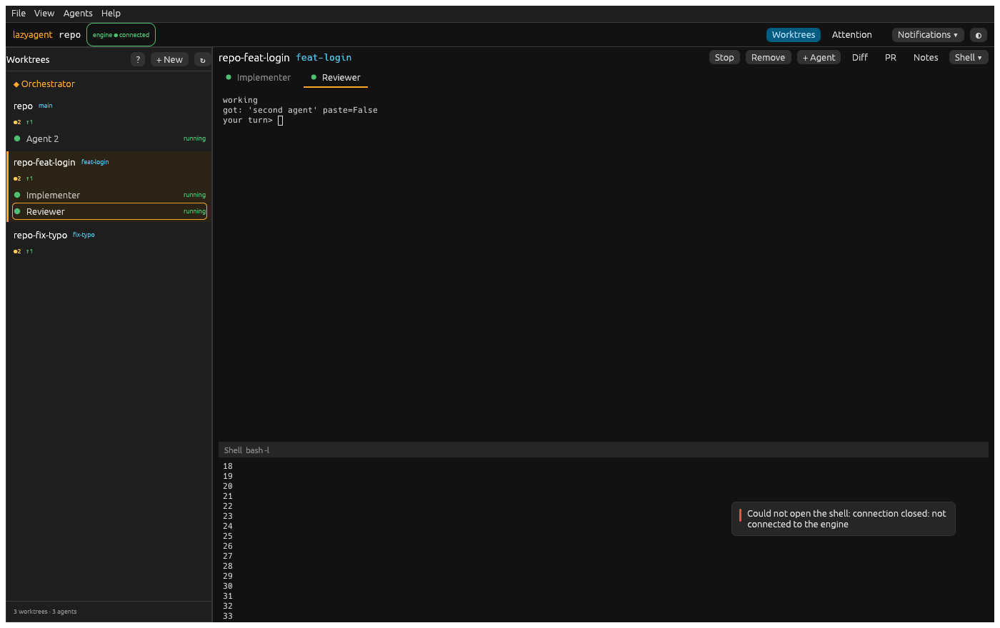
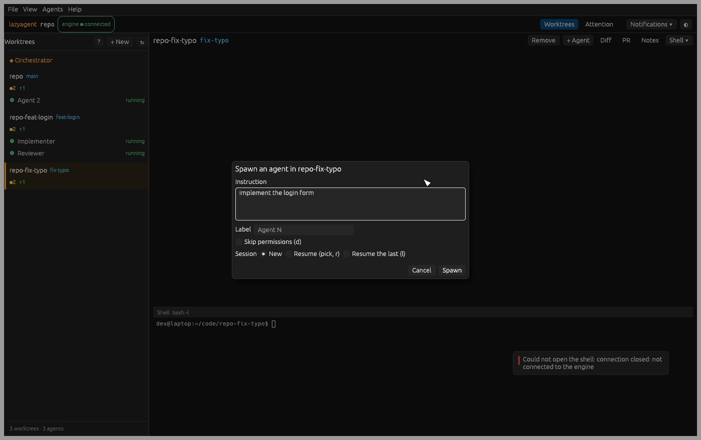
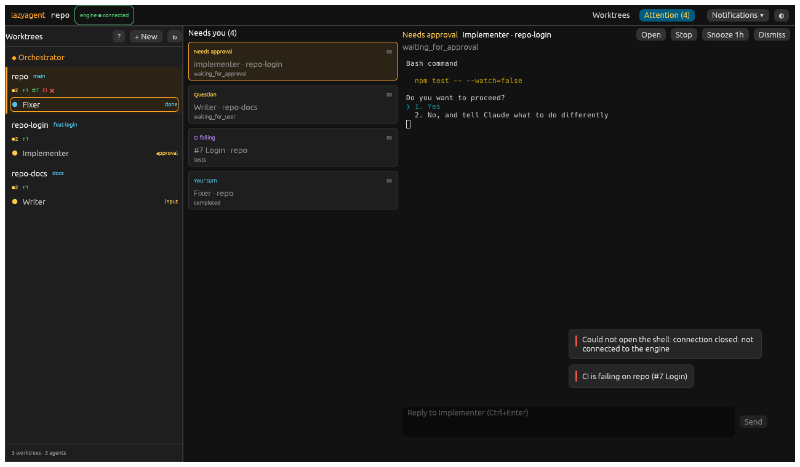
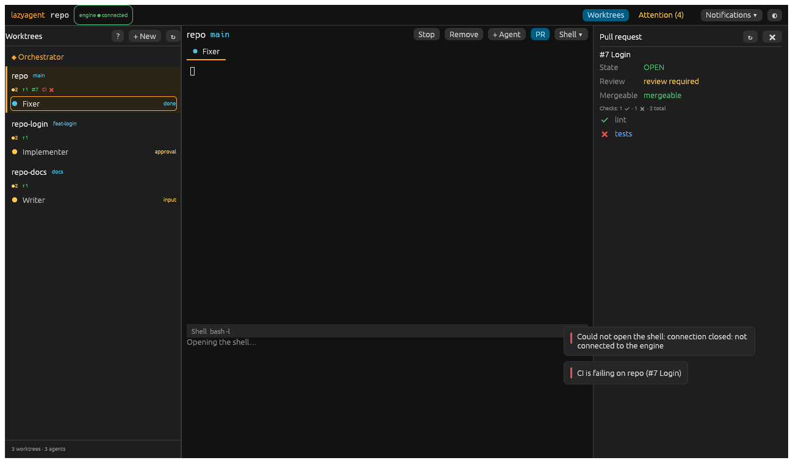
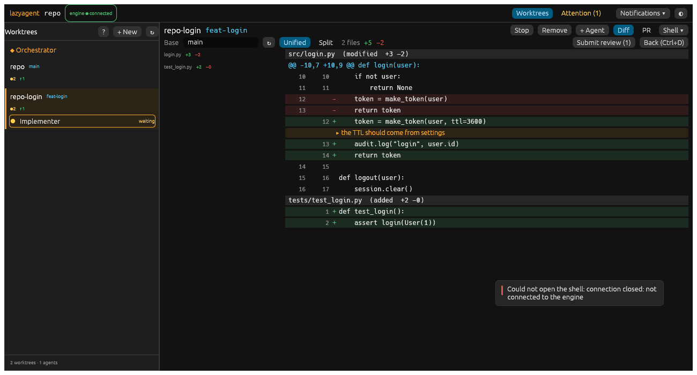
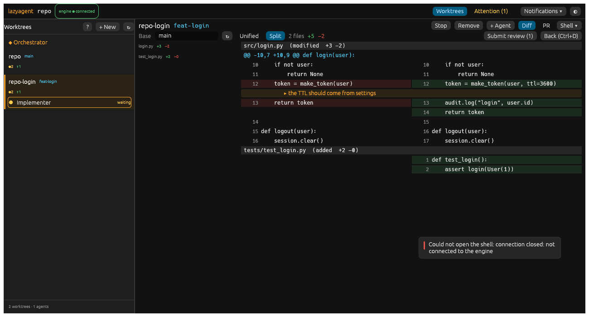
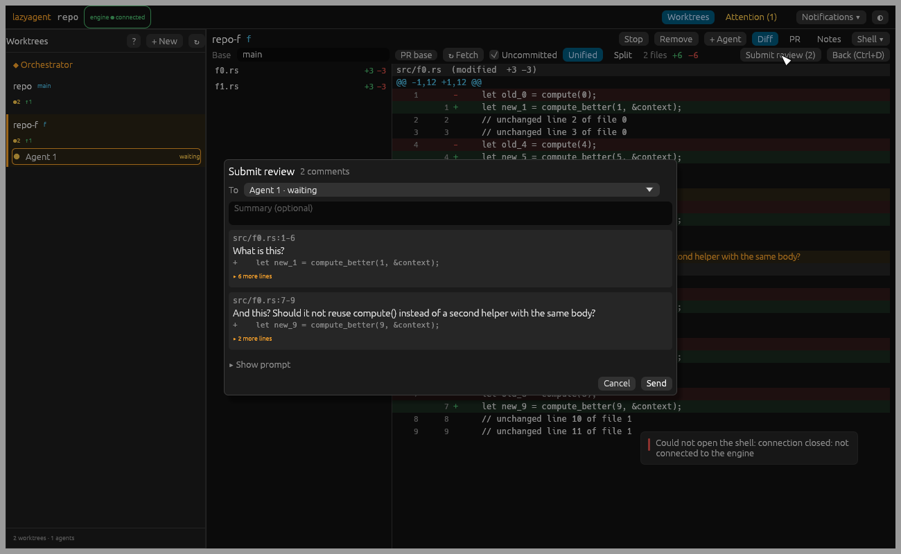
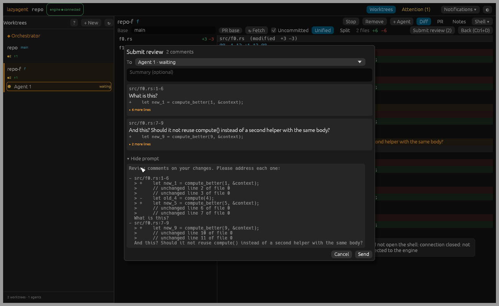

# Native desktop app: plan

- **Status:** plan (D0), 2026-10-18. Implementation follows phase by phase (§9); each phase gets an "As landed" note in §10.
- **Base:** `develop` @ `487f587` (U1-U5 and E1 merged).
- **Builds on:** [engine-split.md](engine-split.md) (protocol v1 §4, discovery §4f, auto-start §6d) and [ui-plan.md](ui-plan.md) (the web MVP U1-U5 and its budgets, §7d).
- **Decision being implemented:** The user chose **Rust + `alacritty_terminal`, now**, over Tauri / Electron / GTK+VTE: a native app that talks to the engine directly over its Unix socket. No webview, no `lazyagent host` in between.
- **Measurements** come from throwaway spikes on this laptop (i7-12700H, 20 threads, Intel Alder Lake iGPU + NVIDIA dGPU, X11, Mesa 23 / lavapipe, Linux 6.8, Rust 1.99.1). Real-display runs are kept short and batched; everything that can run headless does (lavapipe).

## TL;DR

- **Stack:** `eframe`/`egui` 0.37 on `wgpu` + `winit` (X11, everything dlopen'ed at runtime), `alacritty_terminal` 0.26 for emulation, and **our own terminal renderer**: a glyph atlas rasterised with `ab_glyph` (pure Rust, no FreeType/fontconfig) drawn as one textured mesh per terminal through egui. It builds here with **no system -dev package**.
- **Why egui and not iced or raw wgpu:** the framework is not the cost. A full 200×50 terminal redraw costs **0.2-0.4 ms** of CPU with our mesh (egui's text layout: 1.7 ms); idle is **0.0-0.8 %** of a core; parsing runs at **~88 MB/s** (pyte 1.4 MB/s, xterm.js 42-52 MB/s). egui gives forms, lists, scroll areas and a headless test harness (`egui_kittest` + lavapipe) for free; raw wgpu would mean writing all of that.
- **Layout:** a cargo workspace in `desktop/`: `lazyagent-proto` (framing, envelope, typed messages, a blocking thread-based client, discovery, auto-start), `lazyagent-term` (alacritty wrapper: feed, render snapshot, keys → bytes, mouse, selection) and `lazyagent-desktop` (the app).
- **Engine:** the app is one more v1 client (`client: "desktop"`, an open set). It finds the engine like the remote TUI does (`engine.json` in the runtime dir) and auto-starts it through `python -m lazyagent engine start`, so the lock/log/race rules stay in one place. **No engine change is needed for the MVP.**
- **Launch:** `lazyagent desktop [repo]` (Python subcommand that finds and execs the binary with the right interpreter), or `lazyagent-desktop [repo]` directly; a `.desktop` file comes with the packaging phase.
- **Tests:** Rust unit tests; the Python golden fixtures and v1 schemas read from Rust tests (both clients stay in sync); integration tests against a real Python engine with the fake agent; headless render tests on lavapipe; a bench mode with the web budgets as the bar. CI gains a `desktop` job.
- **Phases:** D1 protocol client → D2 terminals + sidebar (+ manual pass) → D3 actions → D4 attention + PR/CI → D5 diff review → D6 packaging, polish, final manual pass.

---

## 1. Goals and non-goals

### 1a. Goals

| # | Goal | Measured by |
|---|---|---|
| G1 | **Parity with the web MVP (U1-U5)** for daily use | §2 parity table all ✅ by D5 |
| G2 | **Best possible performance**: beat every web budget (ui-plan §7d-1) the GUI side owns | §7 targets, measured per phase |
| G3 | **The engine stays the only runtime.** The app is a client; closing it leaves agents running | Integration test: quit app → agent alive → relaunch → screen restored |
| G4 | **Python keeps working:** `lazyagent`, `lazyagent host`, full pytest green; any engine/protocol change is additive and covered by Python tests | CI per merge |
| G5 | **Builds on a stock Ubuntu** without root (no -dev packages) | `cargo build` on this machine and on a bare CI runner |

### 1b. Non-goals (MVP)

- macOS / Windows (D9 of engine-split: Linux only).
- Grid view (U6), orchestrator board, phone, usage/history (U8-U11): later, same protocol.
- Replacing the TUI: it stays for SSH, tmux and the unattended boot.
- Font ligatures, colour emoji, images (sixel/kitty): not in the MVP (§8, R4).

---

## 2. Scope: parity with the web MVP

| Web piece (ui-plan §8a-landed) | Desktop | Phase |
|---|---|---|
| U1 sidebar: orchestrator row, worktrees (branch, dirty/ahead/behind, PR + CI badge), agents (status dot, label, detail) | Native egui side panel from `get_sidebar_state` + events | D2 |
| U1 top bar: repo, engine state (connected / reconnecting / gone), toasts, help sheet, theme | Top bar + toasts + `?` sheet from one keymap table; dark/light | D2 (bar, toasts) / D3 (help) |
| U2 native terminals per agent, the worktree shell as a bottom pane, tabs, size ownership (claim on focus/type), detach after hidden, reattach with tail | Terminal widget per session over `attach_stream` (snapshot / tail), input frames, `claim_size`, selection + copy, paste, mouse reports, scrollback | D2 |
| U2 reconnect with backoff, every visible terminal resuming from its last byte | Same (client supervisor thread) | D2 |
| U3 forms: Spawn (instruction, permissions, resume, label), New worktree (+ launch), Remove (guards, force), Stop (confirm), job drawer, refresh keys | Native dialogs with the same accelerators and guards; job drawer from `job.*` | D3 |
| Restore (TUI `R`, PR 9) | Banner "N agents can be brought back" → `restore_agents` | D3 |
| U4 attention queue (ranks 1-7), reply box, snooze/dismiss, PR/CI panel with linked checks, desktop notifications, title badge | Same, derived client-side; notifications via the freedesktop D-Bus API (`notify-send` fallback) | D4 |
| U5 diff viewer: base, unified/split, virtualised, per-line comments, submit review (now or when idle) | Same; comments kept in the app's state file per worktree | D5 |

---

## 3. Architecture

### 3a. Crates (`desktop/`, a cargo workspace)

```
desktop/
  Cargo.toml                 workspace, shared profile (release: lto = "thin", codegen-units = 1)
  Cargo.lock                 committed (an app, not a library)
  crates/
    proto/   lazyagent-proto     framing.rs envelope.rs types.rs (serde) client.rs discovery.rs launch.rs
    term/    lazyagent-term      terminal.rs (alacritty Term + vte Processor) input.rs (keys→bytes, mouse SGR) render.rs (cell snapshot)
    app/     lazyagent-desktop   main.rs app.rs state.rs (store) views/ (sidebar, terminal, dialogs, attention, diff) renderer/ (atlas, mesh) bench.rs
```

| Crate | Depends on | Why separate |
|---|---|---|
| `lazyagent-proto` | `serde`, `serde_json`, `sha1_smol` | No GUI: unit- and integration-testable in isolation; reusable by a future CLI or a Rust engine's contract tests |
| `lazyagent-term` | `alacritty_terminal` | Emulation and input encoding without a window: tested by feeding bytes and reading cells |
| `lazyagent-desktop` | both + `eframe`, `ab_glyph`, `fontdb` | The only crate that links a GPU stack |

### 3b. Threads and data flow

```
            ┌────────── engine.sock (u32 len · u8 kind · payload) ──────────┐
            │                                                               │
  reader thread  ── control JSON ──► channel ──► UI thread (egui) ── input frames ──► writer (Mutex<UnixStream>)
     │  output frames                               │  reads Arc<Mutex<Terminal>> per session
     └──► Terminal (alacritty) per stream ──────────┘  builds one mesh per visible terminal
            parse here, then ctx.request_repaint()
```

- **Parsing happens on the reader thread**, as alacritty does: the UI thread never parses bytes, it only reads the grid under a short lock and builds a mesh. A 5 MB burst cannot stall input handling.
- **Keystrokes are written synchronously** from the UI thread to the socket (one `write_all` of a ≤ 64 KiB input frame under a mutex): no extra hop between a key and the engine.
- **Repaint on demand only:** the reader asks for a repaint when a visible terminal changed or an event changed the store; an idle app renders nothing (egui's reactive mode).
- **No async runtime.** Two threads per connection (reader, request timeouts are per-call condvars) are simpler and cheaper than tokio for one socket.
- **Store:** plain Rust structs mirroring `get_sidebar_state` (worktrees, orchestrator, pr_info, git_statuses), updated by events in order. `seq`/cursor kept for `subscribe {since}` on reconnect.

### 3c. Terminal rendering

- **Emulator:** `alacritty_terminal::Term` + `vte::ansi::Processor`, one per attached session, scrollback 5,000 lines (the web uses 5,000; snapshots carry 2,000).
- **Renderer:** a glyph atlas (single-channel coverage stored in an egui texture, partial uploads for new glyphs) rasterised with `ab_glyph` at the exact pixel size; cells snapped to whole pixels. Per visible terminal, per frame: one background mesh (runs of equal colour merged) and one glyph mesh, ≈ 4 vertices per non-blank cell. Measured in the spike: **0.2-0.4 ms** for a full 200×50 screen of coloured text (egui's own text layout per row: 1.7-2.8 ms).
- **Fonts:** found with `fontdb` (pure Rust, scans the font dirs; no fontconfig): the configured family (default `DejaVu Sans Mono`), then a fallback chain for symbols agents print (`⏺ ✻ ⎿ ▐▛`: DejaVu Sans, Noto Sans Symbols 2, Noto Sans Mono), then egui's bundled Hack. Bold uses the bold face when found, else the regular one. Box-drawing and block characters fall through the same chain.
- **Damage:** a terminal's mesh is rebuilt only when its content generation changed (bumped by the reader thread) or the view scrolled; otherwise last frame's mesh `Arc` is reused.
- **Cursor, selection, wide chars, underline/strikeout/inverse/dim/hidden** are drawn from the cell flags; the cursor shape follows DECSCUSR.

### 3d. Engine discovery and auto-start

Same rules as the remote TUI (engine-split §4f, §6d):

1. **Repo root:** the `repo` argument resolved (canonical path), else `git rev-parse --show-toplevel` from the cwd: exactly what `resolve_repo_root` computes, because the runtime dir is named after that string.
2. **Socket:** `LAZYAGENT_ENGINE_SOCKET` when set; else `$XDG_RUNTIME_DIR/lazyagent/<sha1(root)[:12]>/engine.json` (fallback `$TMPDIR|/tmp/lazyagent-<uid>/…`) naming this repo, with a socket that accepts a connection.
3. **Auto-start** (unless `LAZYAGENT_ENGINE_AUTOSTART=0` or a socket was given): run `<python> -m lazyagent engine start <root>` in a background thread **while the window initialises**, then connect. `<python>` is `LAZYAGENT_PYTHON` (set by `lazyagent desktop`), else the `lazyagent` executable on PATH. Delegating keeps the lock, log rotation, ready pipe and race handling in one place (Python); the cost is one Python start (≈ 0.2 s) overlapped with the GPU init.
4. **Supervisor:** reconnect with backoff 0.25 s → 5 s; same engine (`engine_id`) → re-seed and resume every visible stream from its last byte (tail); a different engine → drop the old sessions. An engine that announced `engine.shutdown` is not restarted (overlay with a Start button), one that vanished is (as §6d).

### 3e. Launch

| Way | What it does |
|---|---|
| `lazyagent desktop [repo]` | New Python subcommand (no Textual import): resolves the repo root, finds the binary (`LAZYAGENT_DESKTOP_BIN`, then `lazyagent-desktop` on PATH, then `desktop/target/release/lazyagent-desktop` next to a source checkout, rebuilt first when its sources are newer: desktop-update-restart-plan.md §10) and `exec`s it with `LAZYAGENT_PYTHON=sys.executable`. Without a binary it prints how to build one |
| `lazyagent-desktop [repo]` | The binary itself (inside the Linux x86_64/aarch64 wheel as `lazyagent/bin/lazyagent-desktop`; elsewhere `cargo install --path desktop/crates/app`, or the release build) |
| `.desktop` file | `lazyagent desktop --install-desktop-entry` writes `~/.local/share/applications/lazyagent-desktop.desktop` (D6) |

- The binary ships inside the `lazyagent` platform wheels (Linux x86_64 and aarch64, `manylinux_2_28`; built by `hatch_build.py` with `LAZYAGENT_BUILD_DESKTOP=1`, see desktop-update-restart-plan.md §3c). Other platforms get the pure wheel, and `lazyagent desktop` prints the `cargo install` command.

---

## 4. GUI framework choice

### 4a. Options

| Option | Build here w/o -dev pkgs | Terminal render cost | Widgets we would write | Test story | Verdict |
|---|---|---|---|---|---|
| **egui / eframe 0.37 (wgpu) + own mesh** | ✅ verified (3 min clean release build) | 0.2-0.4 ms per full 200×50 frame | Terminal only | `egui_kittest`: AccessKit queries + headless wgpu render (verified on lavapipe, no DISPLAY) | **Chosen** |
| egui with its own text layout per row | ✅ | 1.7-2.8 ms per frame | none | same | Rejected: 5× slower than the mesh |
| iced 0.14 (wgpu + cosmic-text) | expected ✅ (same winit/wgpu stack; not spiked) | same mesh/shader approach needed, through its `shader` widget | Terminal; virtualised lists | No headless renderer harness of the same maturity | Not chosen: Elm-style message plumbing for every form, and no gain where the time goes |
| raw winit + wgpu + glyphon | ✅ | lowest ceiling (≈ the mesh above minus egui's tessellation) | **Everything**: text inputs, scroll, lists, dialogs, focus | Hand-made | Rejected: weeks of widget work for < 0.2 ms per frame |
| GTK4 + VTE | ❌ needs libgtk-4-dev / libvte-dev | VTE | — | — | Excluded by the user's choice and by the machine |

- **iced was not spiked:** egui's measured costs leave nothing for another framework to win on the hot path (the terminal), and egui is the one with a headless test harness that already works here. If egui's immediate mode ever costs too much on big lists, the fix is virtualisation (`ScrollArea::show_rows`), which we need anyway.

### 4b. Spike numbers (egui, throwaway, 1700×900 window, 200×50 terminal, real GPU)

| | Vulkan (Intel) | GL (EGL, iris) |
|---|---|---|
| Idle, 5 s: CPU | 0.7-0.8 % | 0.0 % |
| Flood, 64 KiB of coloured agent-like output per frame (3.3 MB/s, parse + mesh + present at 60 fps): CPU | 15.8-22.9 % | 16.8 % |
| Frame interval during flood, p50 / p95 | 16.7 / 17.9-18.9 ms | 16.7 / 17.5 ms |
| Mesh build per frame, p50 / p95 | 0.20-0.36 / 0.43-0.54 ms | 0.23 / 0.44 ms |
| Memory idle: RSS / PSS / private dirty | 215 / 164 / 36 MB | 119 / 59 / 30 MB |
| Time to first `ui()` call (warm shader cache) | 0.29-0.30 s (2.2 s cold, first run ever) | similar |

- **`alacritty_terminal` throughput:** 50 MB of agent-like output (SGR colours, bold, 256-colour backgrounds, `⏺ ✻ ⎿`, clears every 40 lines, 10,000-line scrollback) parsed in 0.56-0.58 s: **87-89 MB/s** on one core. pyte does 1.4 MB/s on the same kind of input; xterm.js 42-52 MB/s.
- **Memory is mostly GPU drivers:** the Vulkan loader maps every installed ICD (NVIDIA, Intel, lavapipe, radeon) and LLVM; PSS counts them. The app's own private memory is ~30-36 MB idle. The web page's renderer was 388-396 MB RSS (ui-plan B9).
- **Present mode:** `Mailbox` is refused by this surface (validation error), so the latency plan uses `Fifo` with a frame latency of 1 (§7). The backend default (Vulkan vs GL) is decided in D2 by the latency bench; `WGPU_BACKEND` overrides it.

---

## 5. Protocol use

All of it exists in v1 today; the desktop app needs **no engine change for the MVP**.

| Need | Method / event |
|---|---|
| Connect | `hello {protocol: 1, client: "desktop", client_version}` |
| Sidebar | `get_sidebar_state`, `subscribe {since: cursor}`, `worktrees.changed`, `agent.*`, `git_status.updated`, `pr_info.updated`, `engine.notice`, `engine.shutdown` |
| Polling scope | `set_interest {worktree_paths}`: every worktree (as the host does, Q12), so PR badges cover all |
| Terminals | `attach_stream` / `detach_stream`, output + input frames, `claim_size`, `resize`, `stream.resized` / `stream.reset` / `stream.closed`, `open_shell` |
| Actions | `get_config`, `spawn_agent` (with the app's env, D5), `stop_agent`, `create_worktree`, `remove_worktree {custom: true}`, `refresh_worktrees`, `refresh_git_status`, `job.*` |
| Restore | `list_restorable`, `restore_agents`, `dismiss_restorable`, `engine.restored`, `restorable.changed` |
| Attention | `send_agent_input`, `read_agent_output`, `get_pr_info` |
| Diff | `get_diff {worktree_path, pr: true, base?, fetch?, max_bytes}` (the PR's diff since 2026-10-19, §10) |
| Session notes (proposal 0011, N4, N5) | `notes_get`, `notes_put {if_rev}` (`CONFLICT` carries `{rev, text}` in `error.data`), `notes.updated`, `notes.removed`; the panel is hidden when `hello.capabilities` lacks `notes_get`. N5: `notes_list {worktree_path}`, `notes_get {notes_id}`, `notes_adopt`, `notes_delete` (the panel's earlier notes), `stop_agent {notes}` + `StopResult.notes` (the stop handoff) |

- Unknown events and fields are ignored; unknown status values are shown raw (§4c of engine-split).
- **Env (D5):** the app passes its own environment to `spawn_agent` / `open_shell` / `create_worktree` / `remove_worktree` / `restore_agents`, as the TUI does. A `.desktop` launch gets the session's environment, which can lack the shell profile's PATH additions: the app logs the PATH it sends, and `lazyagent desktop` from a shell is the recommended launch until D6 adds a login-shell env probe (Q4).

---

## 6. Testing strategy

| Layer | What | Runs |
|---|---|---|
| Unit (proto) | Framing round trip + the Python framing test vectors; decoder errors (unknown kind, oversize, short stream header); envelope parse | `cargo test` |
| **Golden fixtures** | Every `tests/protocol/fixtures/ipc/*.json` response deserialises into the Rust types (no field silently lost for the types we model); every v1 method and event the client uses exists in `src/lazyagent/protocol/schema/v1/*.json`; the event names we handle are the schema's | `cargo test` (reads the Python repo's files by relative path) |
| Unit (term) | Feed bytes → cells/cursor/modes; the engine's ANSI snapshot (from a fixture captured from `ansi_snapshot`) → same screen as the engine's `read_agent_output`; keys → bytes per mode (app cursor, bracketed paste); mouse SGR | `cargo test` |
| **Integration (real engine)** | `python -m lazyagent.engine <scratch repo>` with a `claude` shim running `tests/engine/fake_agent.py` (as tests/test_engine_cli.py): hello, sidebar, spawn, attach + snapshot, type → echo, `size` after `claim_size`, `stream.closed` on stop, reconnect + tail, create/remove worktree, diff, auto-start through `lazyagent engine start`. Every process under a timeout and killed in `Drop` | `cargo test` when `LAZYAGENT_PYTHON` (default `../.venv/bin/python`) can import lazyagent; skipped with a message otherwise; **required in CI** |
| UI (headless) | `egui_kittest` with a fake store: sidebar rows, dialogs and their guards, attention ranks, diff parse + view, keyboard map. Render tests through wgpu on **lavapipe** (no display): terminal glyphs land in the right cells, cursor, selection, light/dark | `cargo test` |
| Perf | `lazyagent-desktop --bench <scenario>` against a real engine: key→frame latency, frames during a 5 MB burst, end-to-end throughput, idle CPU, attach, memory, cold start; JSON output. Headless parts (parse MB/s, mesh build) as `#[ignore]` tests | Local (real GPU), numbers in each "As landed" |
| Manual | Real app on a scratch repo with a real engine: screenshots (`--screenshot` flag), rough edges fixed | After D2 and at the end |

- **No windows on the user's display from tests.** Everything automated is headless; real-display runs (benches, manual pass) are short, titled "lazyagent desktop bench (auto-closes)", batched, and run under `timeout -k`.

---

## 7. Performance targets (the web budgets are the bar)

| # | Metric | Web budget | Web as landed | Desktop target |
|---|---|---|---|---|
| B1 | Key → frame that paints the echo, idle (p50 / p95) | 8 / 16 ms | 8.4 / 8.9 ms | **≤ 5 / 8 ms** to the rendered frame |
| B2 | Same, with 8 chatty hidden agents (p95 / p99) | 25 / 50 | not re-measured | ≤ 12 / 25 ms |
| B3 | Engine echo over the socket from the client (p95) | 3 ms | 1.09 | ≤ 1.5 ms (no host hop) |
| B4 | Frames while the focused agent prints 5 MB: p95; UI-thread work per frame | 17 ms; long tasks ≤ 100 ms / 5 MB | 16.7-16.8; 63-64 ms | p95 ≤ 17 ms; UI thread ≤ 4 ms per frame, never > 16 |
| B5 | 5 MB end to end | ≥ 10 MB/s | 15-17 MB/s | ≥ 20 MB/s (the engine is then the limit) |
| B6 | Idle CPU, app + engine, 10 agents, 1 visible | ≤ 2 % | 0.3-0.5 % | ≤ 0.3 % |
| B8 | Attach + snapshot, p95 | 50 ms | 7.7-8.6 ms | ≤ 10 ms |
| B9 | Memory, 10 agents | ≤ 450 MB renderer | 388-396 MB | ≤ 60 MB private, ≤ 150 MB RSS (drivers included) |
| B10 | Cold start → interactive, engine running / not | ≤ 1.5 s | 0.4 s TUI warm | ≤ 0.5 s / ≤ 1.0 s |
| B12 | Sidebar with 100 worktrees, every row changed | 4 ms | 2.8 / 3.7-7.1 ms | ≤ 1 ms frame CPU |
| U5 | 5,000-line diff: first screen; scroll frames p95 | 100 ms; 17 ms | 29-63 ms; 16.85 | ≤ 20 ms; ≤ 17 ms with ≤ 2 ms CPU |

- B1 is measured inside the app: the key event timestamp → the end of the frame whose terminal contains the echoed byte (the web measured to the rAF that paints it, the same point). Scan-out adds up to one refresh in both.

---

## 8. Risks and open questions (each with a decision)

| # | Risk / question | Decision |
|---|---|---|
| R1 | Vulkan maps every ICD (NVIDIA, radeon, lavapipe…): 160+ MB PSS before we draw | Measure both backends in D2; default to the one with the better latency, document `WGPU_BACKEND=gl` / `vulkan`. Memory budget counts private memory separately from drivers |
| R2 | `Mailbox` is not offered here; `Fifo` adds up to a frame of latency | `Fifo` + `desired_maximum_frame_latency = 1`; render immediately on echo (no frame pacing on our side); measure B1 |
| R3 | No fontconfig: font lookup by family name through `fontdb` might miss user aliases (`monospace`) | Map `monospace` to a known list (DejaVu Sans Mono, Noto Sans Mono, Liberation Mono, FreeMono); a config key `[desktop] font = "…"` or a path; bundled Hack as the last resort |
| R4 | Colour emoji and complex scripts | Monochrome glyphs from the fallback chain (emoji as outline fonts when present, else tofu). Colour emoji later via `swash` (not needed by agents' UIs) |
| R5 | Wayland | The target session is X11. Build the `wayland` feature too if it links without dev packages (winit dlopens libwayland); otherwise XWayland. Decided in D2 |
| R6 | IME / dead keys | egui forwards IME commits; the terminal sends the committed text. Pre-edit drawn in D6 if time allows |
| R7 | Agents' env when launched from a `.desktop` file (no shell profile) | §5 Env: recommend `lazyagent desktop` from a shell; D6 adds an opt-in login-shell env probe (`$SHELL -lc env`) |
| R8 | Two clients with different sizes on one session (D3 "latest") | Same rule as the web: a terminal claims on focus/typing/resize while owning; renders at the PTY size and crops/pads otherwise |
| R9 | `alacritty_terminal` vs the engine's pyte snapshot (§3b of engine-split): fidelity limited to what pyte models | Accept; the snapshot is ANSI, alacritty parses it like any output. A golden snapshot test pins it |
| R10 | Engine version skew (the app newer than a detached engine) | `hello.capabilities` gates features (e.g. `get_diff` `base`); a missing method is a toast, not a crash |
| Q1 | Ship the binary on PyPI? | **No** at first: `cargo install` / release build + `lazyagent desktop` finding it. **Revisited 21-10:** yes, inside the one `lazyagent` package as platform wheels (desktop-update-restart-plan.md §3c) |
| Q2 | A Rust job in CI? | **Yes** (D1): `cargo fmt --check`, `clippy -D warnings`, `cargo test` incl. the integration tests against the Python engine (uv) and lavapipe render tests (`mesa-vulkan-drivers`), with `Swatinem/rust-cache` |
| Q3 | Where do review comments and snoozes live (the web keeps them in localStorage)? | A per-repo state file `$XDG_STATE_HOME/lazyagent/desktop/<hash>.json` (app-only, like localStorage); engine-stored threads wait for U8/0008 |
| Q4 | Engine env for `.desktop` launches | R7 |
| Q5 | Theme | Dark (default) and light, the web's tokens; the terminal palette follows the theme |
| Q6 | Key map, and Ctrl+D (the web takes it globally, which hides EOF from the terminal; the UI agent's doubt 3) | The web's map (ui-plan §7a), one table that drives both the handling and the `?` sheet; inside a terminal only the global set is intercepted. **Ctrl+D is not global here:** in a focused terminal it is EOF; the diff is Ctrl+D outside a terminal and **Ctrl+Shift+D** everywhere |
| Q7 | Notifications | freedesktop D-Bus via `notify-rust` (pure Rust `zbus`), falling back to `notify-send`; only when the window is not focused |
| Q8 | Clipboard | egui-winit's clipboard (`arboard`, X11 via x11rb, pure Rust); primary selection on select (X11 habit) as a D6 nicety |

---

## 9. Phased plan

Each phase is its own branch from up-to-date `develop`, merged with `--no-ff` once `cargo test` and the full pytest are green.

| # | Branch | Scope | Acceptance | Performance |
|---|---|---|---|---|
| D0 | `desktop-plan` | This document | Merged | Spike numbers (§4b) |
| D1 | `desktop-d1-proto` | Workspace; `lazyagent-proto`: framing, envelope, typed messages, blocking client (requests with timeouts, events, stream frames, input), discovery, auto-start via `lazyagent engine start`; `.gitignore` `target/`; CI `desktop` job | Golden fixtures + schema names tests; integration tests vs a real engine: hello, sidebar, spawn, attach (snapshot), input → echo, claim_size, stop → `stream.closed`, auto-start | B3 echo from Rust p50/p95/p99 |
| D2 | `desktop-d2-terminals` | `lazyagent-term`; the app: window, top bar, sidebar, agent tabs + shell pane with native terminals (attach/snapshot/tail, input, claim/resize, scroll, selection, copy/paste, mouse), reconnect, toasts, theme; `lazyagent desktop`; `--bench`, `--screenshot`. **Manual pass** after it | Agent usable without any other UI; quit → relaunch restores the screen; headless render tests | B1, B4, B5, B6, B8, B9, B10 |
| D3 | `desktop-d3-actions` | Dialogs: Spawn, New worktree (+ launch), Remove (guards, force), Stop; job drawer; refresh keys; restore banner; `?` sheet | §4a flow end to end against the engine (integration) and in kittest | Dialog open ≤ 1 frame; no change to B1 |
| D4 | `desktop-d4-attention` | Attention queue (ranks 1-7, reply, snooze/dismiss, CI items), PR/CI panel, notifications, title badge | A fake agent going `waiting_for_user` is queued; the reply reaches it and clears it | Queue re-derive for 200 agents ≤ 2 ms |
| D5 | `desktop-d5-diff` | Diff viewer (base, unified/split, virtualised rows, comments, submit now / when idle) | Comments + review reach the fake agent | U5 row of §7 |
| D6 | `desktop-d6-polish` | `.desktop` entry, `cargo install` docs, env probe, font config, rough edges; **final manual pass**; README section | Launchable from the app menu; every §2 row ✅ | Full §7 table re-measured |

---

## 10. As landed

(One note per phase.)

### D1: protocol client (2026-10-18)

- **Workspace** `desktop/` (`Cargo.lock` committed, `rustfmt.toml` at 120 columns, release profile with thin LTO). Crates: `lazyagent-proto` and `lazyagent-testkit` (test support, not published). `target/` is ignored.
- **`lazyagent-proto`:**
  - `framing`: the Python framing byte for byte (test vectors taken from `lazyagent.protocol.framing`); the decoder fails for good on a bad header and skips a bad payload, as the Python one; consumed bytes are dropped only when they dominate the buffer (no memmove per frame).
  - `envelope`: req/res/evt; unknown fields ignored; error codes as strings (open set).
  - `types`: every method result and event the app uses; open sets (statuses, confidence, delivery, kinds) stay strings. `EngineEvent::parse` gives the known events a shape; an unknown event, or a known one with an unreadable payload, is `Other` and ignored.
  - `client`: a reader thread per connection; writes from the caller's thread under one mutex (a key is one `write_all`, no hop). Requests block (`request`/`call`, with a timeout) or call back on the reader thread (`request_async`); a request that cannot be sent still completes its callback. `attach_async` registers the sink under the stream id when the reader sees the response, before any output frame of that stream; `stream.resized` / `stream.reset` / `stream.closed` reach the sink on the reader thread in wire order, so a terminal can apply a resize exactly where it falls in the bytes. Pastes over 64 KiB go out as several input frames.
  - `discovery`: repo root, runtime dir (`sha1(root)[:12]`, `XDG_RUNTIME_DIR` else `TMPDIR`/`/tmp` + `lazyagent-<uid>`), `engine.json` naming this repo + a socket that accepts a connection, `LAZYAGENT_ENGINE_SOCKET`, `LAZYAGENT_ENGINE_AUTOSTART=0`. Auto-start runs `$LAZYAGENT_PYTHON -m lazyagent engine start <root>` (else `lazyagent` on PATH) without the client-only variables. Everything takes an explicit `Env` (process env plus overrides), so tests run isolated engines side by side.
- **Sync with Python** (`tests/golden.rs`): the 19 golden fixtures of the methods the app uses decode and re-encode **without losing a field** (a new field in a Python response fails the test until the Rust type has it); error fixtures decode; every method the app calls has params and result schemas; **every event in `events.json` is either handled or listed as deliberately ignored** (`ui.command`, `ui.view_changed`), so a new event forces a decision; the required fields of `attach_stream`, `claim_size`, `open_shell` and `get_config` results equal the schema's.
- **Integration** (`tests/engine.rs`, a real `python -m lazyagent.engine` per test in its own process group, the fake agent behind a `claude` shim, killed in `Drop`): hello + capabilities + sidebar + config; error responses; spawn → `agent.spawned` → attach (snapshot) → type → echo → `claim_size` → `stream.resized` → the agent sees the size → `resize` → stop → `stream.closed` + `agent.exited {stopped}` with no offset gap; detach + re-attach from the last byte is a `tail`; shell + create (`worktrees.changed`) + diff + remove; a dead engine fails pending requests; auto-start through `lazyagent engine start` (idempotent) then `shutdown`.
- **Found on the way:** typing before the fake agent prints its prompt loses the input to the PTY's line discipline (it is not in raw mode yet); the tests wait for the prompt, and the app will too only in the sense that real agents do the same (nothing to fix in the engine).
- **CI:** a `desktop` job: `uv sync`, stable Rust with clippy/rustfmt, `Swatinem/rust-cache`, `cargo fmt --check`, `clippy -D warnings`, `cargo test --locked` with `LAZYAGENT_REQUIRE_ENGINE=1` so the engine tests cannot silently skip.
- **Measured** (release, this laptop, 300 samples after 30 warm-up, 3 runs):

  | | p50 | p95 | p99 |
  |---|---|---|---|
  | B3 echo, Rust client → engine process → fake agent → back | 1.14-1.38 ms | 1.73-1.95 ms | 2.08-2.38 ms |
  | Same with the Python reference client (separate engine process, same session) | 1.08-1.17 | 1.74-1.93 | 2.02-2.35 |
  | `tests/perf/test_echo.py` (engine inside the test's process: no process hop) | 1.03 | 1.39-1.40 | 1.49-1.77 |

  The client adds nothing measurable: the round trip is the engine's (budget B3 p95 ≤ 3 ms; target ≤ 1.5 ms is met at p50 and missed by the engine hop at p95, which no client can remove). Cold engine start through `lazyagent engine start`: **0.20-0.23 s**.

### D2: native terminals and the sidebar (2026-10-18)



The D2 and D3 screenshots are rendered headless by the `sidebar_terminals_and_spawn_screenshots` test (into the temp dir), so they show the current UI.

- **`lazyagent-term`:** `Terminal` (alacritty `Term` + vte `Processor`): feed, resize, reset, a scrolled view, selection (simple / word / line), the program's requests (DSR and DA replies, title, OSC 52, bell) and a `Frame` of resolved cells (colour, bold, italic, underline kinds, strike, wide, selected) that the renderer reads without knowing alacritty. `palette`: the web page's colours (Tango ANSI as xterm.js, theme fg/bg, selection blended over the background), bold brightens colours 0-7 as xterm.js does. `input`: keys (DECCKM, xterm modifier parameters, Shift+Enter = ESC CR for an agent's newline), pastes (bracketed, end marker stripped), mouse reports (X10 and SGR, press/release/drag/motion/wheel).
- **The app** (`lazyagent-desktop`):
  - `conn`: a supervisor thread finds the engine or starts it (`lazyagent engine start`), says hello, seeds from `get_sidebar_state` + `get_config`, then `subscribe {since: cursor}`; on loss it retries 0.25 → 5 s; a new `engine_id` drops the dead panes; an `engine.shutdown` (deliberate stop) is not restarted until the user clicks **Start the engine** in the banner.
  - `panes`: one per session; the stream's sink runs on the reader thread (parse there, UI only draws). The attach callback applies the snapshot before any frame of the stream (since E1 the frames carry the engine's unparsed backlog: the first version of the snapshot test failed exactly there). A gap or `stream.reset` re-attaches from the last byte. Shown panes attach, the three most recently hidden stay attached, the rest detach (P7). The PTY size is claimed on focus and on a box change while focused; typing with another size claims first and the keys wait for the answer. Only the focused pane answers the program's queries.
  - `render`: glyph atlas (1024², rasterised on demand at the exact pixel size, uploaded in pieces), a background mesh (equal-colour runs merged, decorations, cursor) and a glyph mesh per terminal, rebuilt only when the terminal, the atlas, the origin or the focus changed. **Box drawing and block elements are drawn as rectangles** (a table generated from the Unicode names: light, heavy, double; rounded corners square) so lines join and Claude Code's `▐▛███▜▌` fills its cells; `⏺` is drawn as a disc in the cell's colour (only colour-emoji fonts have it, as a fixed orange square). **Colour emoji** come from Noto Color Emoji's PNG strikes, scaled into the cell(s).
  - `fonts`: `fontdb` (pure Rust, reads fonts.conf) → DejaVu Sans Mono, then monospace and symbol fallbacks, then the bundled Hack and Noto Emoji. Font files are **memory-mapped** (file pages, not private memory). egui's own text gets the same fallbacks, and every symbol the UI draws is in the bundled fonts (tested), so no system font is required.
  - Layout: top bar (repo name, engine pill, theme), sidebar (orchestrator, worktrees with branch, dirty/ahead/behind, PR and CI badge, agents with status), worktree header (branch, last commit), agent tabs, the shell as a resizable bottom split, toasts, a banner while the engine is unreachable. Keys: Ctrl+K sidebar (j/k/↑/↓/Enter there), Ctrl+J agent and Ctrl+L shell (each passes through when its terminal already has the keyboard: newline in Claude Code, clear in a shell), Alt+]/[ and Alt+N/P tabs, Ctrl+=/−/0 font size; in a terminal Ctrl+C copies when there is a selection (else ^C), Ctrl+Shift+C/V, Shift+Insert, middle-click paste, an image-only clipboard paste sends ^V (Claude Code then reads the image).
  - **`lazyagent desktop [repo]`** (Python, no Textual import): runs the binary with `LAZYAGENT_PYTHON` set to its own interpreter; without a binary it prints how to build one.
- **Measured choices** (each from a bench below):
  - **Present without vsync** (`AutoNoVsync`: Immediate, else Mailbox, else Fifo) + a **repaint pacer** (output-driven repaints at once when the last one is a refresh old, else at the next slot): key → frame 16.7 ms → **4 ms** p50; floods still draw at ≤ 60 fps. GL offers only Fifo here, so Vulkan stays the default.
  - The window title was re-sent every frame, and a viewport command asks for a repaint: the app never idled (60 fps, 13 % CPU). Sent on change only.
  - **An offload NVIDIA GPU's Vulkan driver is kept out of the process** (`VK_ICD_FILENAMES` without it, only when every connected output is on another DRM driver, never when the user set it, and not passed on to agents): its threads polled every 10-100 ms, **1.2-1.4 % of a core idle**, and 20-30 MB.
  - Raw X11 device events are off (`DeviceEvents::Never`): they wake the loop on any mouse move on screen.
  - Release binary 24 MB (debug info stripped).
- **Tests** (cargo 59 = proto 26, term 16, app 17, plus 1 ignored bench; pytest +4): term unit tests (colours, wide chars, scrollback, modes, replies, selection, split sequences) and the snapshot round trip against a real engine; renderer and box-drawing geometry; the GPU heuristic on fake `/sys/class/drm` trees; **headless kittest UI tests**: sidebar from seed and events, keys → bytes through egui (Ctrl+C, Alt+b, arrows), copy with a selection, B12, no shell retry storm, a **lavapipe render** of terminal cells (CI requires a Vulkan adapter), and **the app against a real engine**: connect, click "Spawn an agent", type, read the fake agent's answer off the terminal, the shell opens. CI installs `mesa-vulkan-drivers`.
- **Manual pass** (real display, scratch repo with three worktrees, fake agents, `xdotool`): spawn and switch agents from the sidebar, type, `size` after a focus claim (37×166, the view) and after a window resize (23×89), Ctrl+L shell, wheel scrollback with its indicator, Alt+] tabs, SGR attributes, Unicode, light theme, drag-select + Ctrl+Shift+C (clipboard checked with xclip), app restart with the agents still running (screens restored by snapshot), `lazyagent engine stop` with the app open, then Start from the banner. Found and fixed: colour-only emoji (`⏺`, 🙂) blank; box-drawing seams; a failed `open_shell` retried every frame (toast storm); stale view after a stop (banner); long repo path pushing the engine pill off the bar; toasts covering the header buttons; wheel 6 lines per event (3 now).
- **Measured** (release, this laptop, defaults; ranges over 2-3 runs; web numbers from ui-plan §8a-landed):

  | | desktop | web | budget |
  |---|---|---|---|
  | B1 key → frame with the echo built, p50 / p95 | **3.9-4.4 / 6.6-9.9 ms** (next frame 6.2-6.5 / 8.2-11.6) | 8.4 / 8.9 (rAF) | 8 / 16 |
  | B1 from an idle loop (no keypress frame before) | 3.4 / 5.7 | — | |
  | B2 same with 8 hidden agents at ~1,000 lines/s, p95 / p99 | **6.95-7.2 / 8.6-9.1 ms** | not re-measured | 25 / 50 |
  | B3 key → bytes back (in the app) | 0.8-0.9 / 1.2-1.3 ms | 2.4 / 3.4 | 3 (p95) |
  | B4 frames while 5 MB arrive | 0 frames > 50 ms, interval p95 8.4-10.8 ms | p95 16.7-16.8 | 17 |
  | B5 5 MB of output until its last screen is drawn | **55-90 ms (57-102 MB/s)**, 1-2 engine stream resets (by design: a client 1 MiB behind gets a fresh snapshot) | 15-17 MB/s | ≥ 10 |
  | B6 idle, app + engine, one agent and a shell on screen | **0.2 % + 0.1-0.2 %**, 4 frames in 10 s | 0.3-0.5 % | ≤ 2 % |
  | B8 attach with snapshot (2,000 lines of history) p50 / p95 | 3.4-5.7 / 6.8-7.5 ms | 7.7-8.6 | 50 |
  | B9 memory | **35 MB private**, 138 MB RSS (drivers' pages) | 388-396 MB renderer RSS | ≤ 60 private |
  | B10 launch → sidebar / → agent terminal drawn, engine running | **121-128 / 155-162 ms** | — | |
  | B10 launch → sidebar, engine started by the app | 387-414 ms | TUI cold 0.43 s | ≤ 1 s |
  | B12 whole frame, 100 worktrees all changing | 2.1-2.2 ms | 2.8 / 3.7-7.1 ms (sidebar) | 4 (my target 1 ms: missed, egui lays out off-screen rows; virtualise when needed) |

  How: `lazyagent-desktop --bench echo|flood|idle|attach|startup` against a scratch repo whose `claude` is the fake agent (`LAZYAGENT_BENCH_BUSY=8` for B2, `LAZYAGENT_BENCH_OFF_FRAME=1` for the idle-loop row); B12 is `cargo test --release sidebar_with_100`. The echo's p95 is the event loop waking for the echo while it is still presenting the keypress's own frame; the frame itself costs 0.4 ms to build and ~1 ms of CPU in all.
- **Not done here** (later phases): dialogs (spawn options, create, remove, stop), the job drawer, restore, the `?` sheet (D3); attention, PR/CI panel, notifications (D4); diff (D5); `.desktop` entry, login-shell env, IME pre-edit, rounded box corners as arcs (D6).

### D3: actions (2026-10-18)



- **Dialogs** (`dialogs.rs`, egui modals; the web's dialogs.js): **Spawn** (instruction, label, skip permissions, session new / resume pick / resume last, the provider shown), **New worktree** (branch, base prefilled as on the web: the configured default branch only when some worktree has it checked out, else the main worktree's branch; extra options when a custom create command is configured; "and launch an agent in it" with its instruction and permissions), **Remove** (the web's stricter guard: the main worktree, or any agent not completed / failed / stopped; force), **Stop** (confirm), and the **`?` sheet** generated from one key table. Accelerators as the TUI's modals when no text field has the keyboard (`n` `d` `r` `l`, `y` `n` `f`), Enter submits, Ctrl+Enter from the instruction, Esc or a click outside closes. An engine error stays in the dialog (a failing custom create shows `WORKTREE_ERROR …` there).
- **Keys outside a terminal** (sidebar focused, or nothing): `s` `x` `c` `d` `r` `Shift+R` `?`, and Alt+G anywhere. "Outside" is decided with egui's `text_edit_focused()`, not `egui_wants_keyboard_input()`, which is true whenever any widget (the sidebar) has focus: the manual pass found `s` dead after Ctrl+K.
- **Create + launch** (§4a): `create_worktree` with the app's env; a custom command runs as a job (the drawer opens); the new worktree is selected once listed, then `spawn_agent` in it; a failed create launches nothing; a failed spawn after a good create is a toast and the worktree stays.
- **Job drawer:** `job.started` / `job.output` / `job.finished` in a bottom panel (the command, its output, the result; the last 192-256 KiB kept per job), a toast when each ends.
- **Restore** (PR 9): on every connection the app asks `list_restorable`; a banner names what an earlier engine ran ("Implementer (repo-feat-login), …") with **Restore all (Shift+R)**, Dismiss, Later; `engine.restored` toasts what came back and what failed. `restorable.changed` (engine-split Q31) replaces the list: an offered agent started again in this engine (the orchestrator with `--continue`) leaves the banner at once. The orchestrator is named "Orchestrator (the orchestrator)", not "Agent (the orchestrator)".
- Header buttons: + Agent, Remove, Stop (when there is an agent), Shell; sidebar: + New, ↻, ?.
- **Tests** (cargo 67 = proto 26, term 16, app 25): default base, remove guard, every key opens its dialog (also with the sidebar focused), the help sheet lists every key; against a real engine: **create + launch → the guard refuses the remove while the agent runs → stop (confirm with `y`) → remove → the selection falls back to main**; **a failing custom create** (`echo boom-{branch}; exit 3` in `.lazyagent.toml`) keeps the error in the dialog, its output in the job drawer and launches nothing; **the instruction and "skip permissions" reach the agent's command line** (read from `/proc`); **agents of a stopped engine are offered by the next one and come back** with Restore all.
- **Found on the way:** two edits of mine had silently not applied (the anchor text had been reformatted by rustfmt): the restore fetch on connect was missing until a test caught it; the edit helper now fails loudly. A test stopping the engine with SIGTERM to its whole process group killed the agents first, so they were "exited on their own" and rightly not offered: the testkit gained `terminate_engines` (the engine alone, as `engine stop` or a crash). A click one frame after the launch checkbox hit the modal's backdrop (the dialog grows a frame later); only a test can click that fast.
- **Measured:** a dialog opens in the frame of its key (the key is handled before the frame is laid out); nothing on the stream path changed (B1 as in D2).

### D4: attention queue, PR/CI panel, notifications (2026-10-18)




- **Queue** (`attention.rs`, pure, the web's attention.js item for item): approval 1, question 2, hanged 3, failed / exited on its own 4, CI failing / changes requested / merge conflict on an open PR 5, "your turn" (`completed`, and `waiting`, how Claude reports a finished turn) 6, a failed job 7; newest first within a rank. An item lives while its condition holds; first-seen times are dropped once it clears, so a dismissed occurrence stays hidden but the next one shows. Re-derived only when its inputs change (store version, exits, finished jobs, marks) or every 30 s (snoozes running out).
- **Attention view** (`g a`, or Attention (N) in the top bar; `g w` back): the list (j / k / ↑ / ↓, Enter to the terminal) and the picked item: an agent's **live terminal** (the same pane as in the worktree view) with a **reply box** (`send_agent_input`, Ctrl+Enter; the toast says how it was delivered), Open (in the worktree view), Stop, Snooze 1h, Dismiss; a PR item shows the PR, its checks with links and **Send the failures to <agent>** (the web's prompt, check names and links); an unexpected exit offers **Spawn again (resume the last session)**; a failed job shows its output.
- **PR/CI panel** (Ctrl+. or PR in the worktree header): title (linked), state, review decision, mergeable, a check count and every check with its link; "No PR for <branch>", or "GitHub CLI not available" when `get_pr_info` could not fetch; ↻ fetches again.
- **Notifications:** while the window is in the background, a new item notifies through `notify-send` (libnotify; **decision changed from the plan's `notify-rust`**: no dependency, already on the desktop; urgent for approvals and questions), per kind on/off in **Notifications ▾**; a PR going red is a toast and a notification even with the window in front. The count is in the window title, `(3) lazyagent — repo` (taskbars show it).
- **State file** (the plan's Q3): `$XDG_STATE_HOME/lazyagent/desktop/<hash>.json` (0600, temp file + rename, at most once a second, off the UI thread, flushed on exit): dismissed occurrences and snoozes (pruned after a week / when expired), notification settings, the theme (used when `--theme` is not given). Tests point it at a temp dir.
- **Tests** (cargo 78 = proto 26, term 16, app 36): queue ranks, clearing, occurrences, snooze, PR kinds, exits, jobs, the CI prompt, mark pruning, the state file (round trip, debounce, corrupt file); the view: ranks, `(3)` title badge, `g a` / `g w` (after Ctrl+K: the agent's terminal otherwise has the keyboard), Dismiss and Snooze persisted, a new occurrence after the condition cleared; a PR going red: toast, CI item, the panel's checks, "Send the failures"; settings and theme back after a restart; a reply reaching a real fake agent with its delivery toast; a lavapipe render of both screens (above).
- **Measured:** re-deriving the queue for 200 agents (160 items): p50 0.10 / p95 0.18 ms release (budget 2 ms; asserted in release only, per the rule that perf asserts stay out of debug and CI paths); the attention view adds no work to the stream path.
- **Found on the way:** toasts at the top right covered the header buttons and the PR panel: they sit at the bottom right now, above the reply box. Not exercised on the real desktop: the notification popup itself (one `notify-send` call; `LAZYAGENT_DESKTOP_NO_NOTIFY=1` turns it off).

### D5: diff viewer and review (2026-10-18)




- **Parser** (`diff.rs`, pure, the web's lib/diff.js): `git diff` plus the engine's untracked-file entries (raw contents), binary markers and the truncation notice → files (status, +/−, binary) with typed rows and line numbers; split pairs a run of removals with the run of additions after it; a comment anchors to (file, side, line); the review prompt is the web's, character for character (tested).
- **View** (Diff in the worktree header, **Ctrl+D outside a terminal, Ctrl+Shift+D anywhere** — Ctrl+D inside a terminal stays EOF, the plan's Q6; Back or the same key returns): the base (prefilled as New worktree would, empty for the main worktree = working tree vs index; Enter or ↻ diffs again), Unified / Split (kept in the state file), the counts, "Diff truncated at 4 MiB", a file list that jumps, and **one virtualised list of fixed-height rows** (`ScrollArea::show_rows`, 18 px): only the visible rows are laid out. `get_diff {base, max_bytes: 4 MiB}`; the text is parsed on a thread, never in the frame.
- **Comments:** click a line's numbers (either side in split) → write → Ctrl+Enter saves; shown under their line in both layouts (a context line has one anchor, so one comment row in split); click one to edit or delete. Kept per worktree in the app's state file (the web keeps them in localStorage; engine-stored threads are U8 / proposal 0008).
- **Submit review:** pick the agent (one that is idle first), an optional summary, a preview of exactly what it receives, "clear the comments once sent" (replaced on 2026-10-20: sent comments stay as threads, see below); **Send** to an idle agent, or to a busy one **Send when idle** (queued in the app, sent when its status becomes waiting / your turn) or Send now. A review that could not be sent keeps the comments.
- **Tests** (cargo 87 = proto 26, term 16, app 45): the parser on the web's cases (modified, renamed, binary, untracked raw contents with an empty line, no-newline note, truncation), split pairs, anchors and the exact prompt; rows carrying comments in both layouts; the view: counts, a comment under its line, Split persisted, Submit → Send when idle → sent when the agent becomes idle (and comments kept when the send fails); **a real change in a real engine's worktree: Ctrl+Shift+D from the agent's terminal, the new file listed, a comment, Send now, the review text arriving in the fake agent, the comments cleared**; a lavapipe render of both layouts (above).
- **Measured** (5,201-line diff, 25 files, 1400×860, release; asserted in release only):

  | | desktop | web | budget |
  |---|---|---|---|
  | parse | 0.9-1.7 ms (on a thread) | 2-5 ms | — |
  | first screen | **6.1-6.3 ms** | 29-63 ms | 100 |
  | a scroll step (60 px), CPU per frame p50 / p95 | **0.43-0.46 / 0.52-0.55 ms** | rows 3.0-3.4 / 4.6-6.0 ms | 17 ms frame, 2 ms CPU (mine) |

- **Not done:** "open in the editor"; long lines scroll sideways, not wrapped (see the diff columns fix below); engine-stored review threads (U8).

### D6: packaging, polish, final manual pass (2026-10-18)

- **Application menu:** `lazyagent desktop --install` (or `lazyagent-desktop --install`) writes `$XDG_DATA_HOME/applications/lazyagent-desktop.desktop` (`desktop-file-validate` clean; `Exec` sets `LAZYAGENT_DESKTOP_LOGIN_ENV=1` and the `LAZYAGENT_PYTHON` it was installed with) and a generated 128 px icon under `icons/hicolor`; the window carries the same icon. Launched from the menu the cwd is `$HOME`, so a **repo picker** opens (recent repos, kept in the state dir, and a path field that has the keyboard); the choice re-execs the app on that repo.
- **Login-shell environment** (R7, Q4): with `LAZYAGENT_DESKTOP_LOGIN_ENV=1` (the menu entry sets it) the app probes `$SHELL -lic 'env -0'` (3 s at most, behind a marker so rc-file noise is ignored) while the window comes up, and agents, shells and jobs get that environment instead of the graphical session's (the profile's PATH, `SSH_AUTH_SOCK`, …). Variables the app sets for itself never reach them.
- **Wayland** (R5): built with winit's Wayland support (dlopen'ed, no -dev package); exercised on X11 only, the session this machine runs.
- README section; `lazyagent desktop --help` mentions `--install`.
- **Final manual pass** (real display, release build): the menu entry through `gtk-launch` → the picker → the app on the chosen repo, its engine auto-started and the shell carrying the login profile; in an isolated scratch world: spawn from the dialog (Ctrl+Enter and Enter), a second agent with a label, Claude hook events turning statuses into **approval / question items**, a **reply from the queue** reaching the fake agent, a real **diff from `main`**, a **comment by clicking a line number**, **Submit review → Send when idle → delivered the moment the agent finished its turn**. Found and fixed: text fields invisible on the main background (now `panel`-filled); Enter in the Spawn dialog's label field did not submit; the picker showed "Not inside a git repository: $HOME" as an error and its field did not have the keyboard; the review preview was not monospace (`small()` resets the font) and said "1 comments". Earlier phases' passes are in their notes.
- Left on this machine afterwards: nothing (the installed entry, icon, recent list and the scratch engine's log were removed; no process left).
- **Tests:** cargo 91 = proto 26, term 16, app 49 (+4: icon, `--install` output, recent repos, the login-shell probe with an rc file that prints noise).

### Fix: sidebar arrows stopped after one row (2026-10-19)

- Reported on a 27-worktree repo, fine on a 5-worktree one. egui moves the keyboard focus itself on unmodified arrow keys (and Tab) to the nearest focusable widget in that direction; with a long list a row sits below the middle of the sidebar's focus area, so the first ↓ moved the selection *and* the focus, and `j`/`k`/↑/↓ then went nowhere (they act only while the sidebar has the focus). The sidebar now sets a focus-lock filter for the arrows, as the terminal view already did; Tab still moves the focus. There are no Home/End/PageUp/PageDown keys in the sidebar.
- **Test:** `sidebar_keys_walk_a_long_list` (kittest, 27 worktrees with long branch names and detached ones): ↓×5, j×3, ↑, k, then ←/→ do not take the keyboard. Failed at the second ↓ before the fix.

### Fix: the diff's columns overlapped (2026-10-19)

- Seen on a 51-file branch in Split: long file names and their +/− counts ran over the line numbers (a truncated label in a horizontal row takes the remaining width, so the counts after it overflowed, and a vertical-only `ScrollArea` grows to its content); split panes clipped long lines with no way to read them; the worktree header's branch and "last: …" subject ran under its buttons (the labels took the row before the right-to-left buttons were laid out).
- **File list:** a resizable `Panel::left` inside the diff (default 260 px, 120-640); each entry paints its counts right-aligned and its name elided (`TextWrapping::truncate_at_width`) into what is left, full path on hover and as its accessible label.
- **Long lines scroll sideways**, one shared offset for both layouts (so split's two panes stay aligned): shift+wheel or a sideways swipe over the code, or the bar under it; line numbers and +/− marks stay put, the code clips past them and to its own pane. The limit is the longest line (tabs as four) against the narrowest code column.
- **Header:** buttons first, then the names left to right in what remains; the branch takes at most 60 % of it and the subject shows only when 60 px are left.
- **Test:** `the_diff_view_keeps_long_names_and_lines_in_their_columns` (kittest, 1000 px window): the header's branch and subject end before Stop/Remove (failed before the fix), every file entry ends left of the rows, shift+wheel scrolls split and unified sideways and clamps at both ends; the render test gained a long name and line.

### Ask the agent about a range of the diff (2026-10-19)

GitHub-style comments on a **range** of lines, wired to the worktree's agent: batch them into the D5 review, or ask now and see the answer under the code. Extends D5 (comments in the app's state file, `review_prompt`, `send_agent_input`); no engine change (proposal 0008's engine-stored threads stay later).

- **Select:** press on a line and drag (either layout; in split the pane you press in is the side, and only that side's lines count), or click a line and shift-click another. A click on a line's numbers still selects that one line. Selections stay inside one file; hunk headers and notes are skipped. The selected lines are tinted.
- **Popup** (on release, at the pointer): `path:12-15`, a text box (focused), **Add to review** (Ctrl+Enter; batched, sent with Submit review as before), **Ask now**, Cancel (Esc).
- **Data:** `Comment` gains `start_line` / `start_side` (absent = one line, so existing state files and the review prompt for one line do not change), `code` holds every selected line (`+`/`-`/` ` prefixed for a range), `asked` (sent as a question), and `replies: [{who: "you" | "agent", text}]`. The thread shows under its last line, as comments do.
- **Review prompt:** a range reads `- path:12-15` with each code line quoted (`  > …`); one line is unchanged. Submit review counts and sends only the threads not asked; clearing after the send clears those only.
- **Ask now:** sent at once to the worktree's agent (an idle one first, like the review form) with the path, the range, the base, the quoted code and the question, plus one instruction: start the answer with the line `⟦answer <id>⟧` and end it with `⟦end <id>⟧` (a short random id). The app remembers the agent's `total_lines` (`read_agent_output`) before sending; when that agent has run and is idle again it reads the new output and keeps what is between the two marker lines (the `⏺`/indent of the CLI stripped) as the agent's reply in the thread. No markers → the thread says "answered in the agent's terminal". The answer always also stays in the terminal.
- **Inline threads:** one fixed-height row per line (the list stays fixed-height and virtualised): the comment (first lines), each reply (a few lines, then "… open"), "asking <agent>…" while waiting. A click opens the thread: all of it, edit/delete, and a follow-up **Ask now** (the thread so far goes with it).

Doubts (defaults picked, not blocking):

- *Scraping the terminal for the answer* is best effort (the CLI wraps and decorates its output); markers make it reliable enough, and the terminal stays the source. Hooks (`Stop` with the last message) would be cleaner if the engine exposed them per agent — later.
- *Ask now while the agent is busy:* sent anyway (a CLI queues typed input, like Send now); the reply is taken when it is next idle after running.
- *Pending answers are not persisted:* after a restart a question that was waiting just has no answer under it (the terminal has it); a follow-up asks again.
- *Unified ranges mixing removed and added lines* are one range anchored at the last line; its `start_side` may differ from `side`.

As landed:

- `diff.rs`: `anchor_range`, `Comment::{id, anchor_id, place}` (a range's id has both ends, so threads on different ranges can end on one line), `ask_prompt`, `parse_answer` (the last start marker alone on its line, the CLI's `⏺` and common indent stripped; the echoed prompt never matches because its markers sit inside a sentence). `diff_view.rs`: `Sel`, the popup (`AskDraft`, an `Area` at the pointer), the thread modal (the old comment editor: edit/delete/ask for a comment, the conversation and a follow-up for a question), `State::{ask_agent, pending_asks, answer}`; the single-letter TUI keys are off while the popup is open.
- The answer is read with `read_agent_output {lines: 2000}` and searched by marker, not sliced by `total_lines`: an agent that clears its screen (the fake one does) keeps the count still.
- Found on the way: rows were 21 px apart, not 18 (egui's item spacing), so the file list's jumps landed short and tints had gaps; the rows now touch. egui can report a press held still as a drag that does not move, so a one-line "drag" counts as a click (popup only from the numbers or with shift), and a thread opens on either.
- **Tests:** the range, the prompts and the answer parser (`diff.rs`); `select_lines_then_add_to_review_or_ask_now` (kittest): drag over three unified lines across both sides → popup `src/f0.rs:-1…+2` → Add to review → the thread under its last line, Submit review (1); split: a click on the code only selects, shift-click another → the right side's lines only → Ask now (no engine: "not sent", the thread stays asked and out of the review); a pending question shows its waiting line, an idle agent whose output cannot be read → "Answered in the agent's terminal.", a marked answer → an `agent` reply and its rows; a click opens the thread. `a_question_reaches_a_real_agent_and_its_answer_comes_back` (real engine): the question in the fake agent's terminal, the fake agent's marked answer (it answers marked questions now) read back into the thread. The render test shows a selection and an answered question.

### Fix: the Diff shows what the pull request shows (2026-10-19)

Reported on a work repo's worktree whose branch has two other feature branches merged in and whose PR targets one of them: the Diff (merge-base with the configured base, a **local** `master` 770 commits behind, to the working tree) listed changes that were not the branch's. Now the Diff is GitHub's "Files changed", with the uncommitted work apart. The base is resolved in the engine, so the desktop, the web page and the TUI's Diff tab agree.

- **Engine (`get_diff` with `pr: true`):** `diff` is `git diff $(git merge-base <base> HEAD) HEAD` (three-dot, committed only, commits not pushed yet included because it is `HEAD`); `uncommitted` is `HEAD` against the working tree (staged and unstaged together) plus the untracked files, as before. The two share the byte cap: each gets at least half, and what one leaves the other may use. The reply's `base` says what was used: `{ref, branch, source: pr|default|override, merge_base, pr_number}`.
- **Base resolution** (`WorktreeService.get_pr_diff`), without `base`: the **open** PR's `baseRefName` (now part of the PR info, `base_ref`, from the same GraphQL batch / `gh pr view` the poller already runs: no new `gh` call per diff; a worktree whose PR info is not cached yet is looked up once, and a lookup already in flight is waited for, up to 15 s, not doubled), else the configured `default_branch`, else the main worktree's branch, else `main`. Each name becomes `origin/<name>` when that remote-tracking branch exists, else the local branch; never the worktree's own local branch (an always-empty diff). None found: `base: null`, `base_error`, and only the uncommitted part. An explicit `base` (the user's override) is used **as given**; one with no merge-base is a `VALIDATION_ERROR`, as before.
- **Refresh** (`fetch: true`): `git fetch origin <branch>` in the viewed worktree first (no prompt, 60 s timeout), and the PR info refreshed. For an override it fetches only an `origin/…` ref. A failed fetch is `fetch_error`, shown as a note; the diff still comes.
- **Desktop:** the Base field shows the ref actually used, with its source next to it (`origin/TASK-456-… (PR #4242 base)`, `(default branch)`, `(override)`; hover: the merge-base). Typing any ref and Enter overrides it; clearing the field, or leaving the resolved ref untouched, lets the engine pick; **PR base** (shown while overriding) goes back. **↻ Fetch** fetches then diffs again. The main worktree is no longer special: it diffs like a branch (against `origin/<default>`, so unpushed commits show), with its uncommitted work apart.
- **Uncommitted, apart:** the uncommitted files come after the PR's, under an **"Uncommitted: staged, unstaged and untracked (not in the pull request yet)"** heading row, each with a yellow bar and an `uncommitted` tag, and under an "Uncommitted" label in the file list; the toolbar counts them (`N uncommitted`). The **Uncommitted** checkbox (on by default, kept in the state file as `diff_hide_uncommitted`) hides them. Why a section and not one merged diff: agents work uncommitted, so their changes must show, but mixing them into the PR's view is exactly what made it unlike GitHub; a section keeps the top of the list identical to "Files changed" and the bottom what the agent is doing now.
- **Comments and Ask now:** an anchor carries its part. A comment on an uncommitted line has `uncommitted: true` and an id ending `:u` (the same file and line can be in both parts with different contents); its line numbers are the working tree's. The review prompt and the question say `path:12 (uncommitted)`; a question about committed lines still says `(diff against <base>)` with the base actually used. Comments saved before have no flag and keep anchoring to the committed part.
- **Web page:** the same (`lib/diff.js` `parsePrDiff`, `anchorOf(path, row, uncommitted)`; the base input shows the resolved ref and its source, a PR base link to go back, ↻ fetches, an Uncommitted checkbox kept with the layout in `localStorage`). **TUI:** the Diff tab heads the text with `Against <ref> (<source>) · merge-base <sha>`, then the PR's diff, then `── Uncommitted (staged, unstaged, untracked) ──` and the rest.
- **Tests:** `tests/test_pr_diff.py` (temp repos with a bare origin): a stacked branch whose PR base is another feature branch (only its own commits, not the base branch's), a stale local base versus `origin/<base>`, staged/unstaged/untracked/unpushed changes in the right part, the shared cap, `origin/` preferred over the local branch, the fetch moving `origin/<base>`, resolution from an open PR / a merged one / none / an override / nothing at all, a failed fetch, and a lookup in flight waited for. Contract: `get_diff` with `pr` and its bad options. Desktop: `base_label`, the field's override rules and notes, the uncommitted rows (heading, hidden, comments under the right copy), `parse_pr` and the `:u` anchors and prompts, a kittest of the Base label / override / PR base / Uncommitted toggle, and the real-engine `get_diff {pr: true}` in `proto/tests/engine.rs`.

Doubts (defaults picked, not blocking):

- *`origin` only:* the remote-tracking ref looked for is `origin/<base>`. A repo whose GitHub remote has another name, or a fork PR whose base lives in `upstream`, falls back to the local branch.
- *An override is verbatim:* typing `master` diffs against the local (maybe stale) `master`; the default already shows `origin/…`, so typing a bare name is taken as meant. ↻ fetches only `origin/…` overrides.
- *Closed or merged PRs* do not count (their base may be gone or moot): the default branch is used.
- *Shared cap split* half and half (the rest to whoever needs it): a huge committed part cannot hide the uncommitted one, nor the other way round.
- *A PR lookup in flight* is waited for up to 15 s; a slower one falls back to the default base for that diff (↻ again picks the PR's once it is cached). The view does not re-diff by itself when `pr_info.updated` later changes the base.
- *Line numbers of committed-part comments* are `HEAD`'s; when the file also has uncommitted edits they can differ from the working tree's. The quoted code goes with every comment, so the agent can find it.
- *The old `get_diff` (no `pr`)* stays as it was for compatibility (working tree vs index, or merge-base to the working tree with `base`); nothing in lazyagent uses it now except `lazyagent diagnostics`.

### Session notes panel (session-notes plan N4, 2026-10-19)

The active agent's notes in a right side panel: `n` outside a terminal (it opens with the editor focused; Esc leaves it, `n` again closes) or the header's **Notes** button; also for the orchestrator. Details in [session-notes-plan.md](session-notes-plan.md) §5 N4.

- **Panel** (`notes_view.rs`): the pinned instruction (collapsible, read-only), a monospace `TextEdit` over the raw Markdown (egui has no Markdown widget), a size meter (amber from 80 %, red at the cap, Save off above it), "last edit 2m ago by agent · rev N · mode …", Save (Ctrl+S) and Revert.
- **State per agent** (`State.notes`, keyed by worktree + agent id): `base_rev` / `base_text` (what was last read), `draft`, the newest announced rev, an `incoming` text, a `conflict`. `notes.updated` only bumps the announced rev; the shown agent's notes are then fetched. A clean draft takes the new text silently; a dirty one gets "Changed by <by> — Reload (lose mine) / Keep editing (save will conflict)". Save is `notes_put {if_rev: base_rev}`; a `CONFLICT` keeps the draft and shows theirs below it with **Overwrite with mine** (re-put with their rev) and **Take theirs**.
- **Keys:** the editor is a text field, so the single-letter keys are off while it has the keyboard (`ctx.text_edit_focused()`); `n` / `Ctrl+S` rows in the `?` sheet.
- **B1 with the panel open:** `LAZYAGENT_BENCH_NOTES=1 lazyagent-desktop --bench echo` opens it on ~6 KiB of notes. On this (busy) machine, three runs each: key → frame built p50 / p95 6.1-9.4 / 11.6-16.9 ms closed, 7.3-8.0 / 13.9-15.2 ms open; frame build 0.8-2.4 ms either way. No difference above the run-to-run noise.

### Recover and stop handoff (session-notes plan N5, 2026-10-19)

Closes the session-notes MVP. Details in [session-notes-plan.md](session-notes-plan.md) §5 N5.

- **Earlier notes** under the panel's editor: the worktree's orphan and restorable notes (`notes_list`), each with View, **Adopt into this agent** (`notes_adopt`, asks before replacing non-empty notes) and Delete (asks). Shown also when the worktree has no live agent. An agent that exits on its own in the visible worktree gives "Agent a2 exited; its notes are kept 7 days".
- **Stop** (`x`): with non-empty notes, **Copy notes and stop** (`c`, the final text to the clipboard), **Stop, keep notes** (`k`, `y`, Enter: an orphan) and **Stop and delete notes** (`d`) replace the plain Stop.
- **Spawn** (`s`): a New session in a worktree with ended notes warns that it deletes them, offers **Carry them into the new agent** and links to the panel's list.

### Fix: review delivery and the Submit review form (2026-10-20)




Reported from the Submit review dialog: a comment was not sent because the worktree had no agent; the dialog was a cramped "Agent 1 (waiting) ▾ to" line over a wall of quoted diff that wrapped badly, with the comments hard to tell apart from the code; and sent comments vanished from the Diff ("Clear the comments once sent").

- **No agent → one is started.** With no live agent in the worktree, Submit review and Ask now (the popup and the thread) start **a new agent with the configured provider and skip permissions** (`spawn_agent {instruction, skip_permissions: true, env}`), and the review or question is its **first prompt**. The UI says so before anything happens: a yellow line, "No agent in this worktree: Send / Ask now starts a new claude agent (skip permissions) and gives it this.", the target shows "New agent (…)", and the button reads **Start agent and send**. The new agent gets its tab, and the Diff stays open. The question's answer is read back as for any Ask now (markers, once the agent has run and is idle). "New agent" is also offered in the target list when agents exist.
- **The form:** a title with the count; one **To** row (the agent's label · status, full width); the summary; the comments as a **list of cards** (`path:lines`, small monospace and muted; the comment in larger plain text; the code's first line, truncated, and **▸ N more lines** to unfold it); **▸ Show prompt** reveals the exact text the agent receives, unwrapped, scrolling both ways; Send / Send when idle / Send now / Start agent and send. Width is the window's minus 80 px, 360-640 px; the list takes at most 45 % of the window's height (140-380 px) and scrolls.
- **Sent comments stay, as threads.** "Clear the comments once sent" is gone. A delivered review marks its comments `sent` (a new `Comment` field; old state files read as not sent) and adds a note, "Sent with the review to <agent>; its answer is in the agent's terminal."; the thread keeps its place under its line, starts with `sent ▸`, and opens as a conversation (no longer editable) with a follow-up **Ask now**. Submit review counts only comments not sent, not asked and not in a review queued with Send when idle. **Clear sent (N)** in the toolbar removes the sent threads at once; Delete in a thread removes one.
- **Tests:** `the_review_form_lists_comments_and_shows_the_prompt_on_demand` (the target, the cards, the code folded and unfolded, no prompt until Show prompt, no clear option), `sent_review_comments_stay_as_threads` (a queued review's comments leave the count, `mark_sent` keeps them under their lines as `sent ▸` with the note, once; the thread opens as a conversation; Clear sent), `with_no_agent_the_review_and_ask_now_say_one_will_start` (the notes and the button; without an engine both fail and say so), and two real-engine ones: `a_review_with_no_agent_starts_one_that_gets_it` (the fake agent's command line carries the review and `--dangerously-skip-permissions`, the comment is sent, the Diff stays open) and `ask_now_with_no_agent_starts_one_and_waits_for_its_answer` (the question as the first prompt, the pending answer bound to the new agent). `a_review_reaches_a_real_agent_from_a_real_diff` now expects the comment kept as sent. `render_the_review_form` made the screenshots above.

Doubts (defaults picked, not blocking):

- *First prompt vs. typed input:* the review goes as the spawn's `instruction`, not typed in after the agent starts: no race with the CLI's startup, and the provider's own first-prompt path is used.
- *One start at a time per worktree:* a second Submit review / Ask now while an agent is starting there is refused with a toast ("an agent is already starting…"); the comment stays and can be sent again once the agent is up. Queuing it was more machinery for a rare case.
- *Always skip permissions* for these agents, as asked: no one is watching that terminal to approve. The provider is the engine's configured one; the conversation is new.
- *Sent text is frozen:* editing a sent comment would make the thread disagree with what the agent got; follow-ups go through Ask now.
- *Until answers come back per comment* (the analysis above), a sent comment's thread only says where its answer is.

### Analysis: the agent's answers in the Diff view, for reviews too (2026-10-20)

Not implemented; a decision for the orchestrator. Today an answer reaches the Diff view only for **Ask now**, by scraping `read_agent_output` between `⟦answer id⟧ … ⟦end id⟧` lines. A **review** (several comments in one prompt) is answered only in the agent's terminal. Wanted: each comment's answer in **both** places, the conversation and inline under its thread.

Constraints that shape every option: the terminal must keep showing the answer (the user reads the conversation there); one review is one turn that answers N comments, often while editing files, so answers are interleaved with tool calls; agents ignore formatting instructions now and then; the engine already gives every agent of every provider the `lazyagent_app` MCP server with the agent's own `LAZYAGENT_AGENT_TOKEN` (since the orchestrator-restore fix); the Claude `Stop` hook is already logged per agent (`ClaudeHooksObserver`, with `session_id` = the conversation id); Codex and Gemini have no equivalent hook in the engine (Codex: app-server JSONL, statuses only; Gemini: telemetry and the screen).

**A. Per-comment markers, extended to reviews.** The review prompt gives each comment an id and asks for `⟦answer <id>⟧ … ⟦end <id>⟧` around each answer; the app scrapes the output after the turn, as Ask now does.
- *Reliability:* medium-low for reviews. One marker pair per turn already depends on the CLI's rendering (wrapping, `⏺`, indentation, a screen clear, the 2000-line window); N pairs in a long turn with diffs and tool output between them is worse: an answer pushed out of the window, a pair split by a tool block, a marker re-wrapped by a narrow terminal. Claude's TUI can also collapse long output.
- *Providers:* all three in principle (it is screen text), but each CLI decorates differently; only Claude's is tuned and tested.
- *Spoofing / injection:* low stakes but real: any text the agent prints (a file it `cat`s, a web page, a test log) that contains `⟦answer <id>⟧` lines lands in the thread. Ids are random, which limits it to text the agent saw in its own prompt.
- *Engine/protocol:* none.
- *Agent ignores it:* the thread says "answered in the agent's terminal"; partial answers are silently missing.
- *Effort:* small (S): a prompt change, a per-comment id, a parse loop.

**B. Claude `Stop` hook / the conversation transcript.** At `Stop` the hook payload carries `transcript_path` (and, in recent versions, the last assistant message); the engine already tails these per agent. The engine would publish an `agent.turn_ended {agent_id, conversation_id, text}` event (or a `get_last_answer` method reading the JSONL), and the app would cut it by markers or by comment.
- *Reliability:* high for *getting the text* (no screen scraping: whole messages, unwrapped); still needs markers (A) to split one turn's message into N comments, so the per-comment split is as reliable as the agent's compliance. The JSONL format is Claude's private format and has changed before.
- *Providers:* **Claude only.** Codex/Gemini keep A's scraping (or nothing).
- *Spoofing:* lower than A: only the assistant's own message counts, not tool output; the markers could still be quoted by the agent from a file.
- *Engine/protocol:* a new event or method, the transcript reader, the hook payload passed through; a capability flag.
- *Agent ignores markers:* the whole last message can still be shown under the review's first comment (or a "review" pseudo-thread) instead of nothing: a real fallback.
- *Effort:* medium (M).

**C. An MCP tool: `review_reply(comment_id, text)`.** The prompt says "for each comment, call `review_reply` with its id and your answer, then say it in the conversation too". The engine validates the caller (agent token → agent, worktree), stores the reply, and emits `review.replied {worktree_path, agent_id, comment_id, text}`; the app puts it in the thread. Text in the terminal stays (the agent also writes it there, and the tool call itself is shown).
- *Reliability:* high when called: structured, one call per comment, no parsing, survives screen clears, compaction and an app restart (the engine can keep replies until read). Works for answers given mid-turn (as soon as they are given, not at `Stop`).
- *Providers:* all three: the `lazyagent_app` server is wired for Claude, Codex and Gemini with the agent's token. Behaviour varies with each model's tool-use discipline.
- *Spoofing / injection:* the strongest of the four: the token identifies the agent, and the engine accepts replies only for comment ids it handed to **that** agent (it learns them when the app sends the review through a new `send_review` method, or by the app registering `{comment_id → agent_id}` before `send_agent_input`); a different agent, or text in a file, cannot post one. A prompt-injected agent can still post nonsense under its own comments, as it can in the terminal.
- *Engine/protocol:* most: a tool, a method or registration for expected ids, an event, a small store (in memory, or in the notes dir), a `hello.capabilities` flag; the web page and TUI could show the same replies. Also the duplicated text: the agent writes the answer twice (tool + prose), costing tokens; or it writes only the tool call and the terminal shows just the call (readable in Claude's UI, terser in others).
- *Agent ignores it:* comments with no call get "answered in the agent's terminal" after the turn ends (the app knows which ids got no reply); combine with B's last message as a fallback for Claude.
- *Effort:* medium-large (M-L): engine tool + validation + event + app wiring + tests across providers.

**D. Session notes as the channel.** The agent writes answers into a `## Review replies` section of its notes (`notes_append`), the app reads `notes.updated` and parses the section.
- *Reliability:* medium: notes are a free-form Markdown document with a size cap, meant for the agent's own memory; replies would crowd it out, need parsing by heading and id, and compete with the notes' own rewrite rules (`notes_replace_section`, compaction, the stop handoff).
- *Providers:* all three (the same MCP server).
- *Spoofing:* token-checked writes (good), but anything the agent puts in notes is parsed (same as A inside the section).
- *Engine/protocol:* none new.
- *Agent ignores it:* as A.
- *Effort:* small-medium, but it bends a feature built for something else, and the user sees review chatter in the notes panel.

**Recommendation: C (the `review_reply` MCP tool), with B as Claude's fallback later.** It is the only option that is structured, works the same for all three providers, cannot be spoofed by text the agent reads, and survives restarts. Ask now would move to it too (one code path; markers kept only as a fallback while engines without the capability exist). Phasing: (1) engine `review_reply` + registered ids + `review.replied` + capability; (2) the app registers ids on Submit review / Ask now, shows replies, and marks "no reply" comments after the turn; (3) optional: Claude's `Stop` last message as the fallback for comments the agent did not reply to. If the engine change is not wanted now, A is the cheap stopgap, with the caveat that it degrades with long review turns.

Doubts for this analysis: whether the agent should answer twice (tool + prose) or only through the tool (the terminal then shows the call, not prose); whether replies live only in the app's state (as threads do now) or also in the engine (proposal 0008's engine-stored threads); how long the engine keeps unclaimed replies.

### Done: `review_reply`, the agent's answers in the Diff view (2026-10-20)

Option C of the analysis above, chosen by the orchestrator. Every answer to a review comment or an Ask now question now shows under its comment in the Diff view, and still in the agent's terminal.

- **Comment ids.** A comment gets a short id for the agent (`Comment.cid`, `c` + hex, kept in the app's state file) when it is first sent, and only when the engine has `review_register`. The prompt tags each comment `path:12 [comment_id: c1a2b3]` and asks the agent to call `review_reply` for each one, *and* to say the answer in the conversation. Ask now uses the same mechanism; the `⟦answer⟧` markers remain only for an engine without `review_register`.
- **Engine** (`engine/reviews.py`, `ReviewStore`):
  - `review_register {worktree_path, agent_id, comment_ids}` records who may answer which comment. A comment sent again (a follow-up, another agent) keeps every agent it went to.
  - `spawn_agent {review_comment_ids}` registers the ids before the agent process starts, so an agent started with a review cannot answer before its ids are known.
  - `review_reply {comment_id, text, caller}` needs the caller's token. The reply is taken only if that comment was registered for the token's agent. Otherwise it fails with "No review comment … was sent to you". Text is at most 16 KiB. On success it emits `review.replied {reply_id, comment_id, worktree_path, agent_id, text, at}`.
  - `review_replies {worktree_path?}` returns the kept replies.
  - Persistence: replies and registrations are kept for 7 days in `$XDG_STATE_HOME/lazyagent/reviews/<repo hash>.json` (0600) by the engine that owns the manifest. Any other engine keeps them in memory.
  - All three methods are on both sockets and announced in `hello.capabilities`.
- **MCP:** a `review_reply(comment_id, text)` tool on the lazyagent server. It passes `LAZYAGENT_AGENT_TOKEN`, as the notes tools do. `lazyagent_app` is wired with the token for Claude, Codex and Gemini, so all three providers can use it.
- **App:**
  - **Before sending.** Submit review and Ask now register the ids before `send_agent_input`. If registering fails, the comment is sent anyway and a toast says its answers will show only in the terminal. A spawn passes `review_comment_ids`.
  - **While waiting.** Sent comments wait (`State.awaiting`, plus the asks) and show "⋯ waiting for the agent's answer".
  - **When a reply arrives.** `review.replied` adds an `agent:` reply under the comment, de-duplicated by `reply_id`, with a toast. It also ends the wait for that comment.
  - **When the turn ends without one.** Once the agent's turn ends, a comment with no reply gets the note "The agent's turn ended without an answer here; see its terminal." A late reply still lands.
  - **After a restart.** On connect, the app fetches the replies it missed with `review_replies`.
  - The note on a sent comment is now "Sent with the review to X." It no longer says the answer is in the terminal.
- **Tests:**
  - Python:
    - `tests/engine/test_reviews.py`: the store.
    - `tests/test_mcp_review_reply.py`: the MCP tool against a real engine; a peer's token or a missing token is refused; a fake agent answers its first prompt's ids at once.
    - Golden fixtures and schemas for the three methods and the event.
  - `fake_agent.py` answers every `[comment_id: …]` it is given over the socket, as the MCP tool would, and prints `replied <id>`.
  - Rust:
    - kittest `review_reply_answers_land_in_their_threads`: ids, the prompt, de-duplication, the waiting line, the no-answer note.
    - Prompt unit tests.
    - The four real-engine diff tests now assert the answer reaches the thread: Send now, Start agent and send, Ask now with no agent, and Ask now to a running agent (plus catch-up without duplicates).

Doubts (defaults taken):
- **Answering twice.** The agent is asked to answer through the tool *and* in prose. That costs a few tokens, but keeps the terminal conversation readable for every provider.
- **Where replies live.** The engine keeps them 7 days for catch-up; the thread itself lives in the app's state file. Engine-stored threads (U8, proposal 0008) are still not done.
- **The Claude `Stop`-hook fallback (B) is not done.** It is not cheap: the hooks observer would have to carry the last assistant message to the engine (a new event or field), and the app would have to split it per comment. Until then, a comment the agent did not answer through the tool gets the "see its terminal" note.
- **Ids only with an engine that has `review_register`.** With an older engine, a review says "its answer is in the agent's terminal" and Ask now uses the markers, as before.
- **Late replies.** A reply that arrives after the "turn ended" note still lands under the note. The note is not removed.

### Update and restart from the app (2026-10-21)

Plan, decisions and doubts: [desktop-update-restart-plan.md](desktop-update-restart-plan.md).

- **Menu bar** (a 24 px row above the top bar): File (New agent, New worktree, Restart…, Quit), View (Worktrees, Attention, Notes, PR, Diff, theme), Agents (Restore agents, Stop the selected agent), Help (Check for updates…, Check automatically, Keyboard shortcuts, About). An "Update available" chip at its right.
- **`lifecycle.rs`:** runs `lazyagent update check|apply --json` and `lazyagent engine restart --json` through the same Python as the engine start, off the UI thread, reading their JSON lines for progress. A restart flushes the saved state, ends the connection (`Conn::shutdown`: no reconnect, no autostart), runs the engine restart, writes its result to `desktop-restart-<pid>.json` in the repo's runtime dir, then `exec`s a fresh launch (`$LAZYAGENT_PYTHON -m lazyagent desktop <repo>`, else `lazyagent desktop`, else the binary) with the environment the app was started with; the new app toasts the result. If the engine restart fails, the app still relaunches (it shows whatever engine state there is).
- **Build commit:** `build.rs` stamps `LAZYAGENT_BUILD_COMMIT` (`+dirty` with changes under `desktop/`), so "the app is behind the checkout" is known.
- **Exits** of a previous engine are dropped when the engine changes: their "Spawn again (resume the last session)" could take another conversation; the restore banner offers those agents instead.
- Screenshots: [u3-menu-help.png](desktop-screenshots/u3-menu-help.png), [u3-update.png](desktop-screenshots/u3-update.png), [u3-restart.png](desktop-screenshots/u3-restart.png).

### Home: gestures, To sit down with, first responder (inbox I4c, 2026-10-23)

What landed and why: [inbox-plan.md](inbox-plan.md) §8 "I4c". Home's keys, outside a text field (each also in `?` and in Home's footer):

| Key | Action | Needs |
|---|---|---|
| `Enter` | Now line or a quick "agent … asks": the agent's terminal; else expand (a brief, "since you looked", and the item counts as seen) | — |
| `o` `n` `p` | Terminal / notes / PR | — |
| `x` | Dismiss the line's inbox item | — |
| `z` | Park until… (the item; a line with no item parks the work item) | events: an engine inbox; the work item: `gestures` |
| `Shift+O` / `u` | Pass to the orchestrator / take it back (or clear your label, park, close) | `claims` / `gestures` |
| `l` | Label who has the ball (`others`, `agent`, `stalled`) and a short text (QA) | `gestures` |
| `Shift+X` | Close the work item as done or dropped | `gestures` |
| `m` / `Shift+M` | Mark the line seen / everything seen | `gestures` (`Shift+M` also clears the client's dots) |
| `Shift+U` | Revert the orchestrator's decision on the line (an optional comment) | `first_responder` |
| `f` | Fold In flight | — |

- The label and revert forms are text fields: while one has the keyboard, the letter keys type. Enter saves or reverts, Esc cancels. Each form takes the keyboard once, when it opens: grabbing it every frame left egui's text focus stuck after the form closed.
- Presence is reported from the frame loop (any key, text, click, pointer move or wheel), before the keys are consumed, at most once a minute.
- Screenshots: [i4c-home-dark.png](desktop-screenshots/i4c-home-dark.png), [i4c-home-light.png](desktop-screenshots/i4c-home-light.png).

### Home polish: park menu, Parked, holds, delegation, the guide (inbox I4d, 2026-10-23)

What landed and why: [inbox-plan.md](inbox-plan.md) §8 "I4d". The user's guide: [docs/guides/home.md](../guides/home.md) (also `?` on Home). Keys added or changed:

| Key | Action | Needs |
|---|---|---|
| `z` | Park menu: `1` 1 h, `2` tomorrow 08:00, `3` 1 week, `4` until something changes, `5` indefinitely; `w` the whole work item; `Esc` closes | `parked` (else I4c's choices) |
| `Shift+Z` | Show / hide Parked | `parked` |
| `d` | Delegate the line's item to the branch's agent | `delegation` |
| `u` | Also takes back the orchestrator's hold, ends a delegation, unparks | `holds` / `delegation` / `gestures` |
| `?` | The Home guide (on Home; elsewhere the key sheet) | — |

- Names are cut in the middle, measured with the body font against a column of 30 % of the line (150-420 pt), so both a branch's prefix and its distinguishing end show; the full name is the tooltip and the expanded line's first line.
- A CI line's "Send the failures to its agent" is a delegation the engine follows when it has `delegation`; with an older engine it is a plain `send_agent_input`, as before.
- Screenshots: [i4d-home-dark.png](desktop-screenshots/i4d-home-dark.png), [i4d-home-light.png](desktop-screenshots/i4d-home-light.png), [i4d-home-guide-light.png](desktop-screenshots/i4d-home-guide-light.png).

### Home: In flight folds its done rows (2026-10-25)

Done rows (merged, closed, worktree removed; kept 24 h since I4a) filled most of In flight and none can be acted on. Those without a suggestion now go into one group at the end of In flight, "8 done today ▸", folded by default; a done row with a suggestion ("close PR #47: its head is in develop") stays in place, dimmed. Desktop only: the engine's rows are unchanged.

| Key | Action | Needs |
|---|---|---|
| `Shift+F` | Show / hide the done group (a click on its header too); unfolding it unfolds In flight | — |

- The In flight count leaves out the folded rows and counts done rows with a suggestion; the old "· N done today" moved into the group's header.
- j/k skip the group's rows while it is folded and walk into them when it is open; Tab never visits In flight. `f` still folds all of In flight, the group included.
- The folded state is per repo, in the app's state file (`home_done_open`, folded when missing).
- Screenshots: [home-done-fold-dark.png](desktop-screenshots/home-done-fold-dark.png), [home-done-fold-light.png](desktop-screenshots/home-done-fold-light.png), [home-done-fold-open-light.png](desktop-screenshots/home-done-fold-open-light.png).

### Diff: soft wrap, a collapsible file list, a collapsible sidebar (2026-10-28)

A long line was cut at the pane's edge (the rest only behind one sideways scrollbar under the whole view), and the file list and the Worktrees sidebar took width the diff needed.

- **Wrap, on by default, like GitHub.** A line longer than its pane takes a row per piece, broken after the last space in the piece's second half, else at the column. Continuation rows have no line number and no +/−, and keep the line's add/remove colour. In Split a row is as tall as its taller side: the shorter side shows only its colour on the extra rows. Wrap (toolbar, next to Unified / Split; Alt+Z; View → Wrap diff lines) is kept in the app's state file (`diff_nowrap`, wrapped when missing). Off, each line is one row and the sideways scrollbar is back.
- **Still one virtualised list of fixed-height rows.** A piece is its own row (`DRow::More`, `DRow::PairMore` in Split), so `show_rows`, the file list's jumps (row `j` at `j × 18 px`) and the comment threads (under a line's last piece) work as before. A click or a drag on a piece selects its whole line, and a comment anchors to that line. The rows are built again when the pane's width in columns changes; the line on top stays on top.
- **File list.** ◂ at its top, `f`, or View → Diff file list hides it; a rail stays with ▸ (show it), ▲ / ▼ (previous / next file). `]` / `[` jump to the next / previous file's header from the row on top, list shown or not. Kept as `diff_files_hidden`.
- **Worktrees sidebar, on every screen.** « in its header, View → Worktrees sidebar, or **Ctrl+B** outside a terminal (**Ctrl+Shift+B** anywhere: in a shell Ctrl+B moves back a character, as Ctrl+D is EOF) collapse it to a rail; » (or a click anywhere on the rail, or Ctrl+K) expands it. Kept as `sidebar_hidden`.

| Key | Action | Where |
|---|---|---|
| `Ctrl+Shift+B` (`Ctrl+B` outside a terminal) | Collapse / expand the Worktrees sidebar | Anywhere |
| `f` | Hide / show the file list | Diff |
| `]` `[` | Next / previous file | Diff |
| `Alt+Z` | Wrap long lines, or keep each on one row | Diff |

- Tests: the wrap points; rows per piece and the thread after the last; Split as tall as the taller side; continuation rows painted without number or sign but with the line's colour; a click on a continuation row (unified and split) and a drag into one anchor to the whole line; file jumps and `]` / `[` with wrapped rows; a narrower or wider pane keeps the line on top; the toggles from the toolbar, the rails, the View menu and the keys, on Home, the guide and the worktrees; the three choices across a restart, and an older state file read as wrapped and shown.
- Screenshots: [d2-wrap-split-dark.png](desktop-screenshots/d2-wrap-split-dark.png), [d2-collapsed-dark.png](desktop-screenshots/d2-collapsed-dark.png), [d2-wrap-unified-light.png](desktop-screenshots/d2-wrap-unified-light.png).

### Home: a line opens on a click anywhere on it (2026-10-30)

Only a Home line's head row took a click, and its labels caught clicks of their own: a click on the padding, a second line (a brief's summary, a suggestion, the last step) or the gap between lines did nothing.

- **The whole line is one click target:** every line it spans, its padding and the gaps between them. A click selects it and expands or folds it, as the head's click did; ghost lines in To sit down with the same. Hovering it tints it and shows a pointer.
- **The target sits under the line's widgets** (`UiBuilder::sense`, `home_view::item_surface`): a button, a link or a menu inside the line takes its own click and nothing else. An expanded line's details keep their clicks: a click on their empty space does not fold the line. The line's labels are not selectable text (they only show; a tooltip still shows on hover).
- Keys unchanged.
- Tests (`tests/h1.rs`): a click on the left padding, the right edge, the state column, a second line, the gap between the lines and the bottom padding opens the line, a second click folds it; the pointer on hover; in an expanded line Delegate sends its gesture, More… opens its menu and a click on the details' empty space leaves the line expanded.

## 11. Final state (2026-10-18)

| Web piece | Desktop | Notes |
|---|---|---|
| Sidebar, top bar, toasts, help, theme (U1) | ✅ D2/D3 | |
| Native terminals, shell, reconnect, size ownership (U2) | ✅ D2 | alacritty, own renderer, 4 ms key → frame |
| Actions, job drawer, restore (U3, PR 9) | ✅ D3 | |
| Attention queue, PR/CI panel, notifications (U4) | ✅ D4 | notify-send |
| Diff viewer, comments, review (U5) | ✅ D5 | comments in the app's state file |
| Launch from a terminal / the menu | ✅ D2/D6 | `lazyagent desktop`, `--install` |

- **How to run it:** `cargo install --locked --path desktop/crates/app` (or `cargo build --release --manifest-path desktop/Cargo.toml`), then `lazyagent desktop [repo]`; `lazyagent desktop --install` for the menu. Keys: `?`.
- **Measured against the web** (details per phase): key → frame p50 ~4 ms (web 8.4), with 8 chatty hidden agents p95 ~7 ms (budget 25), 5 MB of output drawn at 57-102 MB/s (web 15-17), idle 0.2 % of a core, 35 MB private memory (web renderer ~390 MB RSS), attach 3-6 ms, launch to sidebar 0.12 s (engine running) / 0.4 s (cold), a 5,200-line diff's first screen 6 ms.
- **Not done (later):** grid and orchestrator board (U6), engine-stored review threads (U8), phone (U9), usage/history (U10); IME pre-edit drawing, rounded box corners as arcs, "open in editor", a 1 ms frame with 100 worktrees (2.1 ms now: off-screen rows are laid out), a PyPI/manylinux build of the binary (Q1).
