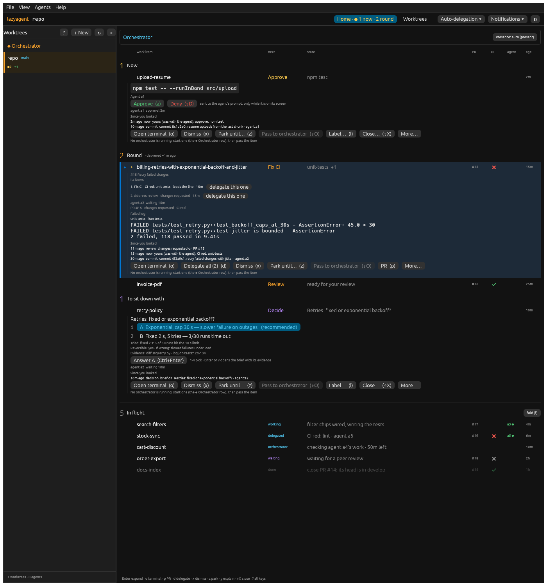
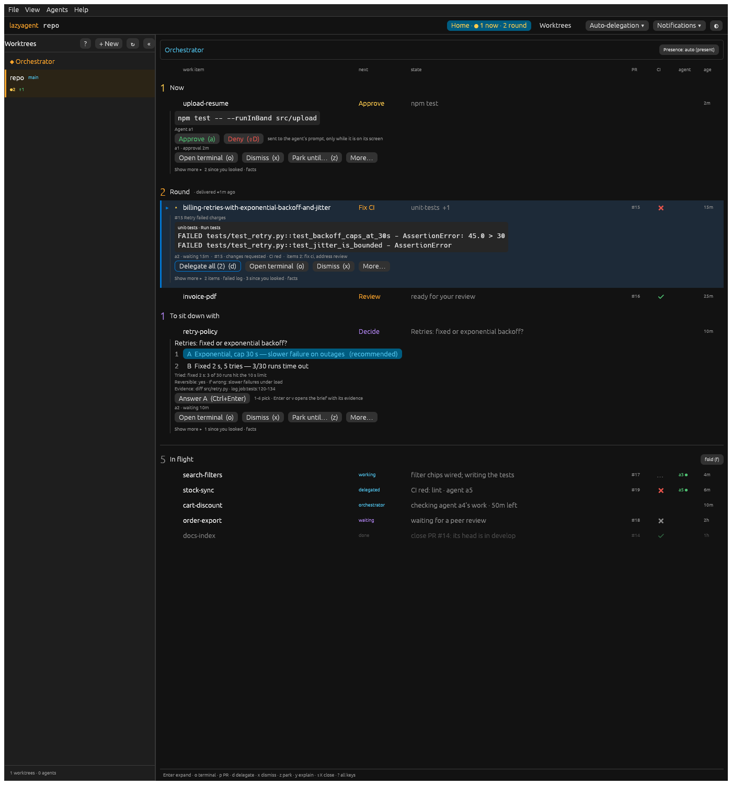
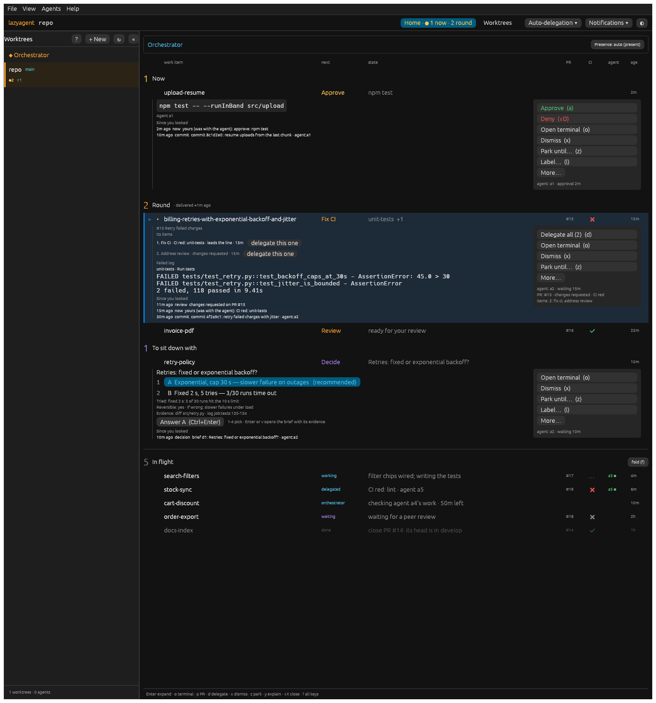
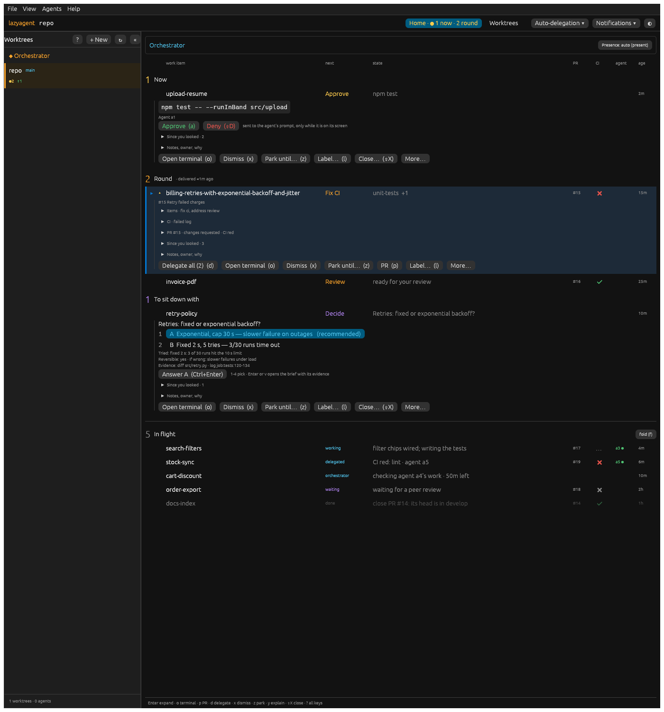
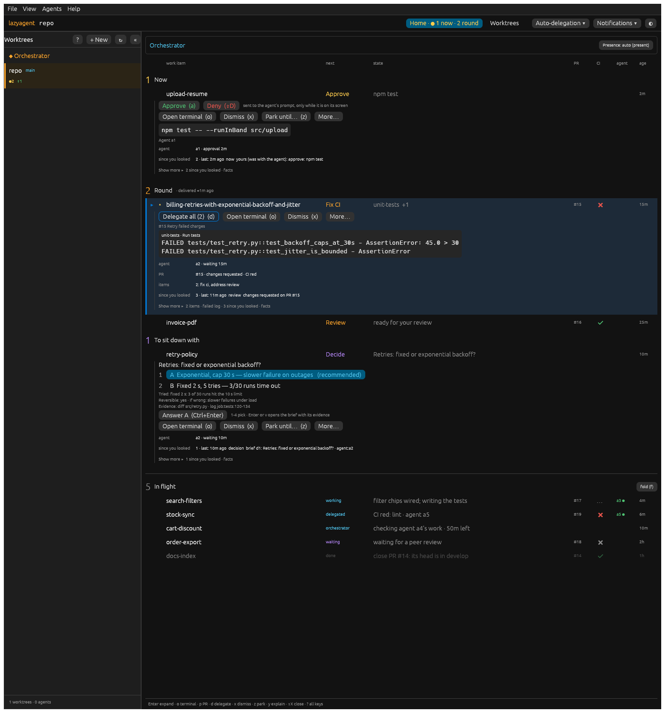

# Home expanded item: proposals (H2, second round)

Status: **proposal, nothing shipped**. The user picks one; the others and the
switch go.

Feedback: the collapsed line is settled, the grid (d) of
[home-item-proposals.md](home-item-proposals.md). The expanded item, the one
a click or Enter opens, "has a lot of information there". Simplify and
reorganise it the same way.

How these were made: every variant is drawn by the real app behind a
temporary dev-only switch, `LAZYAGENT_HOME_DETAIL_STYLE` = `current` (the
default) · `a-summary` · `b-columns` · `c-sections` · `d-actions`
(`desktop/crates/app/src/home_view/detail_proposals.rs`). Today's `details`
is split into its blocks (ask, items, answer, facts, explain, owner, CI log,
timeline, actions, forms); `current` draws them in today's order, the
variants reorder them and show less at first. Nothing new is fetched or
invented.

Every screenshot is the grid line (`LAZYAGENT_HOME_ITEM_STYLE=d-grid`) with
its two adjustments: the agent column shows only a running agent (●), and
the line's sub-lines (release note, last step, suggestion) live in the
details. The sample is round one's (`desktop/crates/app/src/tests/h2.rs`,
`h2_detail_screenshots`), with three items expanded at once: **an approval
in Now** (`upload-resume`), **a red CI with a review behind it**
(`billing-retries-…`, selected, with its failed log) and **a brief in To sit
down with** (`retry-policy`). Each has a few "since you looked" entries. No
orchestrator runs, as on a laptop with none started.

## 1. Today

Light: [h2d-current-light.png](desktop-screenshots/h2d-current-light.png) ·
1000 px: [h2d-current-narrow-dark.png](desktop-screenshots/h2d-current-narrow-dark.png)

What makes it hard to read:

1. **Everything at once, in one column.** The Fix CI item opens 20 lines:
   the PR title, both items with a button each, the agent, the PR, the
   whole failed log, three timeline entries, seven buttons and a sentence
   about the orchestrator. The thing to act on is in the middle.
2. **No primary action.** Seven to eight buttons of equal weight, in an
   order that starts with "Open terminal" on every item; the one the line's
   verb asks for (Delegate on a red CI) is second, the brief's Answer is a
   button among others.
3. **Repeats.** The agent ("Agent a1", then "agent a1 approval 2m"), the PR
   ("#15 Retry failed charges", then "PR #15 · changes requested · CI red")
   and the state ("CI red: unit-tests" in the line, the item list and the
   log) are each said two or three times.
4. **Noise.** "No orchestrator is running: start one…" under *every*
   expanded item, next to a disabled "Pass to orchestrator" button; "sent to
   the agent's prompt, only while it is on its screen" after every approval.
5. **The same small grey text for everything**: facts, timeline, item list
   and hints look alike, so nothing guides the eye.

## 2. Inventory

Everything the expanded item can show today, by block, and where it should
go. *Essential*: needed to act now. *On demand*: one click away. *Noise*:
drop, or move to a hover.

| Block | What | Class |
|---|---|---|
| Name | the full branch name when the line cut it | essential (only when cut) |
| Ask | the approval's command, the question, the brief (question, options, tried, reversible, evidence, Answer) | **essential** |
| Ask label | "Agent a1", "#15 Retry failed charges" under the ask | on demand (repeats the agent / PR) |
| Attestation | a Confirm item's evidence and buttons | essential (Confirm items) |
| Answer | Approve / Deny, the answer field, "what to review" (review commits) | **essential**: the primary action |
| Answer hint | "sent to the agent's prompt, only while it is on its screen" | noise (hover on Approve) |
| Items behind the line | each with "delegate this one", "Answer here" | on demand; a count is essential ("+1") |
| Failed log | job, step, the failing lines | essential **head** (job + 2 lines); the rest on demand |
| Agents | each agent's id, status, age | on demand (the grid line shows a running one) |
| PR | number, review state, CI | on demand (the grid line shows #, CI) |
| Review request, project, waits on, feeder, tracker | where the item comes from | on demand |
| Notes | the agent's last notes line | on demand |
| Gesture | your label / park / close, by whom, when | on demand |
| Skip list | why auto-delegation left it | on demand (essential when CI is red and nothing will happen) |
| Explain | the decision view's answer | on demand |
| Owner | hold, delegation (+ Send anyway), park, claim, "the orchestrator is looking", its decision + Revert | essential when present (it is who has the ball) |
| Moved sub-lines | release note, last step, suggestion | on demand (the suggestion is the done line's state) |
| Since you looked | up to 12 timeline entries | on demand; "N since you looked" essential |
| Actions | Merge/Review on the PR, Approve (⇧A), Open terminal, Delegate (all), Dismiss, Park until…, Take back / Pass, Unpark / Clear, Notes, PR, Label…, Close…, Seen, Why? | **one primary** + 2-3 secondary; the rest under More… |
| Pass reason | "No orchestrator is running…" | noise as a line: hover on Pass, Pass under More… while off |
| Forms | park, close, label | essential while open |

Rule of thumb the variants follow: **the ask, then the one action it asks
for, then a short line of facts; everything else is one click away.** In all
four variants, Pass goes under More… with its reason on hover while it
cannot be used (no line of its own), and the action the line's verb asks for
comes first: Delegate on a red CI, Approve on your review, the brief's
options on a brief, Approve/Deny on an approval.

## 3. Proposals

### (a) Summary + "Show more"

Light: [h2d-a-summary-light.png](desktop-screenshots/h2d-a-summary-light.png) ·
1000 px: [h2d-a-summary-narrow-dark.png](desktop-screenshots/h2d-a-summary-narrow-dark.png)

- **Shown:** the ask (command, question, brief); for a red CI the failed
  job and its first two lines; the answer row; one muted facts line
  (`a2 · waiting 15m · #15 · changes requested · CI red · items 2: fix ci,
  address review`); three actions (the primary outlined) + More…; then
  `Show more ▸ 2 items · failed log · 3 since you looked · facts`.
- **Behind "Show more":** the items with their buttons, the whole log, the
  timeline, every fact, the owner block, the moved sub-lines.
- **Primary action:** Approve/Deny on an approval, the brief's Answer, else
  the first, outlined button (Delegate all on the red CI).
- **Pros:** the Fix CI item drops from 20 lines to 8; the order is the
  order you read in (what, the proof, what to do); the "Show more" label
  says what is behind it, so nothing is hidden blindly.
- **Cons:** the facts line is dense and gets cut at 1000 px; "Show more"
  is one more click for the timeline, which some will want every time.

### (b) Two columns: what it is | what to do

Light: [h2d-b-columns-light.png](desktop-screenshots/h2d-b-columns-light.png) ·
1000 px: [h2d-b-columns-narrow-dark.png](desktop-screenshots/h2d-b-columns-narrow-dark.png)

- **Shown, left:** the ask, the items, the failed log, since you looked,
  the moved sub-lines. **Right (230 px panel):** Approve / Deny full width,
  else the answer; four actions stacked, the primary first; More…; the facts
  as short `key: value` lines.
- **Primary action:** top of the right panel, always in the same place.
- **Pros:** the actions never move: the eye learns where to look; the
  left keeps the full log and timeline without pushing the buttons down.
- **Cons:** nothing removed, only placed: the left is as long as today;
  at 1000 px the log wraps into a narrow column (see the narrow shot); a
  short item (the approval) leaves a tall empty left column; stacked
  buttons take height.

### (c) Collapsed sections

Light: [h2d-c-sections-light.png](desktop-screenshots/h2d-c-sections-light.png) ·
1000 px: [h2d-c-sections-narrow-dark.png](desktop-screenshots/h2d-c-sections-narrow-dark.png)

- **Shown:** the ask and the answer open; then one collapsed header per
  block, its summary in the header: `Items · fix ci, address review`,
  `CI · unit-tests`, `PR #15 · changes requested · CI red`,
  `Since you looked · 3`, `Notes, owner, why`; then today's button bar.
- **Primary action:** the bar, primary first (Delegate all), More… for the
  rest.
- **Pros:** the most predictable: the same headers on every item, the
  header summaries are already the facts; opening one section never moves
  the others' content.
- **Cons:** five headers are five lines of chrome on every item, even when
  a section holds one line; the failed log, the reason a Fix CI line exists,
  is closed by default; the button bar is still long (7 buttons).

### (d) Actions first

Light: [h2d-d-actions-light.png](desktop-screenshots/h2d-d-actions-light.png) ·
1000 px: [h2d-d-actions-narrow-dark.png](desktop-screenshots/h2d-d-actions-narrow-dark.png)

- **Shown:** first the answer row and three actions (primary outlined) +
  More…; then the ask and, on a red CI, the job and its first two lines;
  then the facts as a two-column table (agent, PR, items, held, delegated,
  notes, since you looked); then `Show more ▸`. A brief keeps its question
  and options first: its options *are* the action.
- **Primary action:** the first thing under the line, the same place on
  every item.
- **Pros:** the fastest to act: Enter, then the action is right there;
  the facts table is the most scannable layout of the facts.
- **Cons:** you act before you read the ask (fine for an approval, risky
  for a review); the table takes a line per fact, so an item with many
  facts is not shorter than (a).

## 4. Recommendation

**(a) Summary + "Show more"**, with one thing from (d): the facts line
becomes the small two-column table when it would be cut (narrow windows,
four facts or more).

Why (a): it is the only variant that both *removes* lines (the Fix CI item
goes from 20 lines to 8, the approval from 9 to 6) and keeps the reading
order: what is asked, the proof (command, brief, failed log head), the one
action, then the rest by name. (b) only moves the same content around and
breaks at 1000 px; (c) adds a header line per block and closes the failed
log; (d) puts the buttons before the thing they act on.

Small fixes that apply whatever is picked (all four do them already):

- Pass under More… with its reason on hover while it cannot be used; no
  "No orchestrator is running…" line under every item;
- the action the verb asks for first;
- the moved sub-lines in the details, the suggestion as the done line's
  state.

Once picked: replace `details`'s current order with the chosen variant, drop
the others, both switches (`LAZYAGENT_HOME_ITEM_STYLE`,
`LAZYAGENT_HOME_DETAIL_STYLE`), `Home::expanded_also` and the h2 tests'
extra shots, and make the grid line (d) the only collapsed line.
