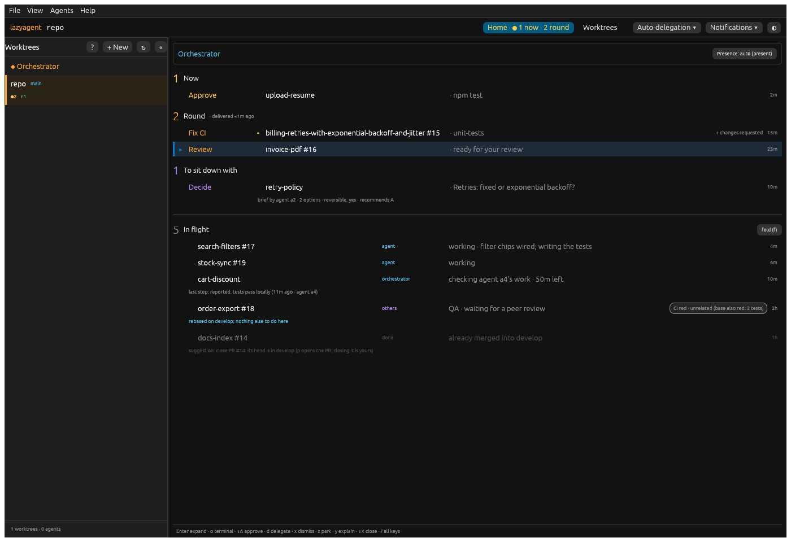
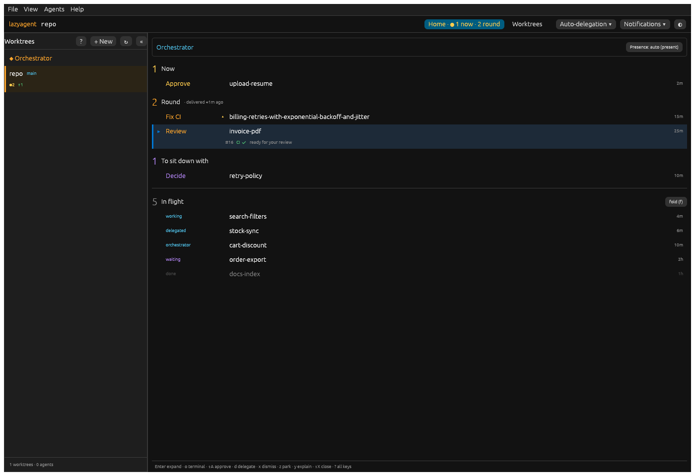
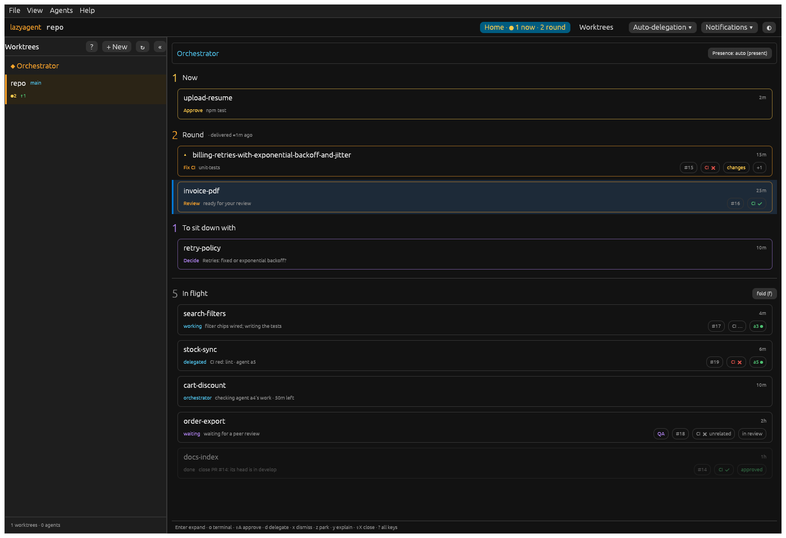
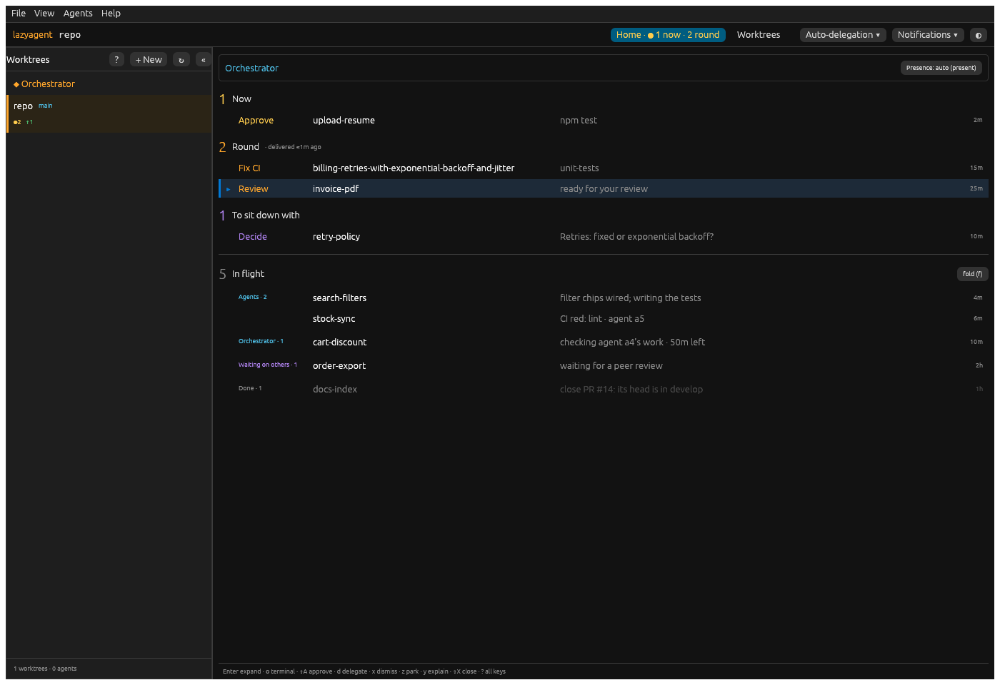
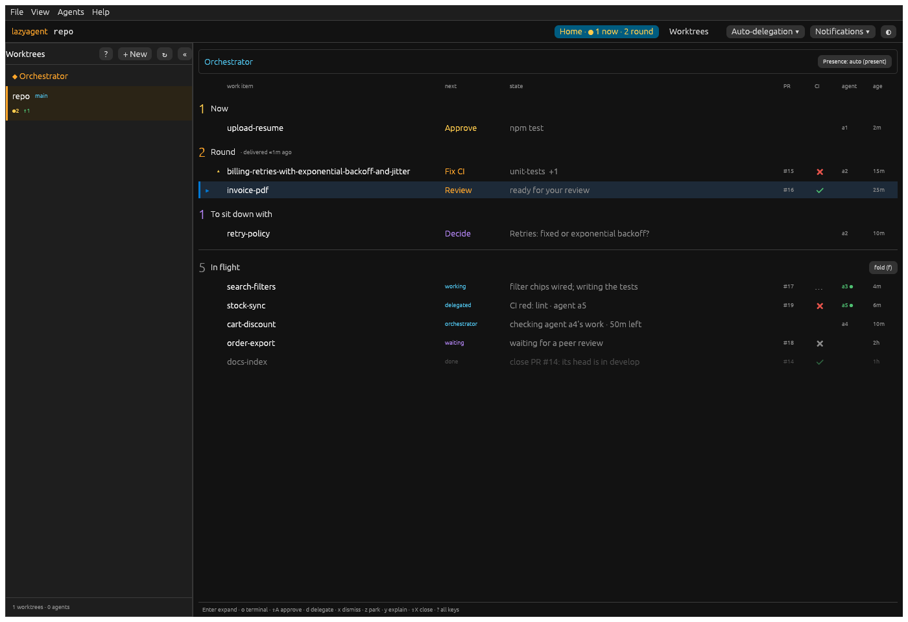

# Home item layout: proposals (H2)

Status: **proposal, nothing shipped**. The user picks one; the others and the
switch go.

Feedback: Home items show too much, and that is counterproductive. Simplify
and reorganise: a cleaner, more schematic item is easier to read.

How these were made: each proposal is drawn by the real app behind a
temporary dev-only switch, `LAZYAGENT_HOME_ITEM_STYLE` = `current` (the
default) · `a-oneline` · `b-card` · `c-ball` · `d-grid`
(`desktop/crates/app/src/home_view/proposals.rs`). Only the line's head
changes: the frame, the selection, the click and the expanded details are the
shipped ones (the whole-surface click is another branch's). Every screenshot
has the same neutral sample (`desktop/crates/app/src/tests/h2.rs`,
`h2_screenshots`): an agent waiting on a command approval, a red CI with a
review behind it on a long branch name, your own review of a PR, a brief, an
agent at work, a PR waiting on a peer (labelled, CI red but unrelated), a
line the orchestrator holds, a letter delegated to the branch's agent, and a
merged PR with a suggestion. `invoice-pdf` is selected.

## 1. Today

Light: [h2-current-light.png](desktop-screenshots/h2-current-light.png) ·
1000 px: [h2-current-narrow-dark.png](desktop-screenshots/h2-current-narrow-dark.png)

What makes it hard to read:

1. **Two grammars.** Inbox lines read *verb · name · fact*; In flight lines
   read *name · owner · fact*. The columns do not line up between the two
   halves, so the eye relearns the row halfway down.
2. **Lines of different heights.** Up to five optional sub-lines (brief
   summary, release note, last step, suggestion, the orchestrator's
   decision), at two indents (18 and 140 px), in two colours. The rhythm
   breaks on every row that has one.
3. **The owner is tiny.** `agent`, `others`, `orchestrator` are small
   coloured words in a column of their own; the meaning is implicit.
4. **What matters is hidden while noise shows.** The delegated letter on
   `stock-sync` reads just "agent · working": the delegation only shows
   expanded. Meanwhile the suggestion line explains a key ("p opens the PR;
   closing it is yours") on every frame.
5. **Spread out.** Name, fact, chips and age sit in four horizontal places;
   the age is ~900 px from the name at 1400 px.

## 2. Inventory

Everything an item can show today, and where it should go.

| Piece | Today | Class |
|---|---|---|
| Verb (Approve, Fix CI, Review, Decide…) | inbox head, zone colour | **essential** |
| Owner (agent, others, orchestrator, parked) | flight head, small | **essential** |
| Title (branch name) | head, middle ellipsis, full on hover | **essential** |
| Fact (one clause: "npm test", the brief's question, the red job, the agent's report, the hold's note) | head | **essential** (one clause only) |
| Age | head, far right | **essential** |
| Zone (Now / Round / To sit down with / In flight) | section header | **essential** (already the structure) |
| Seen dot, selection mark | head | **essential** (tiny) |
| Priority marker ▴ ▾ | head | useful (keep, it is one glyph) |
| PR number | in the title ("#15") | useful: a glyph/column, not part of the title |
| PR CI state (green/red/running) | expanded only (red CI shows as a Fix CI item) | useful at a glance for In flight |
| PR review state | expanded only | on selection |
| Running agent | expanded; "working ·" in the fact | useful at a glance (one glyph) |
| Items behind the top one ("+ changes requested") | head, right side, long text | useful: a count (+1), the list on hover |
| CI unrelated note (`ci_note`, up to 48 chars) | chip in the head | glyph + hover |
| User's label ("QA") | prefix of the fact | small chip or on selection |
| Delegation (letter, agent, fact) | expanded only | **essential** for In flight: it is who has the ball |
| Orchestrator hold / claim and time left | fact + expanded | essential owner, time left in the fact |
| Brief summary ("brief by agent a2 · 2 options · reversible: yes…") | sub-line | on selection (the question is already the fact) |
| Orchestrator's release note | sub-line | on selection |
| Last step on a held line | sub-line | on selection |
| Suggestion ("close PR #14…") + key help | sub-line | the fact of a done line; the key help is noise |
| Orchestrator's decision (first responder) | sub-line | on selection |
| "next round" | head text + dimming | redundant (the dimming says it) |
| Expanded details (items, ask text, CI log, timeline, notes, tracker, actions) | Enter | unchanged |

Rule of thumb the proposals follow: **one line, one grammar, nothing under
the line until it is selected or expanded**; every sub-line above moves to
the expanded details (most already appear there: hold, claim, delegation,
decision, notes; the suggestion and the last step would be added).

## 3. Proposals

### (a) One-liner: verb, title, age

Light: [h2-a-oneline-light.png](desktop-screenshots/h2-a-oneline-light.png) ·
1000 px: [h2-a-oneline-narrow-dark.png](desktop-screenshots/h2-a-oneline-narrow-dark.png)

- **Shown:** verb (inbox) or owner word (In flight: working, delegated,
  orchestrator, waiting, done), title, age. Nothing else.
- **On selection:** a second line with the chips (PR, CI, review, running
  agent, +N) and the fact. Everything else: expanded details, Why?.
- **Primary action:** the verb is the first column; Enter / the key bar as
  today.
- **Long titles:** the title takes all the width left, middle ellipsis,
  full on hover. Almost never cut.
- **Pros:** the calmest; one grammar for both halves; scan by verb.
- **Cons:** too little: "Fix CI" without *which* check, "working" without
  the report; you select a line to learn why it is there. In flight loses
  its one useful sentence.

### (b) Two-line card

Light: [h2-b-card-light.png](desktop-screenshots/h2-b-card-light.png) ·
1000 px: [h2-b-card-narrow-dark.png](desktop-screenshots/h2-b-card-narrow-dark.png)

- **Shown:** line 1 the title (whole width) and the age; line 2 the verb or
  owner, the fact, and framed chips on the right (label, PR, CI ✔/✖/…,
  review, running agent, +N). The card's border takes the zone's colour in
  the inbox.
- **On selection:** nothing more; expanded details as today.
- **Primary action:** the verb starts line 2; Enter / keys.
- **Long titles:** a line of their own: cut only when longer than the whole row.
- **Pros:** the most readable per item; status is visible as chips without
  reading sentences; titles nearly never cut.
- **Cons:** ~2.3× the height: the sample barely fits 960 px; with ten
  lines Home becomes a scroll. Borders on every item are visual noise of
  their own; chips repeat on every card.

### (c) Grouped by who has the ball

Light: [h2-c-ball-light.png](desktop-screenshots/h2-c-ball-light.png) ·
1000 px: [h2-c-ball-narrow-dark.png](desktop-screenshots/h2-c-ball-narrow-dark.png)

- **Shown:** the inbox as today minus the sub-lines (verb, title, fact,
  age). In flight is split by owner (Agents, Orchestrator, Waiting on
  others, Stalled, Done); the group's name and count sit in the verb column
  of its first line, so the rows are only *title · fact · age*.
- **On selection:** expanded details as today.
- **Primary action:** inbox verb; In flight has none (not yours).
- **Long titles:** a 36% column, middle ellipsis, full on hover.
- **Pros:** "who has it" becomes the structure, not a word per row; very
  short rows; the inbox (yours) and the groups (theirs) share one column
  layout.
- **Cons:** In flight's order changes from project to owner (the project
  grouping would need a second level); a line moves group when its ball
  moves, which can feel jumpy; PR/CI state not shown at all.

### (d) One grid, title first, glyph columns

Light: [h2-d-grid-light.png](desktop-screenshots/h2-d-grid-light.png) ·
1000 px: [h2-d-grid-narrow-dark.png](desktop-screenshots/h2-d-grid-narrow-dark.png)

- **Shown:** the same columns in every zone, named once at the top: *work
  item · next · state · PR · CI · agent · age*. "next" is the verb in the
  inbox and the owner word in In flight; "state" is the one-clause fact
  (+N when items wait behind); CI is a glyph (✔ green, ✖ red, grey ✖
  unrelated with the note on hover, … running); agent is its id, ● when it
  runs.
- **On selection:** expanded details as today.
- **Primary action:** the "next" column; Enter / keys.
- **Long titles:** a 32% column, middle ellipsis, full on hover (see the
  1000 px shot).
- **Pros:** one grammar for the whole page; scanning a column answers a
  question ("which CI is red?", "which agents run?") without reading;
  every row is one height; the delegation and the hold become plain
  "next/state" values.
- **Cons:** a table look; at 1000 px the state column gets short (it
  truncates, full on hover); empty cells where a line has no PR.

## 4. Recommendation

**(d) the grid**, with two adjustments when it ships:

- the agent column shows only a *running* agent (●); an idle agent id adds
  nothing at a glance;
- every sub-line moves to the expanded details (as in all four proposals);
  the suggestion becomes the fact of a done line, the key help goes.

Why (d) over the others: it removes the two grammars (the main problem
above) instead of just hiding fields, keeps the one sentence that tells you
*why* a line is there (which (a) loses), stays one row high (which (b)
does not), and keeps In flight's order and project groups (which (c)
changes). (c)'s owner grouping could still come later on top of (d) as a
sort option.

Once picked: replace `Current` with the chosen head in `line_ui`, drop the
other styles, the switch and the `h2` test's extra shots, and move the
suggestion and the last step into the expanded details.
