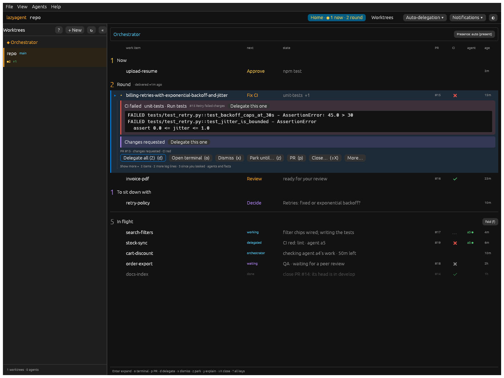

# Home items: the grid line and the expanded item (H2)

Status: **shipped** (desktop). Feedback: Home items showed too much, and the
expanded one "has a lot of information there". Two rounds of proposals on
the same sample; the user picked (d) the grid for the line and (a) Summary
+ "Show more" for the expanded item, with the changes below.

## The line: one grid

The same columns in every zone, named once above them: *work item · next ·
state · PR · CI · agent · age*.

- **next**: the verb in the inbox (Approve, Fix CI, Review, Decide…), who
  has it in In flight (working, delegated, orchestrator, waiting, needs
  you, parked, done).
- **state**: one clause, `+N` when items wait behind the top one (their
  words on hover). A running agent's report, a hold's note and time left, a
  delegation's fact, a done line's suggestion.
- **CI**: ✔ green, ✖ red, grey ✖ red but not the line's (the note on
  hover), … running. **agent**: only a *running* agent (`a3 ●`).
- One row high: nothing under the line. What used to be sub-lines (a
  brief's summary, the orchestrator's release note, the last step, the
  suggestion's key help) is in the expanded item or gone.

## The expanded item: summary, then "Show more"

Light: [h2-ci-light.png](desktop-screenshots/h2-ci-light.png) ·
1000 px: [h2-ci-narrow-dark.png](desktop-screenshots/h2-ci-narrow-dark.png) ·
an approval: [h2-approval-dark.png](desktop-screenshots/h2-approval-dark.png) ·
a brief: [h2-brief-dark.png](desktop-screenshots/h2-brief-dark.png)

In this order:

1. **What it asks**: the command, the question, the brief with its options.
   No "Agent a1" under it (the line and the details already say who).
2. **A section per problem** (`home_view/detail.rs`, `Problem`): CI failed,
   merge conflict, changes requested, review requested. Each has a tint of
   its colour (red, yellow, purple, blue) and a 3 px bar of it on the left.
   The tint is see-through, so it reads in dark and light. The heading
   names it ("CI failed · unit-tests · Run tests", the PR title muted) and
   has **Delegate this one** when the line has several delegable items. A
   red CI's log is in a framed monospace block of its own: the first job's
   first 3 lines (one line each, cut), every job in full with "Show more".
3. **The answer**: Approve (stressed) / Deny, the answer field, what to
   review. Approve's hover says where the answer goes; that line is gone.
4. **Facts**: one muted line, wrapped: the PR's number, review and CI. The
   skip list, when auto-delegation left a red CI alone.
5. **Why? and who else has it**, never folded: the decision view's answer
   once asked (`y`), a hold, a claim, a delegation (Send anyway), a park,
   the orchestrator's decision (Revert).
6. **Every action that applies, inline**: the one the verb asks for first
   and stressed (Delegate on a red CI, Approve on your review), the rest as
   plain buttons, wrapped at narrow widths. **More…** holds only the rare
   ones (Notes, Why?, Label…) and those you cannot use now: Pass to
   orchestrator while it cannot work, its reason on hover (no line of its
   own any more).
7. **Show more ▸** names what it holds ("2 items · 2 more log lines · 3
   since you looked · agents and facts"): the items with their Answer here,
   since you looked, the release note and last step, every fact (agents,
   review request, project, feeder, tracker, notes, your gesture).

Effect on the sample: the Fix CI item opens 8 lines instead of 20 (two
sections, the facts, one row of six actions, Show more); the approval 4
instead of 9.

## Tests

`desktop/crates/app/src/tests/h2.rs`: the grid's columns and running-agent
cell; a red CI opens on its two sections, the log head only, every usable
action inline and Pass under More…, and Show more opens the rest; an
approval shows its command and Approve/Deny with no agent label or hint.
`h2_screenshots` writes the shots above to the temp dir (copied by hand).
