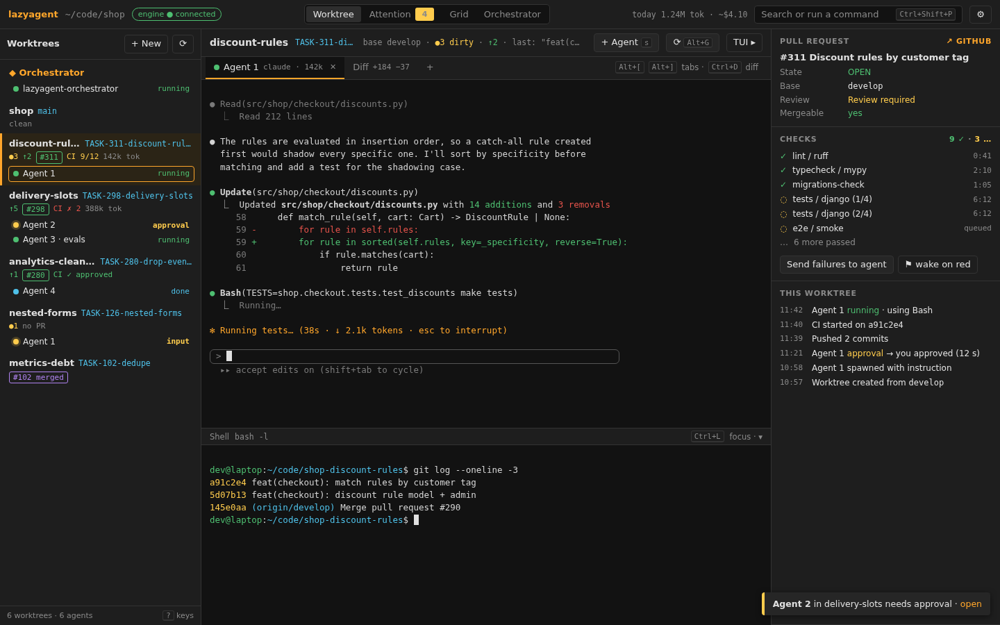
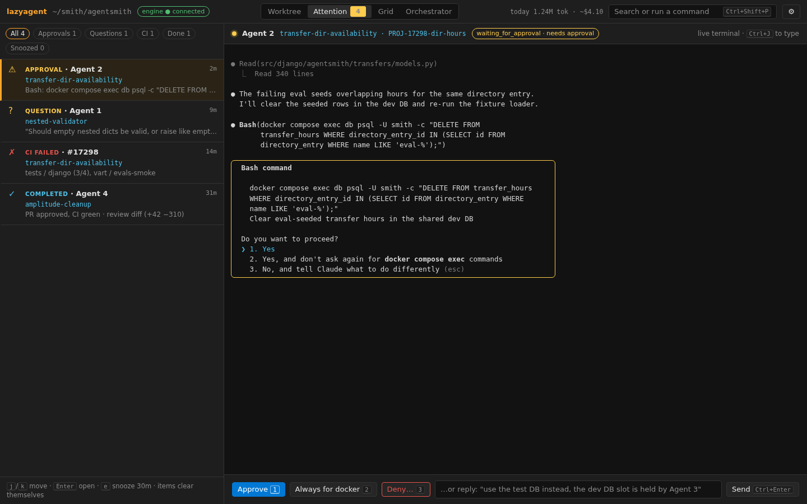
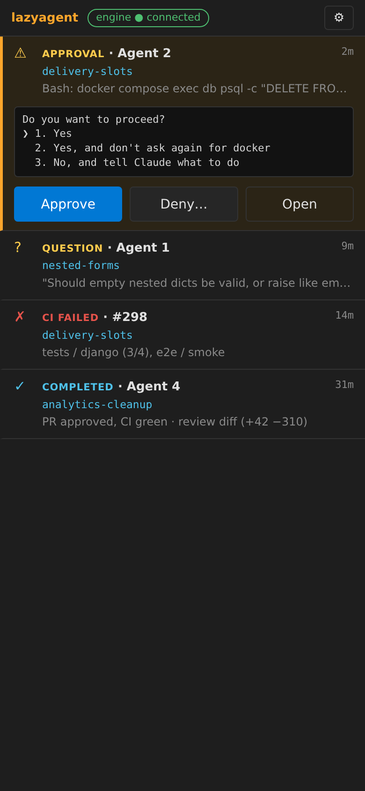
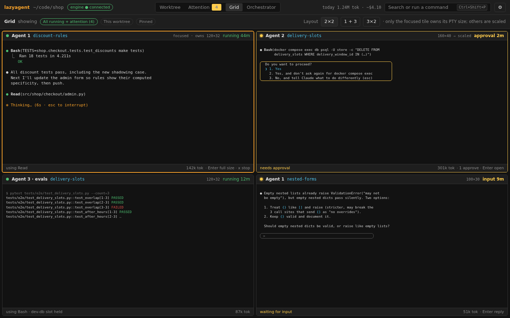
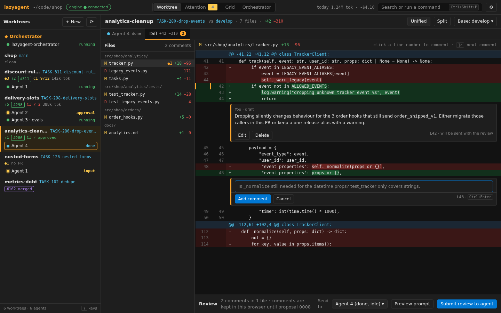

# Graphical UI: plan

- **Status:** reviewed 2026-10-17 (U0); Q1-Q17 answered in §9. Implementation: U1-U5 (see "As landed" notes in §8a).
- **Base:** `develop` @ `145752e` (H2 merged). All `file:line` refs are under `src/lazyagent/` at that commit.
- **Performance data:** §7d. Numbers come from throwaway benchmark scripts (not in the repo) run on the author's machine (i7-12700H, 20 threads, Linux 6.8, system Chrome headless with `--enable-gpu` on Mesa Intel ADL GT2, CPython 3.12, the worktree's develop venv). Another session was running tests at the same time, so absolute numbers carry noise; repeated runs are given as ranges.
- **Builds on:** [engine-split.md](engine-split.md) (§0 why, §4 protocol v1, §6/§6b migration, D1-D11) and [proposals 0001-0009](../proposals/README.md).
- **Mockups:** [`ui-mockups/`](ui-mockups/), shown in §3a-§3d. Static, self-contained HTML/CSS (no scripts, no network) with sample data, in H2's dark tokens; the PNGs are headless Chrome screenshots (Playwright, `channel="chrome"`, 1440×900; the phone one at 390×844).

## TL;DR

- **The GUI grows out of the H2 host page, piece by piece.** H2 already serves a page with a native sidebar and the whole TUI in one xterm.js. Each U-PR moves one TUI piece (agent terminals, modals, diff, shell) to a native widget fed by protocol v1, until the hosted TUI pane is optional (U7) and, after PR 8, unnecessary.
- **The single biggest step is U2: native agent terminals.** The host forwards `attach_stream` and binary stream frames, so the page opens one xterm.js per engine session instead of drawing the agent inside the TUI. Everything the engine needs for it already exists (§3b/§3c of engine-split, PR 6).
- **The new screens that justify a GUI** (§0a of engine-split): an **attention queue** (who needs me, with the live terminal next to it), a **multi-agent grid**, a **diff review** with comments that go back to the agent (0008), and a **PR/CI panel** per worktree (0002).
- **The TUI stays** for SSH, tmux and the unattended weekday boot. It is never deprecated; it just stops being the only screen.
- **Stack (proposal, D7 stays Giovanni's call):** keep H2's no-build-step approach and vendor **Preact + htm + signals** as ES modules (~15 KB), JSDoc types, Chrome `--app` window as the shell. Tauri, a build step and TypeScript are deferred until something forces them (§6).
- **Protocol:** most screens run on existing v1 methods; the host's method whitelist widens step by step. New engine methods are listed in §5 and are all additive.
- **Performance (§7d, measured 2026-10-16):** budgets come first (keystroke → glyph ≤ 8/16 ms p50/p95, ≤ 25/50 ms p95/p99 with 8 busy hidden agents, idle ≤ 2% of a core, attach ≤ 50 ms p95). The baseline shows the GUI side already fits. **The engine's headless pyte is the bottleneck**: 77% of the engine's busy CPU, 1.7-3.0 MB/s, and up to 3.9 s loop stalls after a burst. It sets the tail latency of every client (U2 prototype: p95 1.9 ms idle → 30-46 ms with 8 chatty hidden agents). Three changes follow from the data:
  - an **engine track** E1 (cheap Python fixes, with U2) and E2 (native emulator: C emulators measured 26-38× faster than pyte; brought forward from Phase 5 to right after U2);
  - **WebGL for every visible terminal** when the GPU is real (2-2.5× DOM in a grid), not "WebGL for the focused one only";
  - **native terminals must not go through the hosted TUI**: the H2 path is TUI-bound at 0.8-2.1 MB/s with the TUI at 94-100% CPU.

  The host hop costs 1.4 ms p50, so it stays (Q1).

---

## 1. Goal and users

### 1a. What the GUI solves

From engine-split §0a: the axis is terminal app vs GUI app. The GUI is for the things a character grid does badly.

| Problem today (TUI) | GUI answer | Screen |
|---|---|---|
| One agent visible at a time; the rest is a coloured word in the sidebar | Grid/split of live terminals | Multi-agent (§3c) |
| "Who needs me?" means scanning the sidebar for yellow | A queue sorted by urgency, with the terminal and a reply box next to it | Attention queue (§3b) |
| Reviewing an agent's diff happens in GitHub or the editor, feedback is copy-pasted | Side-by-side diff with inline comments, sent back as one prompt | Diff review (§3d) |
| PR/CI is a 5-line box for the selected worktree only (pr_status_bar.py:29) | Per-worktree badges plus a panel with every check | Main layout right panel (§3a) |
| Notifications are toasts inside a terminal you are not looking at | Desktop notifications, later phone (0003) | §4e |
| Modals are key-driven only (`n`/`d`/`r`/`l` in the spawn modal, prompt_modal.py:70-77); no instruction field | Forms with an instruction box, provider, base branch | Create + launch (§4a) |
| Hover, links, drag, images: none | Native | Everywhere |

### 1b. Users

| User | Where | Uses |
|---|---|---|
| Giovanni at the desk | Linux, Chrome, big screen | GUI (main), TUI in a terminal when it is quicker |
| Giovanni away | Phone | Attention queue + approve/answer (0003), read-only status |
| Unattended boot | tmux → `lazyagent` → `/gio-planner unattended` | TUI only (K8) |
| Over SSH | Remote box | TUI only |
| Orchestrator / skills | MCP + protocol | No UI; they share the engine with whatever screen is open |

### 1c. What stays TUI-only

| Stays in the TUI | Why |
|---|---|
| SSH, tmux, unattended boot | No display. The GUI never becomes a dependency of the boot path |
| Hosted mode (H1) | Kept as the migration crutch until U7; then optional |
| Quick one-off use (`lazyagent` in a terminal) | Zero setup |

---

## 2. Inventory: TUI today → GUI

### 2a. Screens and widgets

| TUI piece | Where | GUI target | Step |
|---|---|---|---|
| Worktree list + orchestrator row, agent roll-ups | worktree_list.py:70-255 | **Native** sidebar (already in H2) | done (H2) |
| PR status bar (selected worktree) | pr_status_bar.py:8-89 | **Native**: badge per worktree (H2) + PR/CI panel with every check | U4 |
| Git info bar (branch, dirty, ahead/behind, last commit) | center_panel.py:72-115 | **Native** header of the worktree view | U3 |
| Agent tabs (`TabbedContent`, one `MonitoredTerminal` per agent) | center_panel.py:118-400 | **Terminal (xterm.js)** per session via `attach_stream`; tabs are native | U2 |
| Agent placeholder ("press s to spawn") | center_panel.py:203 | **Native** empty state with a Spawn button | U2 |
| Diff tab (`Static` with coloured text) | center_panel.py:204-210 | **Native** diff viewer (files, hunks, split/unified) | U5 |
| Worktree shell pane (`bash -l`) | center_panel.py:211-230 | **Terminal (xterm.js)** via `open_shell` + `attach_stream`; collapsible bottom pane | U2 |
| Orchestrator panel | orchestrator_panel.py:15-100 | **Terminal** + native board of worktrees (§3e) | U2 / U6 |
| Job log (custom create/remove output) | job_log.py:15-75 | **Native** log drawer fed by `job.*` events | U3 |
| Toasts (`notify`) | app.py | **Native** toasts (H2) + desktop notifications | done (H2) / U4 |
| Header / Footer | app.py:118-130 | **Disappears**: top bar + command palette + `?` sheet | U1 |

### 2b. Modals

| Modal | Keys today | GUI target | Step |
|---|---|---|---|
| Spawn (`SpawnModal`) | `n` normal, `d` skip permissions, `r`/`l` resume, Backspace new, Esc | **Native** form: permissions toggle, resume mode, **instruction** box (engine already takes `instruction`), label | U3 |
| Create worktree | branch, base (default from config), extra (custom create only) | **Native** form, plus "and launch an agent with: …" (§4a) | U3 |
| Remove worktree (`RemoveWorktreeModal`) | `y`/`n`, `f` force | **Native** confirm with force checkbox, guard text (agent running / main) | U3 |
| Confirm (stop agent) | `y`/`n` | **Native** confirm | U3 |
| Help | `?` | **Native** shortcut sheet, generated from the keymap table (§7a) | U1 |

### 2c. Keyboard

Full table in §7a. Every TUI binding (app.py:132-154, worktree_list.py:197-198, modal bindings) keeps the same key in the GUI, plus a command palette.

### 2d. Flows that exist today

| Flow | TUI | GUI |
|---|---|---|
| Select worktree → see its agent and shell | `j`/`k` | Click or `j`/`k` in the sidebar; native view (U2) |
| Spawn agent | `s` → modal | Button / `s` → form with instruction (U3) |
| Stop agent | `x` → confirm | Tab close button / `x` (U3) |
| Create / remove worktree | `c` / `d` | Forms (U3) |
| Refresh | `r`, `Alt+G` | Same keys; buttons in the worktree header |
| Switch agent tab | `Alt+]`/`Alt+[`, `Alt+n`/`Alt+p` | Same |
| Scrollback | PageUp/PageDown, wheel | xterm.js native scrollback |
| Open PR | click URL in PR bar | Link in PR panel |

### 2e. Migration path: H2 → native, piece by piece

```
H2 today        U2                    U3                 U5            U7 (after PR 8)
┌────┬──────┐   ┌────┬───────┬────┐   ┌────┬───────┐     ┌────┬──────┐  ┌────┬──────────┐
│side│ TUI  │ → │side│agent  │TUI │ → │side│agents │  →  │side│agents│→ │side│ agents   │
│bar │(all) │   │bar │xterm  │pane│   │bar │+forms │     │bar │+diff │  │bar │ shell    │
│    │      │   │    │(native│(rest│  │    │ TUI   │     │    │+PR/CI│  │    │ diff …   │
│    │      │   │    │ tabs) │)   │   │    │ pane ▸│     │    │TUI ▸ │  │    │ no TUI   │
└────┴──────┘   └────┴───────┴────┘   └────┴───────┘     └────┴──────┘  └────┴──────────┘
```

| Step | Moves to native | Criterion to start | Criterion to call it done |
|---|---|---|---|
| U2 | Agent + shell terminals | U1 store in place | A spawned agent is usable (type, scroll, resize, reattach) without the TUI pane in view, **and the hosted TUI no longer renders a session the GUI shows natively** (it shows an empty view instead). Measured: the TUI rendering the visible agent pins it at 94-100% CPU and caps output at 0.8-2.1 MB/s (§7d-2) |
| U3 | Spawn/create/remove/stop forms, job log | U2 | Every TUI modal has a form; the TUI pane is no longer needed for any mutation |
| U4 | Attention queue, PR/CI panel, notifications | U2 | Waiting agents can be answered from the queue |
| U5 | Diff viewer | U1 | Diff tab of the TUI no longer needed |
| U7 | Hosted TUI pane hidden by default, then dropped | U2-U5 done **and** PR 8 (engine outlives the TUI) | `lazyagent ui` runs with no TUI process; parity table §2a all green |

- **Rule for each step:** the hosted TUI pane stays available (a toggle) until U7, so a missing feature never blocks work.
- **Who owns the engine before PR 8:** the hosted TUI process (it is the engine's process in hosted mode). The GUI can hide its pane but not stop it. After PR 8 the host connects to the detached engine instead (§8b).

---

## 3. Information architecture and screens

### 3a. Main layout



([main.html](ui-mockups/main.html))

| Region | Content | Source |
|---|---|---|
| Top bar | repo, engine pill (connected / reconnecting / gone), attention count, usage today (0006), search/palette, settings | `hello`, `engine.*`, derived |
| Left sidebar (resizable, collapsible) | Orchestrator row; worktrees (name, branch, dirty/ahead/behind, PR + CI badge) with their agents (status dot, label, detail) | `get_sidebar_state` + events (H2) |
| Centre | Tabs per agent of the selected worktree (xterm.js), shell as a bottom split, Diff tab | `attach_stream`, `open_shell`, `get_diff` |
| Right panel (toggle `Ctrl+.`) | PR (title, state, review, mergeable), CI checks list, recent events of this worktree | `pr_info.updated`, event log |
| Bottom drawer | Job log (custom create/remove) | `job.*` |
| Toasts | Bottom right (H2) | events |

- **View modes** (top-bar switcher, also `g w` / `g a` / `g g` / `g o` sequences): **Worktree** (default), **Attention**, **Grid**, **Orchestrator**.
- The selection is per page (client state), as in the TUI; the hosted TUI follows it through `ui.select_worktree` only while its pane is shown.

### 3b. Attention queue



([attention-queue.html](ui-mockups/attention-queue.html), phone: )

- **Left:** a list of items, newest-urgent first. **Right:** the selected item's live terminal (attached), its last screen lines and the actions.
- **Item kinds and urgency:**

| Rank | Kind | From | Actions |
|---|---|---|---|
| 1 | Needs approval | `agent.status` → `waiting_for_approval` | Open terminal (focus, type `1`/`2`/…); later Approve / Deny buttons (`answer_prompt`, new) |
| 2 | Question | `waiting_for_user` | Reply box → `send_agent_input` |
| 3 | Hanged? | `possibly_hanged` | Open, Stop |
| 4 | Failed / exited unexpectedly | `failed`, `agent.exited {stopped:false}` | Open shell, respawn (resume last) |
| 5 | CI red / changes requested / conflicts | `pr_info.updated` (diff of two states, client side until `pr.checks` (0002)) | Open PR panel, "send CI failure to agent" |
| 6 | Completed | `completed` | Review diff, dismiss |
| 7 | Job failed | `job.finished {exit_code≠0}` | Open job log |

- **Lifecycle:** an item clears itself when its condition clears (agent back to `running`, CI green). Manual dismiss/snooze is client-local (localStorage) until a shared `attention.*` exists (§5).
- **Badge:** the count shows in the top bar, the tab title (`(3) lazyagent`) and the favicon.

### 3c. Multi-agent view (grid)



([multi-agent.html](ui-mockups/multi-agent.html))

- **Layouts:** auto grid (1, 2, 2×2, 3×2), or a pinned split (one large + a column of small). Tiles are chosen by filter: "all running", "this worktree", "pinned", "needs attention".
- **Tile:** header (worktree, agent, status, elapsed), the live terminal, a footer with the last detail and quick actions (focus, stop, diff).
- **Size policy (D3, §3c of engine-split):** only the **focused** tile claims the PTY size. Other tiles render at the PTY size and scale down with CSS `transform: scale()`, so a grid never SIGWINCHes every agent. Pressing Enter on a tile opens it full size (claims).
- **Limits (measured, §7d-4):** up to **9 live tiles** with the WebGL renderer: frame p95 16.8 ms while all 9 receive output, against 50 ms with DOM. Above 9, or with the page hidden, tiles fall back to a text preview from `read_agent_output` every 2-5 s and detach their stream. 16 live tiles still hold p50 16.7 / p95 33.5 ms on WebGL, so 9 leaves headroom for a slower GPU.

### 3d. Diff review



([diff-review.html](ui-mockups/diff-review.html))

- File tree (with +/− counts) → file diff (unified or split) → inline comment threads → **Submit review to Agent N**.
- Stage 1 (U5) parses today's `get_diff` text on the client; comments are page-local. Stage 2 (U8) is proposal 0008 with engine-stored threads (§5).

### 3e. Orchestrator view

- **Left:** the orchestrator's terminal (it is an agent with key `__orchestrator__`).
- **Right:** a board of every worktree as a card, in columns by roll-up status (Needs you / Running / Idle / Done), with PR/CI badges. Cards link to the worktree view.
- **Bottom:** an event feed (all `agent.*`, `pr_info.updated`, `job.*`, `engine.notice`), filterable.
- "Spawned by the orchestrator" grouping needs a `spawned_by` field that the engine does not have (§5, new).

### 3f. Settings

| Section | Holds | Stored |
|---|---|---|
| Appearance | Theme (dark / light / system), font, font size, density | Page (localStorage) |
| Notifications | Desktop on/off per kind, sound, quiet hours; phone (later) | Page; phone config in engine (0003) |
| Keyboard | The keymap (read-only first, rebinding later) | Page |
| Engine | `get_config` (provider, default branch, custom create/remove) read-only; engine version, `engine_id`, socket | Engine (read-only) |
| About | Versions, protocol capabilities from `hello` | — |

- Editing `.lazyagent.toml` from the GUI: not planned (Q4). "Open config in editor" is enough.

### 3g. Empty, error and disconnected states

| State | Shows |
|---|---|
| No worktrees but main | Sidebar: main only + "New worktree" call to action |
| Worktree with no agent | Centre: "No agent here" + Spawn button + the shell |
| No PR | PR panel: "No PR for `branch`" + a `gh pr create` hint (no action) |
| No `gh` | PR panel: "GitHub CLI not available" (`fetched: false`) |
| Diff empty / capped | "No changes" / "Diff truncated at N KB, open in editor" |
| Engine method error | Inline error on the form that caused it; `engine.notice` as a toast |
| WebSocket dropped | Banner "Reconnecting…", everything greyed but readable; on reconnect: `get_sidebar_state` → `subscribe {since: cursor}` → reattach each visible stream with `from_offset` (tail if still in the ring, else snapshot). No reload needed |
| Engine gone (`engine.shutdown`, or the hosted TUI exited) | Full overlay. Before PR 8: "lazyagent exited (code N). Run `lazyagent host` again" (Q13 of engine-split). After PR 8: "Engine stopped" + Start button (runs the auto-start) |
| Stream reset (slow page) | Silent reattach from the reset offset |
| Token missing/invalid | "Open the link printed by `lazyagent host`" |

---

## 4. Key flows

Each step names the protocol call; **(new)** marks what the engine or host lacks today (§5).

### 4a. Create a worktree and launch an agent with an instruction

1. `c` or "New" → form: branch, base (prefilled from `get_config.default_branch`), extra (shown only if `has_custom_create`), **instruction** (multiline), permissions (normal / skip), provider (**new**: `spawn_agent` has no provider param; it comes from config), label.
2. Submit → `create_worktree {branch, base_branch, extra}`.
   - Plain create: the result has `path`; the sidebar updates from `worktrees.changed`.
   - Custom create: the result has `job_id`; the job drawer opens and streams `job.output` until `job.finished`.
3. On success → `spawn_agent {worktree_path, instruction, skip_permissions, label, env}`. The host sends **its own** env (D5): it was started from Giovanni's shell, like the TUI.
4. `agent.spawned` → a tab opens and attaches (`attach_stream`), focus goes to it.
5. Failure at 2 → form stays with the error; at 3 → worktree exists, a toast offers "Spawn again".

- The chain is client-side; no combined engine method is needed.

### 4b. Approve a permission / answer a blocked agent

1. Agent hook → `agent.status` `waiting_for_approval` (detail `needs approval`, agent_observers.py:159) → attention item, toast, desktop notification if the page is not focused.
2. Click the item → right pane attaches the agent's stream: Giovanni sees the real prompt (the command, the file).
3. **Today:** focus the terminal and press the key the provider shows (`1`, `2`, Enter). Typing claims the size (D3).
4. **Later (0003):** Approve / Deny buttons → `answer_prompt {session_id, choice}` (**new**), which maps to provider keys and refuses if the agent is no longer waiting. A question gets a reply box → `send_agent_input {worktree_path, agent_id, text}` (exists; waits for the child's ack).
5. `agent.status` back to `running` → the item clears.

### 4c. Review an agent's diff and send comments back (0008)

1. From the attention item "Completed", the worktree's Diff tab, or `Ctrl+D` → `get_diff {worktree_path}`.
2. Stage 1: the page parses the unified diff (files → hunks → lines). Comments are kept in the page (localStorage per worktree).
3. "Submit review" → a preview of the composed prompt (`path:line`, quoted hunk lines, comment) → `send_agent_input` to the chosen agent. If the agent is not `waiting`, the button says so and offers "Send when idle" (queued in the page).
4. Stage 2: `get_diff` structured + `base`, `add_review_comment` / `list_review_comments` / `resolve_review_comment`, `submit_review`, `review.updated` (all **new**, 0008). Comments survive reloads and show in every client; the next diff marks comments whose lines changed as "addressed?".

### 4d. Follow a branch's PR and CI (0002)

1. The page widens interest: H2's host already sets it to every worktree (Q12), so `pr_info` covers all of them.
2. Sidebar badge (state + CI roll-up); right panel: title, state, review decision, mergeable, **every check** (`checks[]`: name, status, conclusion).
3. A check link needs `details_url` on `ci_check` (**new**, additive field).
4. Transitions (green→red, review → changes requested, conflicts) are computed client-side from consecutive `pr_info.updated` until the engine emits `pr.checks` / `pr.review` / `pr.merged` (**new**, 0002).
5. "Wake the agent when CI fails" toggle on the panel → `add_rule {on: pr.checks, where: {state: failure}, action: send_input …}` (**new**). Until then the button "Send failure to agent" composes the failed check names into `send_agent_input` by hand.

### 4e. Notifications (0003), including the phone

| Stage | What | Needs |
|---|---|---|
| Desktop, page open | Toast + Web Notification when the page is not focused (H2 already does it); click focuses the agent | — (exists) |
| Desktop, page closed | `notify-send` from the engine | `[notify]` config + notifier (**new**, 0003); after PR 8 so it runs with no screen |
| Phone, push | ntfy topic with the agent, worktree and kind only (no screen excerpt on a public server), link to the phone page | `[notify] ntfy`, `agent.attention` (**new**) |
| Phone, answer | Mobile layout of the attention queue (mockup above) over HTTPS | Reach beyond 127.0.0.1, see below |

- **The 127.0.0.1 clash.** H2 binds loopback only and checks `Host` and `Origin` against `127.0.0.1:<port>` / `localhost:<port>` (K6). A phone cannot reach that.

| Option | How | Verdict |
|---|---|---|
| A. Bind 0.0.0.0 / LAN | Open the port | **No.** Any device on the network gets shells |
| **B. Tailscale Serve (recommended)** | `tailscale serve` proxies `https://<machine>.<tailnet>.ts.net` → `127.0.0.1:<port>`; tailnet-only, TLS by Tailscale, identity headers available | The host keeps its loopback bind; it adds the tailnet origin to the allowed `Host`/`Origin` list (`--allow-origin`, **new**) and keeps the token |
| C. Reverse SSH tunnel / cloudflared | Similar, more moving parts; cloudflared is public unless Access is set up | Fallback only |
| D. ntfy action buttons calling back | Push with "Approve" that POSTs to the engine | Same reachability problem as A-C, and approving blind (0003 risk) |

- **Phone method whitelist:** a narrower set than the desktop page: `get_sidebar_state`, `subscribe`, `read_agent_output`, `send_agent_input`, `answer_prompt`, `attach_stream` (read-only: input frames refused). No spawn, create, remove, shell. Chosen per origin (Q6).
- **Secure context:** Web Notifications and service workers need HTTPS or loopback. Loopback is fine on the desktop; the phone gets HTTPS from Tailscale.

### 4f. Cost / tokens (0006)

- Top bar: "today: 1.2 M tok · ~$4.10 (est.)". Agent tab and sidebar: a small usage chip. Worktree header: total per worktree (≈ per task).
- All **new**: `agent.usage` event, `list_agents.usage`, `get_usage {worktree_path?, since?}`. Shown as estimates (the price table drifts).

### 4g. History (0007)

- "Since you left" card on first load after ≥ 1 h away: per worktree, status changes, approvals asked, PR events, exits, usage. Source: `get_digest {since}` (**new**).
- Per-agent timeline strip (running / waiting / blocked bands) in the right panel: `get_timeline` (**new**).
- Before 0007, the page can build a short timeline from `subscribe {since}` replay (the last 1,000 events, in-memory only).

### 4h. Restore after a reboot (0009, PR 9)

1. Page connects; `hello.capabilities` includes `restore` (**new**). `list_restorable` (**new**) returns agents alive at the last shutdown.
2. Banner: "4 agents were running before the restart. Restore all · Choose · Dismiss".
3. `restore {session_ids | all}` (**new**) → `engine.restored {restored, failed}` → each restored agent gets a tab; failures appear in the attention queue.
4. If the boot script already restored (`restore_on_start`), the banner only reports the result from `engine.restored`.

---

## 5. Protocol needs

Status: **exists** = in v1 today (`protocol/schema/v1/`). **host** = exists in the engine but the H2 host does not forward it (whitelist, server.py:51-62) or does not multiplex its frames. **new** = not in the engine; an additive method/event/field, advertised in `capabilities`.

### 5a. By screen / flow

| Screen / flow | Method / event | Status | U-PR |
|---|---|---|---|
| Sidebar, top bar | `get_sidebar_state`, `subscribe`, `worktrees.changed`, `agent.*`, `git_status.updated`, `pr_info.updated`, `engine.notice`, `engine.shutdown` | exists, forwarded | H2 |
| Native terminals | `attach_stream`, `detach_stream`, `claim_size`, `resize`, binary output/input frames with `stream_id`, `stream.resized` / `stream.reset` / `stream.closed` | host | U2 |
| Worktree shell | `open_shell` (+ attach) | host | U2 |
| Agent list detail (size, attached clients) | `list_agents` | host | U2 |
| Git refresh (`r`, `Alt+G`) | `refresh_worktrees`, `refresh_git_status` | host | U3 |
| Forms | `get_config`, `create_worktree`, `remove_worktree`, `spawn_agent`, `stop_agent`, `job.started` / `job.output` / `job.finished` | host | U3 |
| Spawn: choose provider | `spawn_agent.provider` | **new** (field) | U3 or later |
| Attention: reply | `send_agent_input` | host | U4 |
| Attention: preview text | `read_agent_output` | host | U4 |
| Attention: approve/deny buttons | `answer_prompt {session_id, choice\|text}` | **new** (0003) | U9 |
| Attention: shared dismiss/snooze | `attention.ack` / `agent.attention` | **new** (0003) | U9 |
| PR/CI panel | `get_pr_info`, `pr_info.updated` | exists | U4 |
| Check links | `ci_check.details_url` | **new** (field) | U4 |
| PR transitions | `pr.checks`, `pr.review`, `pr.merged`, `pr.closed` | **new** (0002) | later |
| CI rules | `add_rule`, `list_rules`, `remove_rule` | **new** (0002) | later |
| Diff stage 1 | `get_diff` (text, capped) | exists, forwarded | U5 |
| Diff stage 2 | `get_diff {base?, structured}`, `get_file_diff {path}` (lazy per file), `add/list/resolve_review_comment`, `submit_review`, `review.updated` | **new** (0008) | U8 |
| Orchestrator board | `get_sidebar_state` | exists | U6 |
| Orchestrator grouping | `agent.spawned.spawned_by` | **new** (field) | later |
| Event feed | `subscribe` (all events) | exists | U6 |
| Usage | `agent.usage`, `list_agents.usage`, `get_usage` | **new** (0006) | U10 |
| History | `get_timeline`, `get_digest`, persistent `since` | **new** (0007) | U10 |
| Restore | `list_restorable`, `restore`, `engine.restored` | **new** (0009, PR 9) | U11 |
| Slots (0001) shown in top bar | `list_slots`, `slot.*` | **new** (0001) | when 0001 lands |
| CPU per agent (0004) | `agent.resources` | **new** (0004) | when 0004 lands |
| Phone reach | `--allow-origin`, per-origin whitelist | **new** (host only) | U9 |
| Engine stop / start | `shutdown` | **new** (PR 8) | U7 |

### 5b. Host changes (not engine)

| Change | Why | U-PR |
|---|---|---|
| Multiplex engine stream frames on the page WebSocket | Today binary page frames are TUI keystrokes. Proposal: page binary frame = `u8 type · u32 stream_id · u64 offset? · bytes`, i.e. **the v1 stream frame unchanged**, with `stream_id 0` reserved for the hosted TUI PTY. The host copies output frames from the unix socket into WS frames **without decoding them** (it decodes only control frames, to enforce the whitelist), and checks only `stream_id` ownership on input frames. Measured: a Python hop costs ~1.4 ms p50 / ~0.8 ms p95 and ~6 ms CPU per MB, the same whether it splices, re-frames or wraps in WS (§7d-3) | U2 |
| Widen `ALLOWED_METHODS` per U-PR | Keep the whitelist; each PR adds what its screen needs (table above) | U2-U5 |
| Pass the host env to `spawn_agent` / `open_shell` | D5: the host is the client | U3 |
| `--allow-origin` and per-origin method sets | Phone (§4e) | U9 |
| Serve without a hosted TUI | Connect to a detached engine (`discover(repo_root)`), no PTY of its own | U7 (needs PR 8) |

- **Why the whitelist can widen safely:** the page can already type anything into the hosted TUI, which has shells and spawns agents. Forwarding `spawn_agent` or input frames adds no capability an authenticated page lacks; it only makes it structured. The token, `Host`/`Origin` checks and CSP (K6) remain the boundary. Still, the H2 rule "mutations go through the TUI" is a decision to revisit explicitly (Q2).

---

## 6. Stack

### 6a. Front-end approach

| Option | Build step | Size (min+gz) | CSP `script-src 'self'` | Fit |
|---|---|---|---|---|
| Plain JS/DOM (H2 today, app.js 485 lines) | No | 0 | ✅ | Fine for one sidebar; hand-written DOM diffing gets painful at ~10 screens, forms, a diff viewer |
| **Preact + htm + @preact/signals** (vendored ES modules) | No | ~4 + ~1 + ~2 KB | ✅ (htm parses tagged templates, no `eval`) | Components and state without tooling; React-like, easy to hire into; signals fit an event-fed store |
| Lit | No | ~6 KB | ✅ | Web components; good for isolated widgets; state across screens is DIY |
| Solid (`solid-js/html`) | Optional | ~7 KB | ✅ | Fast, but the no-build path is second-class |
| Svelte | **Yes** (compiler) | small output | ✅ | Needs Node in CI and a built-asset story (engine-split §5c) |
| React + JSX | **Yes** | ~45 KB | ✅ | Heaviest; ecosystem not needed here |

- **Runtime cost is not what separates these options.** The bytes that matter (PTY output, keystrokes) **never go through the framework**: WS message → `Uint8Array` view (no copy) → `term.write` directly, and `term.onData` → `ws.send`. The framework only renders chrome (sidebar, queue, forms) at event rates. So Preact+signals vs Solid's finer-grained updates comes down to a sidebar re-render, which gets a budget (B12: 100 worktrees re-render ≤ 4 ms) and a test in U1, not a framework switch. No framework benchmark was run; if B12 fails, the fix is narrower signals or virtualisation before a different library.
- **Lists:** virtualise any list over ~200 rows (sidebar with many worktrees, the event feed, a diff file over 2,000 lines). Store updates from events are applied once per animation frame.
- **TypeScript:** JSDoc annotations + `// @ts-check`, checked by `tsc --noEmit` in an optional CI job. No transpile step, so the wheel ships the same files the tests run.
- **Build step trigger:** introduce Vite (engine-split §5c) only if one of these happens: the code passes ~8-10k lines, a dependency ships only as CommonJS, or bundle size matters on the phone. Until then, vendored ES modules with hashes in `VENDOR.md`, exactly like xterm.js in H2.
- **Diff rendering:** own component over a small unified-diff parser (~150 lines) first; `diff2html` is an option but brings its own CSS and HTML injection surface.
- **Terminal (revised with data, §7d-4):** xterm.js 6 (vendored, as H2) + `addon-fit` + **`addon-webgl` 0.19.0 for every visible terminal** when the GPU is real. Fall back to the DOM renderer when the WebGL renderer string names a software rasteriser (SwiftShader, llvmpipe: measured 10× slower than DOM, with 2 s of long tasks per 2 MB) or on `onContextLoss`. There is no canvas renderer to fall back to: `@xterm/addon-canvas` stopped at 0.7.0 (peer `@xterm/xterm ^5`, released with 5.5.0), and 6.0.0 shipped with only DOM and WebGL. `addon-search`, `addon-web-links` later.
- **Writes:** output frames arrive as `ArrayBuffer` (`binaryType = "arraybuffer"`, as H2) and go to `term.write(new Uint8Array(buf))`, a view with no copy and no text decoding. Write a chunk immediately when no write is in flight. While one is pending, coalesce chunks and write them once per animation frame. Per-chunk writes give the lowest echo (DOM: send→DOM 2.8 ms p50); per-frame batching costs up to one frame of latency but cut Chrome's CPU during a 5 MB burst (40% batched + WebGL vs 58% per-chunk + DOM; renderer and batching changed together in that run, so the split between them is not measured).

### 6b. Shell

| Option | Linux engine | Pros | Cons | Verdict |
|---|---|---|---|---|
| Browser tab | Chrome (Blink) | Zero install, best xterm.js perf | Ctrl+W/T/N/L conflicts; mixed with other tabs | Works (H2 today) |
| **Chrome `--app=<url>` window** | Blink | Own window and icon, no address bar, most shortcuts reach the page | Needs Chrome/Chromium installed (it is); not a real "app" | **Recommended default** for `--open` |
| PWA (installed) | Blink | Dock icon, standalone window, badging API for the attention count | Needs a **stable origin**: today the port is random (0), and the token lives in `sessionStorage` per window | Later, if a stable port per repo is added (Q8) |
| Tauri | **WebKitGTK** | Small, native menus/tray, system notifications | The GUI's performance rests on GPU WebGL (§7d-4: 2-2.5× DOM in a grid; a software GL path is 10× slower). Chrome's GPU path is measured here; WebKitGTK's is not (`libwebkit2gtk-4.0` is installed, but measuring it needs a GTK window on the desktop). A Rust toolchain in CI; a second packaging path | Phase 4, only if tray/global shortcuts are wanted, **and only if a spike runs the same xterm bench (§7d-6) in WebKitGTK within the budgets** |
| Electron | Blink | Full control | ~100 MB, its own update story | No |

### 6c. Security (keeps H2's model)

| Control | H2 today | GUI plan |
|---|---|---|
| Bind | 127.0.0.1 only | Same. Phone via Tailscale Serve proxying to it (§4e) |
| Token | 32 bytes, URL fragment → `sessionStorage`, first WS message, constant-time compare | Same. PWA (later) would need a persisted token: `localStorage` + rotation on engine restart |
| Host / Origin | Must be `127.0.0.1:<port>` / `localhost:<port>` | Plus explicitly allowed origins (`--allow-origin`) |
| CSP | `script-src 'self'`, `style-src 'self' 'unsafe-inline'` (Q11) | Same. No CDN, no inline scripts, no `eval` (rules out some template libs; htm is fine). Diff and terminal text are inserted as text nodes, never `innerHTML` |
| Method whitelist | Read-only + `ui.*` | Widened per U-PR (§5a); a narrower set per origin for the phone |
| Message size | 1 MiB cap | Same; stream frames ≤ 64 KiB (engine side) |
| Mutations | Through the TUI modals only | Direct engine calls from U3 (Q2) |

### 6d. Distribution in the wheel

- The page stays under `src/lazyagent/host/static/` as **tracked files**, so hatch ships them in the wheel and the sdist with no build hook (as H2). Vendored libraries under `static/vendor/<lib>/` with license and `VENDOR.md` hash.
- No Node at install time, ever. If a build step comes later, follow engine-split §5c (CI builds into the package, `artifacts = [...]`).
- Command name: keep `lazyagent host` until U7, then add `lazyagent ui` (alias) for the no-TUI mode (Q3).

---

## 7. Accessibility, keyboard, theme, performance

### 7a. Keyboard-first, TUI parity

- **Scopes:** keys typed into a focused terminal go to the agent, except the **global** set below, intercepted with xterm.js `attachCustomKeyEventHandler` (same as the TUI's `priority=True` bindings). Single letters work only when focus is outside a terminal (sidebar, queue, grid), as in the TUI.

| Key | TUI action | GUI | Scope |
|---|---|---|---|
| `Ctrl+K` | Focus sidebar | Same | global |
| `Ctrl+J` | Focus active agent | Same | global |
| `Ctrl+D` | Diff | Same (Diff tab) | global |
| `Ctrl+L` | Focus terminal (shell) | Same | global |
| `Alt+]` / `Alt+n` | Next agent tab | Same | global |
| `Alt+[` / `Alt+p` | Previous agent tab | Same | global |
| `Alt+G` | Refresh git status | Same | global |
| `j` / `k` | Sidebar down/up | Same (also arrows) | sidebar |
| `s` / `x` | Spawn / stop | Same, opens form / confirm | outside terminal |
| `c` / `d` | Create / remove worktree | Same | outside terminal |
| `r` | Refresh list | Same | outside terminal |
| `?` | Help | Shortcut sheet | outside terminal |
| `q` | Quit | **Changed:** closes nothing; before PR 8 quitting means stopping the TUI and all agents, so it is a menu item with a confirm, not a key | — |
| Modal keys (`n`/`d`/`r`/`l`, `y`/`n`/`f`, Esc, Enter) | Spawn / confirm / remove | Same accelerators on the native forms | form |
| — | — | `Ctrl+Shift+P` command palette (every action by name) | global |
| — | — | `g w` / `g a` / `g g` / `g o`: Worktree / Attention / Grid / Orchestrator view | outside terminal |
| — | — | `Ctrl+.` right panel, `Ctrl+B` sidebar | global |
| — | — | `Ctrl+Enter` send (reply box, review) | form |

- **Browser conflicts:** `Ctrl+L`, `Ctrl+D`, `Ctrl+K` are browser shortcuts in a tab; the page `preventDefault`s them, which works in a tab and better in `--app` windows. `Ctrl+W/T/N` cannot be caught in a tab: that is a reason for `--app` (§6b).
- **Shell keys stolen:** `Ctrl+L` (clear), `Ctrl+D` (EOF), `Ctrl+K` (kill line) are taken globally, exactly as in the TUI. A per-key "pass through to terminal" setting is an option (Q7).

### 7b. Accessibility

- Sidebar is an ARIA `tree` (worktree → agents) with roving tabindex; the queue is a `listbox`; toasts are an `aria-live="polite"` region (H2 already).
- Status is never colour-only: every dot has a text label (`running`, `approval`, …) as the H2 sidebar does.
- Visible focus ring on every control; focus returns to the opener when a form closes.
- xterm.js `screenReaderMode` toggle in settings.
- `prefers-reduced-motion`: no animated spinners/transitions.
- Contrast: tokens checked at WCAG AA for text on `--bg` / `--surface` in both themes.

### 7c. Theme

- Dark is the default and reuses H2's tokens (`--bg #121212`, `--surface #1e1e1e`, `--panel #262626`, `--accent #ffa62b`, `--primary #0178d4`, status colours), app.css:1-16.
- Light theme: the same token names redefined under `[data-theme=light]` and `prefers-color-scheme: light`; xterm.js gets a matching theme object (agents' own colours stay ANSI).
- Status colours are shared with the TUI's meaning (worktree_list.py:33-46): running green, waiting/approval yellow, completed cyan, failed/hanged red.

### 7d. Performance

Goal: the best performance we can measure. The budgets come first. Every number below was measured on 2026-10-16 (setup in the header) with throwaway scripts: an in-process engine + v1 server with N fake agents (tests/engine/fake_agent.py), a v1 client, a Python WS client against `lazyagent host`, Playwright + system Chrome on the H2 page, and a **U2 prototype**: xterm.js attached to the engine stream through a host-like Python bridge. Ranges are repeated runs.

#### 7d-1. Budgets

| # | Metric | Budget | H2 today | U2 prototype | How it is measured |
|---|---|---|---|---|---|
| B1 | Keystroke → glyph, focused terminal, idle machine (p50 / p95) | **≤ 8 / 16 ms** (one 60 Hz frame at p95) | send→DOM 5.7 / 11.9 ms; next frame 17 / 28 | send→DOM 2.8 / 8.7 (DOM); send→recv 1.6 / 1.9 | Playwright: `keydown` → `ws.send` → WS message containing the glyph → MutationObserver on `.xterm-rows` (DOM) or write callback + `requestAnimationFrame` (WebGL). key→send is 0.1 / 0.2 ms |
| B2 | Same, 10 agents with 8 printing ~1,000 lines/s hidden (p95 / p99) | **≤ 25 / 50 ms** | — | send→recv 30-46 / 44-55 ❌ (engine-bound) | Same, plus `count 60000` in each hidden agent |
| B3 | Engine echo over the socket, no UI (p95 idle / p95 load / p99 load) | **≤ 3 / 8 / 16 ms** | — | 0.9-2.3 / 5.7 / 17.2 | v1 client: input frame `z` → output frame containing it |
| B4 | Frames while the focused agent prints 5 MB | **p95 ≤ 17 ms**, long tasks ≤ 100 ms per 5 MB | 16.7-16.8, 0 ms | 16.8, 0-97 ms | rAF deltas + `longtask` PerformanceObserver |
| B5 | Sustained output of the visible agent, end to end | **≥ 10 MB/s**; the UI never throttles the agent | 0.8-2.1 MB/s (hosted TUI at 94-100% CPU) ❌ | 2.1-2.8 MB/s (engine at 97-98%, pyte) ❌ | `spew 5000000`, time until `done` |
| B6 | Idle CPU, host + engine + page, 9-10 agents, 1 visible | **≤ 2% of one core** total | engine/TUI 0.0-0.1%, host 0.0%, Chrome 1.3% | engine 0.0%, bridge 0.0%, Chrome 0.6% (WebGL) / 5.1% (DOM) | `/proc/<pid>/stat` utime+stime over 8-10 s, every process of the tree |
| B7 | Engine CPU per hidden agent printing ~1,000 lines/s | **≤ 1% of a core** | — | 33-52% for 8 → 4-6.5% each ❌ | Same, busy window |
| B8 | Open a worktree: `attach_stream` + snapshot (p95; worst case right after a burst) | **≤ 50 ms; worst ≤ 100 ms** | — | 3.8-6.0 ms p50 for a 218 KB snapshot (2,000 lines); **0.13-3.9 s** right after a 5-20 MB burst ❌ | v1 client, attach/detach ×10-20 |
| B9 | Page memory, 10 agents | Renderer RSS **≤ 450 MB**, JS heap **≤ 50 MB** | 378-380 MB, 4.0-5.1 MB | 388-396 MB, 5.9-6.3 MB | CDP `Performance.getMetrics`, `/proc` RSS of `--type=renderer` |
| B10 | Cold start: command → engine socket → page interactive | **≤ 1 s → ≤ 1.5 s** | 0.76 s (1 worktree), 1.34 s (9) → page ready 1.6 s | page ready 0.17 s (DOM), 2.0 s (WebGL, headless GPU init) | Wall clock from the process spawn |
| B11 | Grid: 9 live tiles all receiving output | **frame p95 ≤ 17 ms** | — | WebGL 16.8 ✅, DOM 50 ❌ | §7d-4 grid bench |
| B12 | Sidebar re-render, 100 worktrees | **≤ 4 ms** | not measured | not measured | U1 test: `performance.now()` around a store update |
| B13 | Engine RSS / host RSS | ≤ 60 MB / ≤ 60 MB | engine-in-TUI 48-57 MB, host 40 MB | engine 29-30 MB | `/proc` RSS |

- ❌ marks a budget the measured baseline misses. **B2, B5, B7 and B8 all fail for the same reason: the engine's headless pyte (§7d-5).** The GUI side (xterm.js, Chrome, the host hop) already meets its budgets.

#### 7d-2. Paths compared

| Path | Echo p50 / p95 (ms) | 5 MB burst | CPU during burst |
|---|---|---|---|
| v1 client → engine.sock (no UI) | 0.8-1.7 / 0.9-2.3 | 5 MB delivered in 0.04 s (108-148 MB/s); pyte catches up afterwards | engine ~0.37 s CPU per MB, mostly after delivery |
| + one Python hop (splice / parse+re-frame / WS framing) | 2.3-2.4 / 3.0-3.1 | 116-149 MB/s | hop 0.11-0.13 s per 20 MB |
| H2: WS → host → hosted TUI → agent (Python WS client) | 3.5-6.4 / 11.2-13.3 | 2.4-3.0 s (1 agent), 6.1 s (9 agents) | TUI 94-100%, host ~1% |
| H2 in Chrome (key → DOM) | 5.7 / 11.9 | 4.1-6.0 s | Chrome 57-78%, TUI 73-82% |
| U2 prototype in Chrome (key → DOM, DOM renderer, per-chunk writes) | 2.8 / 8.7 | 1.8-2.4 s | engine 97-98%, Chrome 40-58%, bridge ~4% |

- **The H2 path is TUI-bound:** the hosted Textual app re-emulates and repaints the agent and re-encodes it as TUI output (0.9-1.9 MB of TUI output per 5 MB of agent output). Native terminals (U2) remove that hop, and U2 must stop the hosted TUI from rendering sessions the page shows (§2e).
- **U2's burst is engine-bound:** the delivery to the page is slow enough that the 4 Hz pyte flush interleaves with PTY reads on the engine loop, so pyte throttles the agent. With the CLI client the burst arrived before the first flush.

#### 7d-3. The host hop (Q1)

| Option | Echo cost | Throughput | Where the work runs | Verdict |
|---|---|---|---|---|
| WS served by the engine | 0 (baseline) | — | Engine loop, the one already saturated by pyte (§7d-5) | No: it saves ~1.4 ms but adds HTTP, WS framing, auth and static files to the hottest loop, and puts the browser-facing attack surface inside the process that owns every PTY |
| **Host as a v1 client, splicing stream frames (chosen)** | +1.4 ms p50, +0.8 ms p95 | Unchanged (116-149 MB/s) | Its own process and core; ~6 ms CPU per MB | **Yes.** It fits B1 with room; the security model (token, Host/Origin, CSP, whitelist) stays where it is |
| Host parsing and re-encoding every frame | Same as splice within noise | Same | Same | Not needed for output; the host still parses control frames for the whitelist |

#### 7d-4. Terminal emulators and renderers

Throughput on two 5 MB workloads at 120×40 in 4 KiB chunks: **plain** (the fake agent's `spew`: 99-character lines) and **agent** (synthetic Ink-style output: spinner redraws, box re-renders with erase-line/cursor-up, SGR 256 colours, coloured diff lines).

| Emulator | Kind | plain MB/s | agent MB/s | vs pyte (agent) |
|---|---|---|---|---|
| pyte + lazyagent `ScrollbackScreen` (engine today) | Pure Python | 3.0 | 1.7 | 1× |
| libvterm 0.3 (system lib, via ctypes) | C | 14.1 | 44.6 | 26× |
| `vt100` 0.3.0 (PyPI, C library + bindings) | C | 73.7 | 65.7 | 38× |
| xterm.js 6.0.0 parse only (Chrome, no renderer) | JS (JIT) | 52.2 | 41.6 | 24× |

| xterm.js renderer (Chrome, Mesa Intel GPU) | 1 terminal, 2 MB | 4 tiles | 9 tiles | 16 tiles | 20 tiles |
|---|---|---|---|---|---|
| DOM: frame p50 / p95 ms, long tasks | 16.6 / 16.8, 0 | 16.7 / 66.6, 0 | 33.3 / 50.0, 0 | 33.2 / 66.7, 140 ms | 49.9 / 83.3, 323 ms |
| WebGL: frame p50 / p95 ms, long tasks | 16.7 / 16.7, 0 | 16.7 / 33.4, 0 | 16.7 / 16.8, 0 | 16.7 / 33.5, 0 | 16.7 / 50.0, 0 |
| WebGL contexts lost | — | 0 | 0 | 0 | 0 |
| WebGL on SwiftShader (no GPU) | 2.1 s for 2 MB, frame p50 66.7 ms, 2.0 s of long tasks (DOM: 0.22 s, 0) | not run | not run | not run | not run |

- Grid tiles receive 400 KB each of the agent workload, at 100×30, font 9 px. WebGL processes the same bytes 2.2-2.6× faster than DOM.

#### 7d-5. Where the engine's CPU goes

cProfile of the engine with 8 hidden agents printing ~1,000 lines/s plus a 5 MB burst. Out of 13.1 s of busy time (cProfile inflates pure-Python code, so read these as shares):

| Share of busy CPU | What |
|---|---|
| **77%** | `TerminalSession.flush` → pyte `Stream.feed` (headless emulation, K1) |
| — 28% of the total | lazyagent's `ScrollbackScreen._encode_scrollback_row` (engine/screen.py:48), run on every line that scrolls off |
| — 24% of the total | `pyte_patch._patched_draw` |
| 10% | `TerminalSession._recv` (PTY read, ring, decode, fan-out) |
| ~13% | asyncio loop, v1 server, framing, observers |

- **Consequences, measured:** 8 chatty hidden agents cost the engine 33-52% of a core (B7). The visible agent's echo then goes from p95 1.9 ms to 30-46 ms (B2), because every 0.25 s flush runs on the loop. A 5-20 MB backlog is fed in **one** `feed()` call, so the next `attach_stream` waited 1.35-3.9 s (B8) and the loop answered nobody in the meantime.
- **The lever is real (K1, Phase 5 lever in engine-split §0b):** native emulators parse the same agent workload 26-38× faster.

#### 7d-6. Decisions this changes

| # | Decision | Before | Now, and why |
|---|---|---|---|
| P1 | Native emulator in the engine | Phase 5 ("Rust later") | **Bring forward to E2, right after U2** (before U6 grid multiplies visible streams). Data: pyte is 77% of busy CPU and the cause of B2/B5/B7/B8; C emulators are 26-38× faster. Proposal: a pyo3 extension over the Rust `vt100` crate (scrollback, `contents_formatted`, modes) or `alacritty_terminal`, built with maturin as manylinux wheels (Linux only, D9). E2 starts with a **spike gate**: ≥ 20× pyte on `agent.bin`, and the snapshot contract tests (cell, scrollback, cursor, modes, margins; engine-split §3b) pass. The Rust crates themselves were not benchmarked here (no toolchain on this machine); the measured C libraries set the expectation. Fallback if the gate fails: libvterm via ctypes (26×, but a system dependency outside the wheel) |
| P2 | Cheap engine fixes first | — | **E1, alongside U2:** (a) encode scrollback rows lazily at snapshot time instead of on every scroll (28% of busy CPU); (b) feed backlogs in slices (≤ 64 KiB, yielding between them) so a flush never blocks the loop for more than ~5 ms (removes B8's seconds-long stalls); (c) [proposal 0005](../proposals/0005-claude-status-from-hooks.md): agents whose status comes from hooks skip the screen scan and parse lazily. Target after E1: B8 met, B2 p95 halved; B5/B7 need E2 |
| P3 | Renderer | WebGL for the focused terminal, DOM for grid tiles | **WebGL for every visible terminal** on a real GPU; DOM on software GL or context loss (§6a). Data: 2.2-2.6× DOM in a grid; 20 contexts, none lost; software GL 10× worse |
| P4 | Live grid tiles | ~6 | **9** (WebGL p95 16.8 ms at 9) |
| P5 | Hosted TUI with native terminals | TUI pane hidden but alive | Hidden **and** not rendering the agents the page shows (U2 criterion). Data: the TUI is the H2 bottleneck (94-100% CPU, ≤ 2.1 MB/s) |
| P6 | Host hop (Q1) | Host, by security argument | Host, now also by measurement (§7d-3) |
| P7 | Hidden streams | Detach on hide | Keep the stream of the last 2-3 viewed sessions attached while hidden (xterm parses at 42-52 MB/s, so keeping one costs ~0% CPU at agent rates), detach after 30 s hidden or when the page is hidden. Reattach is 3.8-6 ms (tail or snapshot) once E1 removes the backlog stall |
| P8 | Compression | — | **Localhost: none** (the hop moves 100+ MB/s). **Phone only:** permessage-deflate (not in the stdlib WS today). The synthetic agent workload compresses 11.9× at 26 MB/s per core with zlib level 6; real output will compress less |
| P9 | Shell | Chrome `--app` | Unchanged, now with the reason: the budgets depend on GPU WebGL, measured in Chrome; Tauri only after a WebKitGTK spike passes the same bench |

#### 7d-7. Regression tests

| Test | What it asserts | Runs | Lands in |
|---|---|---|---|
| `tests/perf/test_echo.py` (marker `perf`) | Engine echo over the socket: 300 samples after warm-up; p95 ≤ 2× B3 (CI headroom) | Every PR (≈ 10 s) | **U1** |
| `tests/perf/test_emulator.py` | Feeds `agent.bin`-style output to the engine's emulator; records MB/s; fails below 0.8× the stored baseline | Every PR | **U1** (pyte), the threshold moves with E2 |
| `tests/perf/test_attach.py` | Snapshot attach p95 ≤ B8, also right after a 5 MB burst | Every PR | **E1** |
| `tests/host/test_browser_perf.py` (Playwright) | B1 key→DOM p95 (headless CI has no GPU: DOM renderer, 1.5× headroom); B4 frames and long tasks during `spew`; B9 heap | Every PR with the `web` job | **U2** |
| Nightly `perf` job | The full set above, plus B2/B6/B7 with 10 agents (8 busy) and the grid bench (B11) on a GPU runner if one exists; JSON results kept as an artifact and compared with the last 7 nights (> 20% worse = red) | Nightly, never blocks a PR | **U2** |

- **Changed by Q16 (2026-10-17):** no Playwright and no browser job in CI, and no nightly job for now. `test_browser*.py` and the browser perf tests carry the `e2e` marker and skip cleanly when Playwright or a browser is missing; they run locally. The engine-side `perf` tests (no browser) still follow the rows above.
- Thresholds hold the median of 3 runs with warm-up, because shared CI runners are noisy (so was this machine). `perf` tests stay out of the default `pytest` run so the 56 s suite stays fast; CI runs them in a separate job.
- The benchmark harness (engine server with N fake agents, WS client, Playwright instrumentation) becomes test helpers in U1/U2, not ad-hoc scripts.

#### 7d-8. Operating rules (unchanged where the data agrees)

| Concern | Rule |
|---|---|
| Many agents | Attach streams only for visible terminals, plus the 2-3 most recent (P7); the engine keeps detection going headless |
| Hidden page | Detach all streams 30 s after `visibilitychange` → hidden; keep the event subscription |
| Event bursts | Store updates batched per animation frame |
| Big diffs | Per-file collapse; files over ~2,000 lines virtualised; stage 2 loads files lazily (`get_file_diff`, new) |
| Scrollback | xterm.js `scrollback: 5000` per attached terminal; snapshots carry 2,000 lines (engine cap) |
| Backpressure | Engine drops a slow stream at 1 MiB and sends `stream.reset` (engine-split §4e); the host drops a page 8 MiB behind (H2). The page reattaches |

---

## 8. Phased plan

### 8a. U-PRs

Each PR is small, keeps `lazyagent` and `lazyagent host` working, and extends `tests/host/test_browser.py`-style Playwright tests (headless Chromium, falling back to `channel="chrome"`; fake agent from the host fixtures).

| # | PR | Scope | Done when | Tests | Performance |
|---|---|---|---|---|---|
| U0 | **docs: UI plan** (this) ✅ reviewed 2026-10-17 | Plan + mockups + performance baseline | Reviewed; Q1-Q17 answered | — | Budgets B1-B13 agreed (§7d-1) |
| U1 | **ui: component foundation** | Vendor Preact + htm + signals; `store.js` built from `get_sidebar_state` + events; port the H2 sidebar, toasts and top bar to components; theme tokens incl. light; help sheet from a keymap table. **No behaviour change** | The existing browser test passes unchanged; light theme renders | Existing test_browser; new: theme toggle, `?` sheet lists every TUI binding (asserted against `LazyAgent.BINDINGS`) | Adds `tests/perf/` (echo, emulator throughput) and the B12 sidebar test (100 worktrees ≤ 4 ms). Page idle CPU ≤ 1.3% (H2 today) with Preact loaded |
| U2 | **host+ui: native terminals** | Host multiplexes v1 stream frames (`stream_id 0` = TUI PTY) and forwards `attach_stream`, `detach_stream`, `claim_size`, `resize`, `open_shell`, `list_agents`. Page: agent tabs + shell split as xterm.js per session; TUI pane becomes a toggle | A fake agent spawned through the TUI shows in a native tab; typing reaches it; resize claims; detach/reattach (hide/show) keeps the screen; a reconnect resumes with `tail` | test_server: frame mux, whitelist; test_browser: agent tab, input, reattach after reload, `stream.closed` closes the tab | **B1** key→DOM p95 ≤ 16 ms (prototype: 8.7); **B4** frames p95 ≤ 17 ms during `spew`; B6 idle ≤ 2%; WebGL on a real GPU, DOM fallback tested; the hosted TUI renders no natively shown session; host splices output frames. Adds `test_browser_perf.py` and the nightly job |
| E1 | **engine: cheap emulation fixes** (alongside U2, independent of the UI) | Lazy scrollback-row encoding at snapshot time; backlog fed in ≤ 64 KiB slices with a yield between them; [0005](../proposals/0005-claude-status-from-hooks.md) skip-scan for hook-driven agents | B8 met even right after a burst; B2 p95 at least halved | `tests/perf/test_attach.py`; snapshot round-trip tests unchanged | **B8** ≤ 50 ms p95 / ≤ 100 ms worst; the engine loop is never blocked > 5 ms by a flush |
| E2 | **engine: native emulator** (after U2, before U6; spike first) | pyo3 extension over the Rust `vt100` crate (or `alacritty_terminal`), maturin manylinux wheels; `ScrollbackScreen` behind an interface with pyte as the fallback | The engine runs on the native emulator by default; pyte stays importable as a fallback | Spike gate: ≥ 20× pyte on `agent.bin`; the snapshot contract tests pass against both emulators | **B5** ≥ 10 MB/s, **B7** ≤ 1% per chatty hidden agent, **B2** p95 ≤ 25 ms |
| U3 | **ui: native actions** | Forms for spawn (with instruction), create (+ launch), remove, stop; job drawer; refresh keys; host forwards the mutating methods and passes its env | Every TUI modal has a native equivalent; §4a works end to end | test_browser: create + launch with a fake agent and a fake custom create (job output); remove guard; stop confirm. test_server: env forwarding | Forms open ≤ 50 ms after the key; no new work on the stream path (B1 unchanged) |
| U4 | **ui: attention queue + PR/CI panel** | Attention view derived client-side (§3b); reply box (`send_agent_input`), preview (`read_agent_output`); PR/CI right panel with every check; title/favicon badge; notification settings | A fake agent going `waiting_for_user` appears in the queue, a reply reaches it and clears the item | test_browser: queue ordering, reply, auto-clear, notification body; PR panel from a fake `pr_info` | Queue updates batched per frame; B6 holds with 10 agents and the queue open |
| U5 | **ui: diff viewer** | Client-side unified-diff parser, file tree, unified/split, page-local comments, "submit review" via `send_agent_input` | Diff tab of the TUI not needed for daily review | Parser unit tests (run in the browser page via Playwright `evaluate`, no Node), test_browser: comment + submit reaches the fake agent | A 5,000-line diff renders its first screen ≤ 100 ms and scrolls at ≤ 17 ms frames (virtualised); parsing runs off the input path |
| U6 | **ui: grid + orchestrator views** | Grid with size policy (§3c), text-preview fallback; orchestrator board + event feed | 4 agents watched at once without SIGWINCH storms | test_browser: tiles don't claim size (PTY size unchanged), focus claims | **B11** 9 live tiles at frame p95 ≤ 17 ms (prototype: 16.8 with WebGL); tiles never claim size; above 9 tiles text previews; B2 checked with E1 in place |
| U7 | **host: no-TUI mode** (after **PR 8**) | `lazyagent ui` connects to the detached engine via `discover`; no hosted TUI; engine stop/start from the page | Closing the page and the host leaves agents running; reopening shows them | test_host_integration with a detached engine (PR 8 fixtures) | **B10** cold start ≤ 1.5 s to an interactive page against a detached engine; reattach to every visible stream ≤ 50 ms (B8) |
| U8 | **engine+ui: review comments (0008)** | Structured diff, stored threads, `submit_review` | Comments survive reload and show in two pages | Contract tests for the new methods; test_browser two pages | Comment threads add ≤ 1 ms per diff re-render; `review.updated` batched |
| U9 | **engine+host+ui: phone (0003)** | `answer_prompt`, `agent.attention`, ntfy notifier, `--allow-origin`, phone whitelist, mobile layout | Approve a fake agent's prompt from a phone-size viewport through an allowed origin | Contract tests; test_server origin sets; test_browser at 390×844 | Phone page: first paint ≤ 2 s over Tailscale; permessage-deflate on the phone origin only (P8); no change to the desktop path |
| U10 | **engine+ui: usage + history (0006, 0007)** | Usage chips and totals; "since you left" digest; timeline strip | Numbers match a scripted transcript | Contract + browser | Usage/history events throttled (≤ 1 Hz per agent); B6 and B7 unchanged |
| U11 | **ui: restore banner (0009)** | Banner and flow on top of PR 9 | Restore after an engine restart from the page | Needs PR 9 fixtures | Restoring 10 agents keeps the page at B4 frames |

- **Order rationale:** U1 pays for itself before any new screen (H2's app.js is already at the size where hand DOM updates get brittle), and it puts the performance tests in place before anything they guard. U2 is the hinge: once terminals are native, every other piece is "just a form". E1 ships with U2 because U2 is the first client that keeps several streams attached. E2 comes before U6 because the grid multiplies visible streams, and pyte is what fails B2/B5/B7. U4 before U5 because waiting agents cost more time than reviewing diffs. U8-U11 wait for their engine proposals.

### 8a-landed. As landed

#### U1: component foundation (2026-10-17)

- **Vendored** (`host/static/vendor/preact/`, `VENDOR.md` with tarball hashes): Preact **10.29.8** (not 11.0.1: 11.0 was 9 days old; `@preact/signals` 2.11 supports `>= 10.25`), `@preact/signals` 2.11.3, `@preact/signals-core` 1.14.4, htm 3.1.1. 26 KB of ES modules, 10.7 KB gzipped. Bare import specifiers are rewritten to the sibling files: an import map is an inline script, which the CSP (`script-src 'self'`) refuses. No build step.
- **Layout of the page:** `app.js` (entry: connection, actions, keys), `lib/` (`html.js` Preact+htm+signals+`memo`, `conn.js` the WebSocket and requests, `store.js`, `format.js`, `keymap.js`, `theme.js`, `tui.js` the hosted TUI's xterm.js), `components/` (`sidebar.js`, `chrome.js`: top bar, toasts, overlay, help sheet, TUI pane). The DOM ids and classes of H2 are kept, so the H2 browser test passes unchanged (only its fixture moved to `tests/browser.py`).
- **Store:** signals per slice (worktrees, orchestrator, PR info, view, connection, toasts). Every change goes through `enqueue`, applied once per animation frame (or 50 ms when frames do not run, as in a hidden tab) in one `batch`, in arrival order, so a `get_sidebar_state` answer cannot land on top of later events. `agent.updated` copies only its worktree; `worktrees.changed` and `get_sidebar_state` reuse the object of every unchanged worktree (structural compare), so a memoised row re-renders only when its worktree changed.
- **Theme:** dark (default), light, system; tokens on `:root` / `[data-theme=light]`, the choice in `localStorage`. The hosted TUI's terminal stays dark in both themes: Textual paints its own dark palette over every cell, so a light terminal background only showed as a light frame around it (seen in the screenshots). `terminalTheme()` (from the tokens) is there for the native terminals of U2.
- **`?` sheet:** generated from `lib/keymap.js`, which lists every TUI binding with its Textual key names; a test checks them against `LazyAgent.BINDINGS`, `WorktreeList` and the modals. `?` opens it outside a terminal (inside, it goes to the TUI), also from the top bar; Esc closes and focus returns to the opener.
- **Tests (local only, Q16):** markers `e2e` (browser; skipped before any fixture runs when Playwright is missing, `needs_playwright`) and `perf` (deselected by default; `pytest -m perf`). Playwright is the `e2e` dependency group (`uv sync --group dev --group e2e`), not in CI. JS unit tests run in the page through `evaluate` against a static harness (`page.route` serves `host/static` at `http://lazyagent.test`, no host). New: `tests/host/test_page_js.py` (8), `test_browser.py::test_theme_and_help_sheet`, `tests/host/test_browser_perf.py` (B12, idle CPU), `tests/perf/test_echo.py` (B3), `tests/perf/test_emulator.py` (pyte throughput against `baseline.json`).
- **Measured** (this laptop, headless system Chrome 151): B12 sidebar with 100 worktrees, every row changed: p50 2.8-2.9 ms, p95 3.7-7.1 ms (budget 4 ms); one agent changed: p50 0.2-0.3 ms; first mount of 100 rows 22 ms. Idle with the page open: Chrome renderer 0.2-0.6%, all Chrome processes 0.8-1.9%, TUI + engine 0.1-0.2%; H2's page measured the same way in the same session: 0.8-1.8%, no measurable difference. B3 engine echo p50 0.76 / p95 1.09 / p99 5.5 ms (budget 3 ms p95). pyte: plain 3.5 MB/s, agent workload 1.4 MB/s (§7d-4: 3.0 / 1.7).
- **Not done here:** the light theme for the hosted TUI itself (Textual paints its own palette), the command palette and the `g` sequences (they come with the views they switch).

### 8b. Fit with PRs 7-9 and §6's web phase

| Engine-split item | Relation |
|---|---|
| **PR 7** (TUI RemoteBackend, in progress elsewhere) | Independent. Both are v1 clients; U2 exercises the same `attach_stream`/size rules from the browser, which is a useful second client for PR 7's contract tests |
| **PR 8** (`lazyagent engine`, auto-start, agents survive the UI) | **Gates U7.** Until then the hosted TUI process owns the engine; the GUI can hide but not drop it. U1-U6 do not depend on it |
| **PR 9** (restart manifest) | **Gates U11** (restore) |
| **§6 PR 10+ "web"** (WS in the engine, `lazyagent web`, Vite) | **Proposal: fold it into the host.** The host is already the web server and a v1 client; keeping WS, auth and the whitelist in the host keeps the engine a unix-socket-only process with one security boundary. `lazyagent web` becomes the U7 no-TUI mode of the host. Engine-side WS stays possible (contract suite over WS) but is not needed (Q1) |
| Phase 3 (diff review, notifications) | = U5/U8 and U4/U9 |
| Phase 5 (Rust engine / native emulator) | **The emulator part moves up to E2** (after U2, before U6), measured as the engine's bottleneck (§7d-5). Swapping the whole engine stays Phase 5 |
| Phase 4 (Tauri) | Optional after U7 (§6b) |

---

## 9. Open questions

Answered by the orchestrator on 2026-10-17 (source: the day's decisions log). Out of that day's scope: E2, U6, U7, U8-U11.

| # | Question | Recommendation | Decision (2026-10-17) |
|---|---|---|---|
| Q1 | Where does the web server live long term: the host (a v1 client proxying with a whitelist) or the engine (WS transport, engine-split PR 10+)? | **The host**, now with data (§7d-3): the hop costs 1.4 ms p50 / 0.8 ms p95 and ~6 ms CPU per MB on its own core, with no throughput loss. Serving WS from the engine would save that but add HTTP/WS/auth work to the engine loop, which pyte already saturates. One security boundary; the engine stays unix-only | **Host** (v1 client with the whitelist). The hop costs 1.4 ms p50; the engine keeps only its unix socket and one security boundary |
| Q2 | Drop H2's "mutations only through the TUI modals" rule and forward `spawn_agent` / `create_worktree` / `remove_worktree` / `stop_agent` / `send_agent_input` / input frames from the page? | **Yes, from U2/U3.** The page can already type into the TUI, so it adds no capability; the token/Origin/CSP boundary is unchanged | **Yes**, from U2/U3. No new capability; token, Origin and CSP unchanged |
| Q3 | Command name for the GUI: keep `lazyagent host`, or add `lazyagent ui` / `lazyagent web`? | Keep `host` until U7; then **`lazyagent ui`** for the no-TUI mode, `host` as the hosted variant. Drop the separate `web` name from engine-split §5d | Keep **`lazyagent host`**; `lazyagent ui` comes with U7 (out of scope on 2026-10-17) |
| Q4 | Edit config from the GUI? | **No.** Read-only `get_config` + "open in editor"; avoids a `set_config` with validation and file-format round trips | **No**, read-only |
| Q5 | Front-end stack (D7) | **Preact + htm + signals, vendored, no build step, JSDoc types**; Chrome `--app` window. The terminal byte path bypasses the framework, so its runtime cost only touches chrome (B12 guards it). Tauri only after a WebKitGTK spike passes the §7d benches. Revisit a build step at ~8-10k lines | **Preact + htm + signals, vendored, no build step, JSDoc types**; Chrome `--app` window. Revisit at ~8-10k lines |
| Q6 | Phone reach | **Tailscale Serve** to the loopback host + `--allow-origin` + a narrower per-origin method set; ntfy for push with no screen excerpt. Never bind beyond loopback | **Deferred** to U9 (out of the MVP). Proposal kept: Tailscale Serve + `--allow-origin` |
| Q7 | `Ctrl+L` / `Ctrl+D` / `Ctrl+K` are stolen from the shell (as in the TUI). Keep parity? | **Keep parity** by default, plus a setting to pass a key through when the shell has focus | **TUI parity**; a pass-through setting later |
| Q8 | Stable port per repo (needed for an installable PWA and bookmarks)? | **Not yet.** Random port + `--app` window is enough; revisit with U9 (phone) where Tailscale gives a stable URL anyway | **No** for now |
| Q9 | Attention dismiss/snooze: per page or shared in the engine? | **Per page** in U4; shared (`agent.attention` + ack) with U9, when the phone makes it a multi-client problem | **Per page**; shared when the phone lands |
| Q10 | Grid tiles: scale the PTY-size render down, or let tiles claim their own size? | **Scale down, never claim** unless focused (D3); a tile claiming would SIGWINCH every agent on each layout change. Up to 9 live WebGL tiles (§7d-4) | Scale, never claim (D3). The grid (U6) is out of scope today |
| Q11 | Should `q` exist in the GUI? | **No key.** Before PR 8 it kills every agent; a menu item with a confirm. After PR 8 "close" only detaches, so the window close button is enough | **No key**; a menu item with a confirm |
| Q12 | Diff stage 1 comments are page-local. Acceptable until U8? | **Yes**; the value is the send-back flow, not storage. Warn in the UI that comments live in this browser | **Yes**, acceptable until U8, with a notice in the UI |
| Q13 | Bring the native emulator (engine-split Phase 5) forward to E2, right after U2? | **Yes** (§7d-6 P1). pyte is 77% of the engine's busy CPU and the reason B2/B5/B7/B8 fail; C emulators are 26-38× faster on the same input. It needs a Rust toolchain in CI and manylinux wheels; gate it with a spike (≥ 20×, snapshot contract tests pass) | **Yes as a direction, not today**: it needs Rust in CI and manylinux wheels, and wants Giovanni's review. PR 7 already fixed the latency (echo p95 6.8 ms) |
| Q14 | Rust `vt100` vs `alacritty_terminal` for E2 | **Spike both on `agent.bin` and the snapshot tests**; prefer `vt100` (smaller, has formatted-contents and scrollback APIs) unless the numbers say otherwise. Neither crate was measured here | **Deferred** with E2; spike both then |
| Q15 | WebGL as the default renderer | **Yes, on a real GPU** for every visible terminal; DOM on software GL (10× slower measured) or context loss (§7d-6 P3) | **Yes on a real GPU**, DOM as the fallback |
| Q16 | Budgets as CI gates | **Yes for B1/B3/B4/B8** on every PR with 2× (engine) or 1.5× (browser) headroom over the budget, median of 3; B2/B6/B7/B11 nightly only, non-blocking (§7d-7) | **Changed: no Playwright in CI** (Giovanni's call). E2E and browser perf tests carry a pytest marker and skip cleanly when Playwright or a browser is missing; perf tests run locally and never block |
| Q17 | Budget values (§7d-1) | **Adopt as proposed**: B1 ≤ 8/16 ms, B2 ≤ 25/50 ms, B5 ≥ 10 MB/s, B6 ≤ 2% idle, B8 ≤ 50 ms. The tightest one, B1 p95 = one frame, is already met by the U2 prototype (8.7 ms to DOM) | **Adopted as proposed** |
