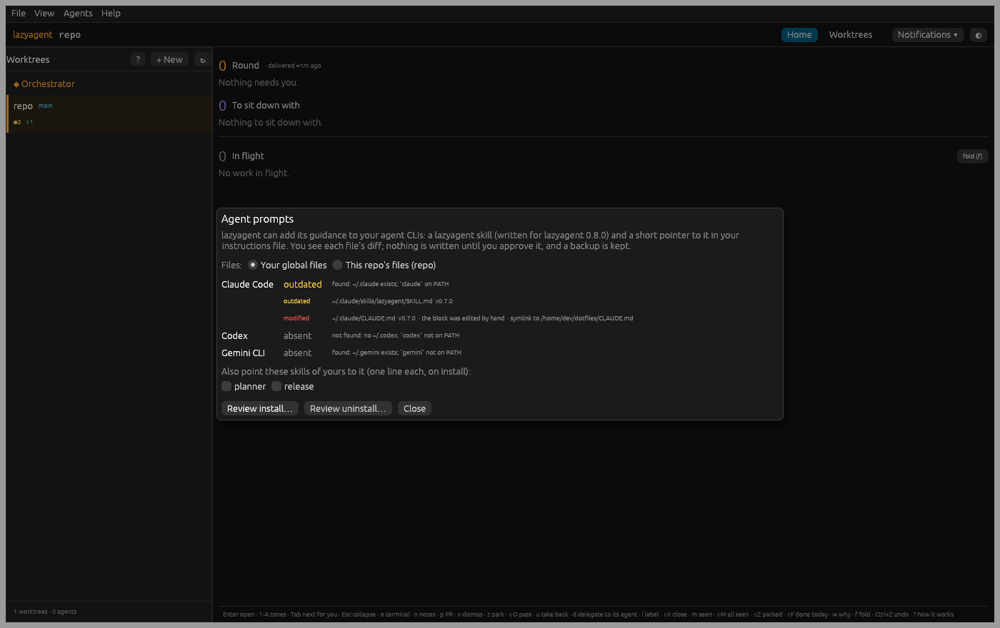
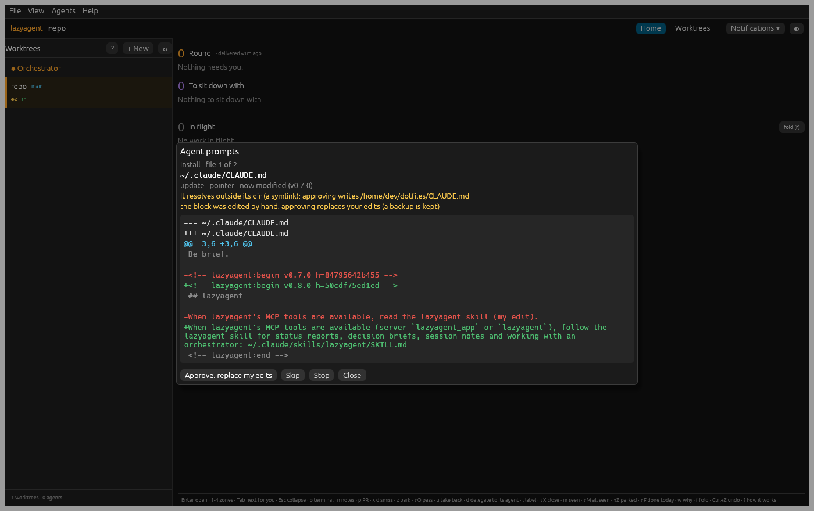

# Agent prompts

The agents lazyagent starts get a short preamble (when to call
`status_report`, `request_decision`, keep notes). Your own sessions, your
skills and your orchestrator or planner skill do not. `lazyagent prompts`
installs lazyagent's guidance into your agent CLIs' own prompt files, so
every session knows the tools, and keeps it matching the installed version.

Nothing is written until you have seen and approved each file's diff.

## What it installs

| File | What | Claude Code | Codex | Gemini CLI |
|---|---|---|---|---|
| The **lazyagent skill** | The guidance itself: status reports (`status_report`, with `ball="agent"` and `until` when work goes on in the background), decision briefs (`request_decision`), session notes, working under an orchestrator (report back with `SendMessage`; an optional "ready to merge, then wait for the go" convention), the orchestrator's `orchestrator_hold` / `orchestrator_release`, and how rules and "Why?" decide a row | `~/.claude/skills/lazyagent/SKILL.md` | `~/.codex/skills/lazyagent/SKILL.md` | `~/.gemini/skills/lazyagent/SKILL.md` |
| A **pointer** | A few lines at the end of your instructions file naming the skill (and its path, for a CLI that does not load skills by itself) | `~/.claude/CLAUDE.md` | `~/.codex/AGENTS.md` | `~/.gemini/GEMINI.md` |
| **Skill lines** (optional) | One line in skills of yours you pick (`--skills planner,orchestrator`), telling them to follow the lazyagent skill | `~/.claude/skills/<name>/SKILL.md` | `~/.codex/skills/<name>/SKILL.md` | `~/.gemini/skills/<name>/SKILL.md` |

`CLAUDE_CONFIG_DIR` and `CODEX_HOME` move those dirs, as they do for the CLIs.
A CLI counts as found when its dir exists (it has run here); `status` also says
whether its binary is on `PATH`.

`--scope repo` writes the repo's own files instead (`CLAUDE.md`, `AGENTS.md`,
`GEMINI.md` at the repo root, and the skill under `.claude/skills/`,
`.codex/skills/`, `.gemini/skills/`), for a team that commits them. It is
never the default.

The skill is rendered from templates shipped in the package, so it always
matches the lazyagent you run. It does not repeat the preamble's rules
differently: it says the same things, with the details the preamble has no
room for.

## The CLI

```sh
lazyagent prompts status                 # per target: installed, outdated, modified or absent
lazyagent prompts diff                   # what install would change (--uninstall: what uninstall would)
lazyagent prompts install                # file by file: the diff, then y / n / q
lazyagent prompts install --skills planner --target claude
lazyagent prompts install --dry-run      # the diffs only
lazyagent prompts install --yes          # approve all (see below)
lazyagent prompts uninstall              # take it all out again, file by file
```

`--target claude|codex|gemini|all` (or a comma list; default: the CLIs found)
and `--scope global|repo` work on every command.

With `--yes`, a block you edited by hand is skipped unless you add `--force`,
and a file that resolves outside its dir (a symlink, say into a dotfiles repo)
is skipped unless you add `--follow-symlinks`. Asked file by file, both are
said before the question.

## The desktop

Agents → **Prompts…** lists the targets and their files with their state,
lets you pick your global files or the repo's and the skills to point to the
lazyagent skill, then shows each file's diff with **Approve** and **Skip**.
The desktop writes nothing itself: the engine does, with the same code as the
CLI (`prompts_status`, `prompts_plan`, `prompts_apply`).





After an upgrade that changes the text, the menu bar shows **Prompts
outdated** (once per connection; it goes when you open the page), and
`lazyagent status` ends with one line saying so. Nothing is updated on its
own.

## Safety

- **One file at a time, after its diff.** An approval carries the sha256 of
  the file the diff was made from and of the result. If the file changed in
  between (or lazyagent was upgraded), the write is refused: preview it again.
- **Markers.** A block sits between `<!-- lazyagent:begin v0.8.0 h=… -->` and
  `<!-- lazyagent:end -->`. An update replaces only what is between them; your
  text around it is never touched. `h` is a hash of the block's body, so a
  block you edited reads **modified**, and is shown, not overwritten silently.
  Markers that do not pair up are left alone (fix them by hand). The skill
  file carries the same stamp after its front matter.
- **Backups.** Every write first copies the file to
  `$XDG_STATE_HOME/lazyagent/prompts/backups/<time>/<its path>` and adds a line
  to `log.jsonl` there. Writes are atomic (a temporary file, then a rename) and
  keep the file's mode.
- **Symlinks.** A file that resolves outside its dir is written through the
  link (the link stays) only once you approve that, with the real path shown.
- **Uninstall** removes the blocks (and the blank line install added), deletes
  the skill file and its empty dir, and deletes an instructions file that
  holds nothing else. A `lazyagent/SKILL.md` lazyagent did not write is never
  deleted.

| State | Means |
|---|---|
| `installed` | What this version would write (an upgrade that changes nothing in it is no news) |
| `outdated` | Written by lazyagent, untouched since, and this version writes something else; or only some of a target's files are there |
| `modified` | Edited by hand since lazyagent wrote it (or not written by lazyagent) |
| `absent` | Not there |
