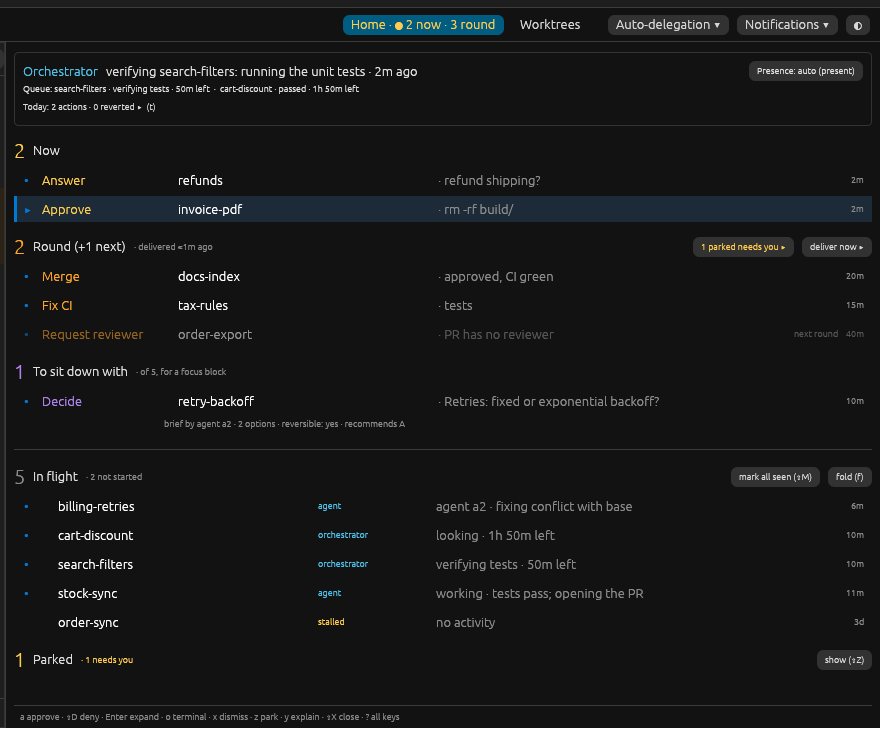
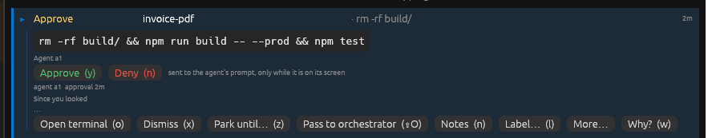
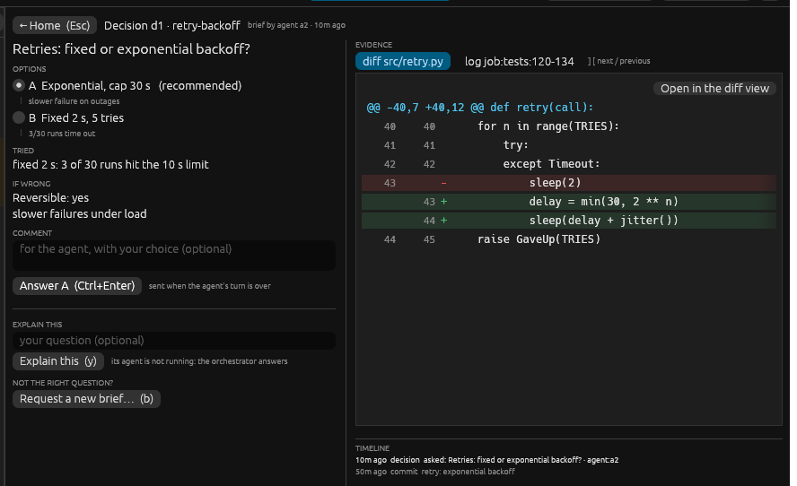
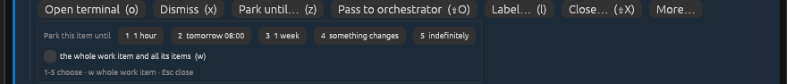
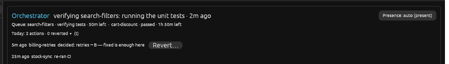

# How lazyagent works

<!-- Generated by `lazyagent rules doc --write` from the rules catalog and src/lazyagent/engine/rules/concepts.toml. Do not edit by hand. -->

The same page is in the desktop app: Help → How lazyagent works (`F1`); `?` on Home opens it at Home.

- [How it fits together](#how-it-fits-together)
- [Home](#home)
- [Reading a line](#reading-a-line)
- [The ball](#the-ball)
- [Decisions](#decisions)
- [Park, label, close](#park-label-close)
- [The orchestrator](#the-orchestrator)
- [Every state](#every-state)
- [Inbox items](#inbox-items)
- [Keys and actions](#keys-and-actions)
- [Why is this line here?](#why-is-this-line-here)
- [Your rules](#your-rules)
- [Facts](#facts)

## How it fits together

The engine watches. Agents work. The orchestrator helps. You decide.

- **Engine**: Owns the state: worktrees, agents, PRs, CI. Derives every line from facts. No LLM.
- **Agents**: Claude Code or Codex sessions, one or more per worktree. They work, ask and report.
- **Orchestrator**: An agent with a mandate: relays, re-runs CI, holds while it verifies. Never merges alone.
- **You**: Answer what blocks an agent, merge, decide. Home shows what needs you first.

```
you ⇄ desktop (Home) ⇄ engine ⇄ agents
            ⇅
       orchestrator
```

## Home

One line per work item: a branch with its PR, its agents and its CI, or a teammate's PR that asks for your review. Nothing to keep up to date: the engine derives every line.



*Home: Now, the Round, To sit down with, In flight, and the Parked chip.*

| zone | colour | what |
|---|---|---|
| **Now** | yellow | An agent is blocked on you: an approval, a question. Shown at once. |
| **Round** | orange | Quick things that block nobody, and the reviews teammates asked of you. Delivered in rounds, so nothing moves under your cursor. |
| **To sit down with** | purple | Things to read: a brief, changes requested, a finished branch. Against your limit (deep_max). |
| **In flight** | cyan | The ball is not yours: who has it and since when. Done rows fold at its end for a day. |
| **Parked** | purple | What you parked, folded until you open it (⇧Z). Says when it comes back. |

Colours:

- **orange**: You: the ball is yours. Nothing else is orange.
- **yellow**: Now, and parked items that still need you.
- **purple**: To sit down with; your labels, parks and closes.
- **cyan**: The orchestrator, and lines an agent works on.
- **blue**: The selected line, and the • of a changed line.
- **grey**: Facts and ages. Dimmed: done, or the next round.

## Reading a line

An inbox line starts with what to do (a verb); an In flight line with who has the ball.



*An expanded line: the whole ask, its buttons, and since you looked.*

```
•  ▴  cart-discount #12  agent  working · 12m · tests pass; opening the PR  3m
```

- `•` changed since you looked
- `▴` high priority (▾ low)
- `cart-discount #12` branch and PR
- `agent` who has the ball
- `working · 12m · …` the state: a fact, never a guess
- `3m` how long it has been like this

## The ball

Who must move next. Only the ball you sees your inbox.

| ball | colour | means |
|---|---|---|
| **you** | orange | In your inbox. |
| **orchestrator** | cyan | You passed it, or it holds it while it verifies. |
| **agent** | cyan | An agent works on it (directly, or delegated). |
| **others** | purple | A reviewer or a teammate (or your label says so). |
| **stalled** | yellow | Nobody runs and nothing moves. |
| **done** | grey | Merged, closed, or already in the base branch. |

## Decisions

A brief is a question with options, a recommendation and evidence. Enter (or v) opens it.

- **Answer**: 1-4 pick, Ctrl+Enter answers. It reaches the agent after its turn.
- **Explain this**: y: the owner agent explains in 10 lines; ⇧Y restores it first.
- **New brief**: b: ask for a better one, with a note.



*The decision view: options on the left, evidence on the right.*

## Park, label, close

Keep your inbox to what you can act on today.

- **Park  z**: 1 h, tomorrow, a week, until something changes, indefinitely.
- **Label  l**: Who has the ball and why: others · QA.
- **Close  ⇧X**: Done or dropped; stops its agent. Never touches the worktree, branch or PR.
- **Undo**: x, z, d, ⇧O and ⇧D (deny) show Undo for 5 s (Ctrl+Z).



*The park menu: until when, for this item or the whole work item.*

## The orchestrator

A delegate with a mandate. The strip on top of Home says what it is doing, what it holds and what it did today.

- **Pass  ⇧O**: Hand it an item for 2 h. It releases it with a note, or hands it back.
- **Hold**: It holds a worker's branch while it verifies, then releases it to you.
- **Mandate**: Present: small reversible steps. Away: also reversible briefs, rebases, workers.
- **Never alone**: Merge, publish, force-push, delete unpushed work, close a PR: always yours.
- **Revert  ⇧U**: Undo its decision for a day: tells the agent, stops what it spawned.



*The orchestrator strip: its report, its queue, today's actions, presence.*

## Every state

Each line's state comes from the first rule that matches, top to bottom. An unknown fact never matches.

### Now

| verb | state | when | key |
|---|---|---|---|
| **Approve** | approve: ‹the agent's detail line› | The agent's status is waiting for approval | `Enter` Expands the line: approve (a) or deny (⇧D) a command there, type an answer to a question |
| **Answer** | answer: ‹the agent's detail line› | The agent's status is waiting for user | `Enter` Expands the line: approve (a) or deny (⇧D) a command there, type an answer to a question |

### Round

| verb | state | when | key |
|---|---|---|---|
| **Check agent** | agent may hang | The agent's status is possibly hanged |  |
| **Relaunch** | agent failed | The agent's status is failed |  |
| **Relaunch** | agent exited | (exits) |  |
| **Fix CI** | CI red: ‹the first failing check not explained by the base› | The PR's state is open and the PR's checks are red on its head and the failing checks not explained by the base is not empty and there are no agents at work | `d` Send the item to the branch's agent |
| **Fix CI** | CI red: ‹the first failing check not explained by the base› | There is no PR and Actions on the head is red and the failing checks not explained by the base is not empty and there are no agents at work | `d` Send the item to the branch's agent |
| **Resolve conflict** | conflict with base | The PR's state is open and the PR's mergeability is conflicting and there are no agents at work | `d` Send the item to the branch's agent |
| **Fix job** | job failed | (jobs) |  |
| **Update task** | Tracker | (tracker) | `p` The tracker task |
| **Read** | Agent reports | (report) |  |
| **Sync** | Sync with base: ‹the first check the base has fixed› | Actions on the head is red and the failing checks not explained by the base is empty and the unrelated checks the base has fixed since is not empty and there are no agents at work | `d` Send the item to the branch's agent |
| **Review** | review requested by ‹the PR's author› | The PR asks you for a review and the PR is not yours | `p` The PR (you merge it, or review it, there) |
| **Merge** | merge: approved, CI green | The PR's state is open and the PR's review decision is approved and CI on the PR is green or none and the PR's mergeability is mergeable and (the PR is yours or it is not known whether the PR is yours) | `p` The PR (you merge it, or review it, there) |
| **Request reviewer** | PR has no reviewer | The PR's state is open and the PR's review decision is review required or none and there are no PR's requested reviewers and there are no PR's reviews |  |

### To sit down with

| verb | state | when | key |
|---|---|---|---|
| **Address review** | changes requested | The PR's state is open and the PR's review decision is changes requested and (the PR is yours or it is not known whether the PR is yours) | `d` Send the item to the branch's agent |
| **Review** | review: agent finished | The agent's status is completed, waiting or interrupted and there are no agents at work and there is no PR and not the orchestrator's own place and the agent's report does not say where the ball is |  |
| **Decide** | Decide | (decision) | `v` Open the brief |

### Inbox (the top item decides)

| verb | state | when | key |
|---|---|---|---|
| you | ‹the top inbox item's state› | There are open inbox items on the work item |  |

### In flight

| verb | state | when | key |
|---|---|---|---|
| orchestrator | orchestrator · looking | You passed it to the orchestrator |  |
| orchestrator | orchestrator · (holding / ‹the orchestrator's hold note›) | The orchestrator holds it |  |
| orchestrator | orchestrator · looking | Who holds a routed item here is orchestrator |  |
| agent | agent ‹the agent it was delegated to› · fixing (it / ‹what the agent is fixing›) | The delegation's phase is on it |  |
| ‹your label's ball› | (the state below) | Your gesture is label |  |
| agent | fixing CI / starting / working | There are agents at work |  |
| agent | CI running | The PR's state is open and CI on the PR is running |  |
| ‹the agent's reported ball› | reported: ‹the agent's reported ball› / ‹the agent's report note› | The agent's reported ball is others |  |
| ‹the agent's reported ball› | agent ‹the agent that reported› · (working / ‹the agent's report note›) / reported: ‹the agent's reported ball› / ‹the agent's report note› | The agent's reported ball is not empty |  |
| others | ‹the task's mapped state› | The task's mapped ball is others |  |
| ‹the task's mapped ball› | ‹the task's mapped state› | The task's mapped ball is not you |  |
| stalled / others | review requested · set aside / ‹the PR's author›'s PR( · approved /  · changes requested) | The PR's state is open and the PR is not yours |  |
| others | (PR open / review requested)(, CI green) | The PR's state is open and the PR's review decision is review required or none |  |
| agent | waits: approve / waits: answer / waits: agent failed / waits: agent may hang / agent idle | There are agents |  |
| stalled | agent to restore | There are agents to restore |  |
| stalled | no activity | The time since the last sign of work is over the stalled threshold |  |
| stalled | approved, CI green | The inbox queue is on and the PR's state is open and the PR's review decision is approved and CI on the PR is green or none and the PR's mergeability is mergeable |  |
| stalled | approved, not mergeable | The PR's state is open and the PR's review decision is approved |  |
| stalled | no agent | Always |  |

### Parked

| verb | state | when | key |
|---|---|---|---|
| (the ball below) | waiting: ‹reason› / waiting (‹board›) / parked until ‹when› / parked: ‹reason› | Your gesture is park |  |

### Done

| verb | state | when | key |
|---|---|---|---|
| done | merged | The PR's state is merged |  |
| done | PR closed | The PR's state is closed |  |
| done | already merged into ‹the branch that already holds the head› | The PR's state is open and there is a branch that already holds the head |  |
| done | dropped by you / closed by you | Your gesture is close |  |

### All rules, in order

First match wins. *queue off*: rules for an engine without the inbox queue.

| # | rule | ball | state | when |
|---|---|---|---|---|
| 1 | `closed.merged` (locked) | done | merged | The PR's state is merged |
| 2 | `closed.pr_closed` (locked) | done | PR closed | The PR's state is closed |
| 3 | `closed.already_merged` (locked) | done | already merged into ‹the branch that already holds the head› | The PR's state is open and there is a branch that already holds the head |
| 4 | `closed.by_you` (locked) | done | dropped by you / closed by you | Your gesture is close |
| 5 | `park` (locked) | (the ball below) | waiting: ‹reason› / waiting (‹board›) / parked until ‹when› / parked: ‹reason› | Your gesture is park |
| 6 | `queue` (locked) | you | ‹the top inbox item's state› | There are open inbox items on the work item |
| 7 | `claim` (locked) | orchestrator | orchestrator · looking | You passed it to the orchestrator |
| 8 | `hold` (locked) | orchestrator | orchestrator · (holding / ‹the orchestrator's hold note›) | The orchestrator holds it |
| 9 | `held` (locked) | orchestrator | orchestrator · looking | Who holds a routed item here is orchestrator |
| 10 | `delegated` (locked) | agent | agent ‹the agent it was delegated to› · fixing (it / ‹what the agent is fixing›) | The delegation's phase is on it |
| 11 | `approve` *queue off* | you | approve: ‹the agent's detail› | The inbox queue is off and the agents' statuses include waiting for approval |
| 12 | `answer` *queue off* | you | answer: ‹the agent's detail› | The inbox queue is off and the agents' statuses include waiting for user |
| 13 | `agent_failed` *queue off* | you | agent failed | The inbox queue is off and the agents' statuses include failed |
| 14 | `agent_may_hang` *queue off* | you | agent may hang | The inbox queue is off and the agents' statuses include possibly hanged |
| 15 | `needs_you` *queue off* | you | needs you: ‹the agent's report note› | The inbox queue is off and the agent reported it needs you |
| 16 | `review_request` *queue off* | you | review requested by ‹the PR's author› | The inbox queue is off and the PR asks you for a review and the PR is not yours |
| 17 | `merge` | you | merge: approved, CI green | The PR's state is open and the PR's review decision is approved and CI on the PR is green or none and the PR's mergeability is mergeable and (the PR is yours or it is not known whether the PR is yours) |
| 18 | `changes_requested` *queue off* | you | changes requested | The PR's state is open and the inbox queue is off and the PR's review decision is changes requested |
| 19 | `conflict_no_agent` *queue off* | you | conflict with base | The PR's state is open and the inbox queue is off and there are no agents at work and the PR's mergeability is conflicting |
| 20 | `ci_red_no_agent` *queue off* | you | CI red: ‹the first failing check› | The PR's state is open and the inbox queue is off and there are no agents at work and CI on the PR is red and the failing checks not explained by the base is not empty |
| 21 | `agent_finished` *queue off* | you | review: agent finished | The inbox queue is off and there are agents whose turn is over and there are no agents at work and there is no PR and the agent's reported ball is empty |
| 22 | `label` | ‹your label's ball› | (the state below) | Your gesture is label |
| 23 | `agent_running` | agent | fixing CI / starting / working | There are agents at work |
| 24 | `ci_running` | agent | CI running | The PR's state is open and CI on the PR is running |
| 25 | `reported_others` | ‹the agent's reported ball› | reported: ‹the agent's reported ball› / ‹the agent's report note› | The agent's reported ball is others |
| 26 | `reported_ball` | ‹the agent's reported ball› | agent ‹the agent that reported› · (working / ‹the agent's report note›) / reported: ‹the agent's reported ball› / ‹the agent's report note› | The agent's reported ball is not empty |
| 27 | `tracker_you` *queue off* | you | ‹the task's mapped state› | The task's mapped ball is you and the task's mapped level is known and the inbox queue is off |
| 28 | `tracker_others` | others | ‹the task's mapped state› | The task's mapped ball is others |
| 29 | `tracker_ball` | ‹the task's mapped ball› | ‹the task's mapped state› | The task's mapped ball is not you |
| 30 | `teammate_pr` | stalled / others | review requested · set aside / ‹the PR's author›'s PR( · approved /  · changes requested) | The PR's state is open and the PR is not yours |
| 31 | `no_reviewer` | you | PR has no reviewer | The PR's state is open and the PR's review decision is review required or none and there are no PR's requested reviewers and there are no PR's reviews |
| 32 | `review_requested` | others | (PR open / review requested)(, CI green) | The PR's state is open and the PR's review decision is review required or none |
| 33 | `agent_idle` | agent | waits: approve / waits: answer / waits: agent failed / waits: agent may hang / agent idle | There are agents |
| 34 | `restorable` | stalled | agent to restore | There are agents to restore |
| 35 | `no_activity` | stalled | no activity | The time since the last sign of work is over the stalled threshold |
| 36 | `approved_ready` | stalled | approved, CI green | The inbox queue is on and the PR's state is open and the PR's review decision is approved and CI on the PR is green or none and the PR's mergeability is mergeable |
| 37 | `approved_not_mergeable` | stalled | approved, not mergeable | The PR's state is open and the PR's review decision is approved |
| 38 | `no_agent` | stalled | no agent | Always |

## Inbox items

What can land in your inbox, at which level, and the verb it shows.

| verb | item | level | class | blocks an agent | key |
|---|---|---|---|---|---|
| **Approve** | Needs approval | now | quick | yes | `Enter` Expands the line: approve (a) or deny (⇧D) a command there, type an answer to a question |
| **Answer** | Question | now | quick | yes | `Enter` Expands the line: approve (a) or deny (⇧D) a command there, type an answer to a question |
| **Check agent** | Hanged? | round | quick |  |  |
| **Relaunch** | Failed | round | quick |  |  |
| **Relaunch** | Exited | round | quick |  |  |
| **Fix CI** | CI failing | round | quick |  | `d` Send the item to the branch's agent |
| **Fix CI** | CI failed | round | quick |  | `d` Send the item to the branch's agent |
| **Address review** | Changes requested | deep | deep |  | `d` Send the item to the branch's agent |
| **Resolve conflict** | Merge conflict | round | quick |  | `d` Send the item to the branch's agent |
| **Review** | Your turn | deep | deep |  |  |
| **Fix job** | Job failed | round | quick |  |  |
| **Update task** | Tracker | round | quick |  | `p` The tracker task |
| **Read** | Agent reports | round | quick |  |  |
| **Decide** | Decide | deep | deep |  | `v` Open the brief |
| **Sync** | Sync with base | round | quick |  | `d` Send the item to the branch's agent |
| **Review** | Review requested | round | quick |  | `p` The PR (you merge it, or review it, there) |

## Keys and actions

Single letters act on the selected line. Shifted keys ask first or are bigger.

### Home

| key | does |
|---|---|
| `j k ↓ ↑` | Next / previous line |
| `Tab` | Next line that needs you |
| `1 2 3 4` | Jump to Now, Round, To sit down with, In flight (on a brief: pick an option) |
| `Enter` | Expand (approve or answer there); open a brief |
| `Esc` | Close the form, else collapse |
| `a  ⇧D` | On an approval: approve / deny (deny waits 5 s for Undo) |
| `Ctrl+Enter` | On an expanded brief: answer |
| `v` | The decision view |
| `y  ⇧Y` | Explain this / restore its agent and explain |
| `w` | Why is this line here? |
| `o` | The agent's terminal |
| `n` | Its session notes |
| `p` | Its PR (or tracker task) |
| `x` | Dismiss the item (Undo 5 s) |
| `z` | Park: 1 h, tomorrow, a week, on change, indefinitely (1-5; w whole work item) |
| `⇧Z` | Show / hide Parked |
| `⇧F` | Show / hide done today |
| `⇧O` | Pass to the orchestrator (Undo 5 s) |
| `u` | Take back a pass or hold; clear your label, park, close or delegation |
| `d` | Delegate to the branch's agent (Undo 5 s) |
| `l` | Label who has the ball |
| `⇧X` | Close the work item and stop its agent (asks first) |
| `m  ⇧M` | Mark seen / everything seen |
| `⇧U` | Revert the orchestrator's decision (asks first) |
| `t` | The orchestrator's actions today |
| `Ctrl+Z` | Undo the last dismiss, park, delegate, pass or deny |
| `f` | Fold In flight |
| `g w  g h` | The worktrees / back to Home |
| `?` | This page, at Home |

### The decision view

| key | does |
|---|---|
| `1-4` | Pick an option |
| `Ctrl+Enter` | Answer |
| `]  [` | Next / previous evidence tab |
| `y  ⇧Y` | Explain this / restore its agent and explain |
| `b` | Request a new brief |
| `o` | The agent's terminal |
| `⇧U` | Revert the orchestrator's decision |
| `Esc` | Back to Home |

### This page

| key | does |
|---|---|
| `F1` | Open this page (anywhere) |
| `Esc` | Back to where you were |

### The Why? view

| key | does |
|---|---|
| `Esc` | Back to Home |

### Actions

| action | key | does |
|---|---|---|
| `answer` | `Enter` | Expands the line: approve (a) or deny (⇧D) a command there, type an answer to a question |
| `expand` | `Enter` | Expands the line |
| `open_terminal` | `o` | The agent's terminal |
| `open_notes` | `n` | The agent's notes |
| `open_pr` | `p` | The PR (you merge it, or review it, there) |
| `open_tracker` | `p` | The tracker task |
| `dismiss` | `x` | Dismiss this occurrence of the item |
| `park` | `z` | Park the item or the work item |
| `label` | `l` | Put a ball and a text on the row |
| `close` | `⇧X` | Close the work item (done / dropped) and stop its agent |
| `take_back` | `u` | Take back a pass, or clear your gesture |
| `pass` | `⇧O` | Pass to orchestrator |
| `delegate` | `d` | Send the item to the branch's agent |
| `decision_view` | `v` | Open the brief |
| `explain` | `y` | Explain this |
| `explain_restore` | `⇧Y` | Explain this (restore) |
| `rebrief` | `b` | Request a new brief |
| `seen` | `m` | Mark seen |
| `all_seen` | `⇧M` | Mark all seen |
| `revert` | `⇧U` | Revert the orchestrator's decision |
| `why` | `w` | Why is this row in this state? |
| `fold` | `f` | Fold In flight |
| `fold_parked` | `⇧Z` | Fold Parked |

## Why is this line here?

w on any Home line (or Why? in the expanded line) shows the rule that matched, the facts it read, and the rules above it that did not match.

## Your rules

Rules are data. Your global rules.toml and a repo's .lazyagent/rules.toml can add, replace or narrow the built-ins. A bad rule is skipped and the built-in stays.

```toml
# $XDG_CONFIG_HOME/lazyagent/rules.toml
version = 1

[[rule]]
id = "merge"
says = "Merge only after QA."
and_when = 'tracker.qa == "tested"'
```

- No rules of yours: the built-ins apply.

## Facts

What rules can read. The engine fetches a costly fact only when an active rule reads it.

| fact | is | type | source | fresh | cost |
|---|---|---|---|---|---|
| `item.key` | the work item | text | worktree scan | on worktrees.changed | free |
| `item.repo` | the repo | text | worktree scan | on worktrees.changed | free |
| `item.branch` | the branch | text | worktree scan | on worktrees.changed | free |
| `item.restorable` | the agents to restore | num | restart manifest | on restorable.changed | free |
| `item.idle` | the time since the last sign of work | duration | projection (activity, else the facts' last change) | per pass | free |
| `config.stalled_after` | the stalled threshold | duration | config [status] stalled_hours | on start | free |
| `now` | now | time | the engine's clock | per pass | free |
| `agents.count` | the agents | num | agent registry | on agent.* events | free |
| `agents.running` | the agents at work (running or starting) | num | agent registry | on agent.* events | free |
| `agents.idle` | the agents whose turn is over | num | agent registry | on agent.* events | free |
| `agents.statuses` | the agents' statuses | set agent_status (running, waiting, waiting_for_user, waiting_for_approval, completed, failed, interrupted, possibly_hanged, starting) | agent registry | on agent.* events | free |
| `agents.first_running` | the first working agent's status | enum agent_status (running, waiting, waiting_for_user, waiting_for_approval, completed, failed, interrupted, possibly_hanged, starting) | agent registry | on agent.* events | free |
| `agent.id` | the agent | text | agent registry | on agent.* events | free |
| `agent.status` | the agent's status | enum agent_status (running, waiting, waiting_for_user, waiting_for_approval, completed, failed, interrupted, possibly_hanged, starting) | agent registry | on agent.* events | free |
| `agent.detail` | the agent's detail line | text | agent registry | on agent.* events | free |
| `place.is_orchestrator` | the orchestrator's own place | bool | agent registry | static | free |
| `agent.reported` | the agent's report says where the ball is (it works on) | bool | overlay | per pass | free |
| `pr.exists` | there is a PR | bool | PR poller | ≤ 60 s | poll |
| `pr.state` | the PR's state | enum pr_state (open, merged, closed, none) | PR poller | ≤ 60 s | poll |
| `pr.review` | the PR's review decision | enum pr_review (approved, changes_requested, review_required, none) | PR poller | ≤ 60 s | poll |
| `pr.mergeable` | the PR's mergeability | enum pr_mergeable (mergeable, conflicting, unknown) | PR poller | ≤ 60 s | poll |
| `pr.review_requests` | the PR's requested reviewers | num | PR poller | ≤ 60 s | poll |
| `pr.reviews` | the PR's reviews | num | PR poller | ≤ 60 s | poll |
| `pr.draft` | the PR is a draft | bool | PR poller | ≤ 60 s | poll |
| `pr.author` | the PR's author (login) | text | PR poller | ≤ 60 s | poll |
| `pr.mine` | the PR is yours (its author is the user gh is logged in as) | bool | PR poller, gh's login | ≤ 60 s | poll |
| `pr.review_requested_from_me` | the PR asks you for a review (you, or a team of yours) | bool | review requests search | ≤ 60 s | poll |
| `pr.labels` | the PR's labels (lower case) | set label | PR poller (review query) | ≤ 60 s | extra |
| `pr.human_approvals` | the PR's approvals by people (latest review each; no apps) | num | PR poller (review query) | ≤ 60 s | extra |
| `pr.commits_after_ready` | the pushes since the PR was marked ready (0: a draft) | num | PR poller (review query) | ≤ 60 s | extra |
| `pr.number` | the PR's number | num | PR poller | ≤ 60 s | poll |
| `pr.base` | the PR's base branch | text | PR poller | ≤ 60 s | poll |
| `pr.head_sha` | the PR's head commit | text | PR poller | ≤ 60 s | poll |
| `pr.merged_into` | the branch that already holds the head (empty: none) | text | git (merged_into) | per head | free |
| `ci.state` | CI on the PR | enum ci_state (green, red, running, none) | PR checks | ≤ 60 s | poll |
| `ci.first_failing` | the first failing check (empty: none) | text | Actions runs on the head, else PR checks | ≤ 60 s | poll |
| `ci.pr_red` | the PR's checks are red on its head | bool | PR checks, made precise by Actions | ≤ actions_poll_s | poll |
| `ci.head` | Actions on the head | enum ci_head (green, red, running, moved, none) | Actions runs (I7) | ≤ actions_poll_s | poll |
| `ci.failing_tests` | the failing tests on the head (lower case) | set test | JUnit artifacts or log parsers ([ci.check] tests_from) | once per run attempt | extra |
| `ci.base_point` | the base commit the head is compared with | text | git and Actions run metadata ([ci_unrelated] compare_to) | per head | extra |
| `ci.base_failing_tests` | the tests failing on the base at that commit | set test | JUnit artifacts or log parsers ([ci.check] tests_from) | once per base sha | extra |
| `ci.unrelated_checks` | the failing checks whose tests all fail on the base too | set check | mechanism A | per pass | extra |
| `ci.related_failures` | the failing checks not explained by the base | set check | failing checks minus ci.unrelated_checks | per pass | poll |
| `ci.unrelated` | CI is red only for reasons unrelated to the branch | bool | mechanism A | per pass | extra |
| `ci.unrelated_summary` | what explains the red (empty: nothing) | text | mechanism A | per pass | free |
| `ci.base_fixed` | the unrelated checks the base has fixed since | set check | the base's newest run in the Actions runs | ≤ actions_poll_s | extra |
| `ci.first_related` | the first failing check not explained by the base | text | mechanism A, else the first failing check | per pass | poll |
| `ci.first_base_fixed` | the first check the base has fixed | text | mechanism A | ≤ actions_poll_s | extra |
| `queue.enabled` | the inbox queue is on | bool | ActionableQueue | static | free |
| `items.count` | the open inbox items on the work item | num | ActionableQueue | per pass | free |
| `items.top.kind` | the top inbox item's kind | text | ActionableQueue | per pass | free |
| `items.top.level` | the top inbox item's level | enum level (now, round, deep) | ActionableQueue | per pass | free |
| `items.top.state` | the top inbox item's state | text | ActionableQueue | per pass | free |
| `items.blocks_agent` | an open inbox item blocks an agent | bool | ActionableQueue | per pass | free |
| `tracker.linked` | a tracker task is linked | bool | tracker hub, else a feeder's facts | poll_s | poll |
| `tracker.status` | the task's status | text | tracker adapter, else a feeder's facts | poll_s | poll |
| `tracker.qa` | the task's QA (unknown: no task, or nothing maps it) | enum tracker_qa (tested, not_required, pending, failed) | tracker adapter [<adapter>.qa] mapping, else a feeder's facts | poll_s | poll |
| `tracker.state` | the task's mapped state | text | tracker adapter mapping | poll_s | poll |
| `tracker.ball` | the task's mapped ball | enum ball (you, agent, others, stalled, done) | tracker adapter mapping | poll_s | poll |
| `tracker.level` | the task's mapped level | enum level (now, round, deep) | tracker adapter mapping | poll_s | poll |
| `tracker.stale` | the tracker's last call failed | bool | tracker hub | poll_s | free |
| `gesture.kind` | your gesture | enum gesture_kind (label, park, close, none) | overlay | per pass | free |
| `gesture.ball` | your label's ball | enum ball (you, agent, others, stalled, done) | overlay | per pass | free |
| `gesture.text` | your gesture's text | text | overlay | per pass | free |
| `gesture.until` | your park's end (a time or an event) | raw | overlay | per pass | free |
| `gesture.how` | how you closed it | text | overlay | per pass | free |
| `gesture.waiting` | a feeder's Waiting lane | bool | overlay | per pass | free |
| `gesture.source` | the feeder that parked it | text | overlay | per pass | free |
| `claim.active` | you passed it to the orchestrator | bool | claims | per pass | free |
| `hold.active` | the orchestrator holds it | bool | claims | per pass | free |
| `hold.note` | the orchestrator's hold note (empty: none) | text | claims | per pass | free |
| `holder` | who holds a routed item here (empty: nobody) | text | first responder | per pass | free |
| `delegation.phase` | the delegation's phase | text | delegation | per pass | free |
| `delegation.agent` | the agent it was delegated to | text | delegation | per pass | free |
| `delegation.fact` | what the agent is fixing (empty: unsaid) | text | delegation | per pass | free |
| `report.needs_user` | the agent reported it needs you | bool | overlay | per pass | free |
| `report.ball` | the agent's reported ball (empty: none) | text | overlay | per pass | free |
| `report.note` | the agent's report note (empty: none) | text | overlay | per pass | free |
| `report.agent` | the agent that reported (empty: none) | text | overlay | per pass | free |
